# Changelog

<!-- Every release adds its entry here before its tag is pushed:
     .github/RELEASE.md describes the step, and scripts/repository-checks.sh
     refuses a desktop version this file does not name. The landing page
     renders this document at tryluke.dev/changelog, ten releases a page, and
     each release on a page of its own at tryluke.dev/changelog/<version>.
     Each release heading is a contract with those pages: exactly
     `## <version> — <YYYY-MM-DD>`, which becomes the release's sticky
     version-and-date rail and its address. A release's first feature
     section, its first paragraph, and its first screenshot become the title,
     description, and image of the card its page shares as.

     Style: say what changed for the reader and stop. A big feature gets a
     `###` section of its own, named for the feature and described in a
     sentence or three, with a screenshot where one helps.
     Everything else gathers under the standing sections, in this order:
     `### Improvements` for what got better, `### Fixes` for what got repaired,
     `### Misc` for brand, packaging, documentation, and the like. A bullet is
     one sentence with no period at the end, leading with the thing itself
     rather than its background. Improvements and feature prose speak in the
     present tense to "you", with Luke as the actor; Fixes read
     "Fixed <symptom you could see>"; Misc reads "Added/Updated …". "Now" only
     where the old behavior is the contrast. Name features, pages, and
     shortcuts concretely. A feature behind Settings › Experimental stays out
     of the changelog, its own section, bullets, and pictures alike, until it
     graduates; the release that takes it out of Experimental announces it.

     Every bullet and feature section links the pull request or requests
     that made it, as `([#123](https://github.com/ReviewStage/luke/pull/123))`:
     Luke is open source, so a reader can follow a change to its code. A
     bullet's links close its last line, or start the next one indented when
     they do not fit in 80 columns, one link to a line after the first. A
     feature section's links stand on lines of their own under its prose and
     above its screenshot. Work merged through an integration branch links
     the pull requests behind it beside the one that landed it.

     Screenshots live in apps/web/public/changelog/<version>/, each named for
     what it shows and placed under the section it illustrates, and are
     written here repository-relative
     (apps/web/public/changelog/<version>/<name>.png) so GitHub renders them
     too; the page rewrites that prefix to the site root. A release's
     screenshots show the build that shipped: a UI change gets a new
     screenshot in the release that changed it, and a screenshot redone later
     is taken from that release's own commit.

     Every screenshot is taken on a Mac from the release's own build in fixture
     mode, staged for the one feature it shows, and framed on macOS's Golden
     Gate Sunset aerial by scripts/changelog-screenshot.sh, so every release's
     pictures match. The changelog-screenshots skill
     (.agents/skills/changelog-screenshots) is the whole method. Each picture
     is chosen on purpose: a section gets one only where it helps, no two share
     a composition, and the layout (the sidebar folded or open, the side panel
     closed, open, or full screen, a menu or card held open) is whatever puts
     the feature in front, as the whole window at 1600 by 1000 points or, with
     `--crop`, a close-up cut from that same framed picture, inside the app and
     as tall as every other screenshot, only narrower. Each shows the state a
     feature is for, everything connected, checks passing, work done or moving,
     never an error or empty state unless that state is the news. Every picture
     is signed in as Dean Stratakos with his GitHub photo, shows no Update pill
     or other development chrome, and dates everything minutes or days before
     the capture, never the fixture's 1970 or an hours-long timer. Its data is
     synthetic: the acme organisation, its teal mark, and its repositories,
     never a real account's titles, branches, or conversations. -->

Notable changes to Luke, newest first. Each heading is a released version and
the date its release was published.

## 0.18.0 — 2026-10-18

### Continue and fork an agent

Continue a coding agent that failed or ended in a new agent, or fork one at
any of its messages. The new agent starts on a branch holding its source's
work up to that point, keeps its start branch and pull request, and reads its
source's transcript whole, with Luke's summary of whatever does not fit. A
card at the top of its transcript says what it continued or forked from, and
Continue opens as a draft you can edit before it starts.
([#3312](https://github.com/ReviewStage/luke/pull/3312),
[#3328](https://github.com/ReviewStage/luke/pull/3328),
[#3330](https://github.com/ReviewStage/luke/pull/3330),
[#3332](https://github.com/ReviewStage/luke/pull/3332),
[#3333](https://github.com/ReviewStage/luke/pull/3333),
[#3341](https://github.com/ReviewStage/luke/pull/3341),
[#3370](https://github.com/ReviewStage/luke/pull/3370),
[#3385](https://github.com/ReviewStage/luke/pull/3385),
[#3397](https://github.com/ReviewStage/luke/pull/3397),
[#3472](https://github.com/ReviewStage/luke/pull/3472),
[#3476](https://github.com/ReviewStage/luke/pull/3476),
[#3477](https://github.com/ReviewStage/luke/pull/3477),
[#3481](https://github.com/ReviewStage/luke/pull/3481),
[#3490](https://github.com/ReviewStage/luke/pull/3490),
[#3495](https://github.com/ReviewStage/luke/pull/3495),
[#3519](https://github.com/ReviewStage/luke/pull/3519),
[#3635](https://github.com/ReviewStage/luke/pull/3635))

### Review in the Pull request tab

Review an agent's pull request without leaving Luke. Comment on lines in Files
changed, see the pending review's count, and submit or discard it. Files
changed lists every file with a filter and Collapse all, draws review threads
on their lines, shows changed images before and after, and keeps its Viewed
boxes in step with GitHub. Merge, close, reopen, and retitle the pull request,
pick its reviewers and labels, and react or comment in its Conversation, all
as yourself. The agent's pull request now stands as a row over its composer,
and every pull request chip opens its agent's tab.
([#3245](https://github.com/ReviewStage/luke/pull/3245),
[#3268](https://github.com/ReviewStage/luke/pull/3268),
[#3286](https://github.com/ReviewStage/luke/pull/3286),
[#3294](https://github.com/ReviewStage/luke/pull/3294),
[#3304](https://github.com/ReviewStage/luke/pull/3304),
[#3305](https://github.com/ReviewStage/luke/pull/3305),
[#3309](https://github.com/ReviewStage/luke/pull/3309),
[#3313](https://github.com/ReviewStage/luke/pull/3313),
[#3348](https://github.com/ReviewStage/luke/pull/3348),
[#3607](https://github.com/ReviewStage/luke/pull/3607),
[#3619](https://github.com/ReviewStage/luke/pull/3619),
[#3624](https://github.com/ReviewStage/luke/pull/3624),
[#3638](https://github.com/ReviewStage/luke/pull/3638),
[#3643](https://github.com/ReviewStage/luke/pull/3643),
[#3645](https://github.com/ReviewStage/luke/pull/3645),
[#3646](https://github.com/ReviewStage/luke/pull/3646))

### Inbox threads

Every Inbox item is a thread of messages under its title, and the agent reads
and replies on it. Answer an approval, a to-do, a note, or a choice right in
the thread or in the agent's message box, quote the agent's words, and attach
files. Open an item's files, pages, and pull requests in the side panel beside
it. Each row reads as two lines, the last word in its thread under its title,
and you mark it read or unread, or swipe it right to do so.
([#3230](https://github.com/ReviewStage/luke/pull/3230),
[#3279](https://github.com/ReviewStage/luke/pull/3279),
[#3331](https://github.com/ReviewStage/luke/pull/3331),
[#3337](https://github.com/ReviewStage/luke/pull/3337),
[#3340](https://github.com/ReviewStage/luke/pull/3340),
[#3469](https://github.com/ReviewStage/luke/pull/3469),
[#3482](https://github.com/ReviewStage/luke/pull/3482),
[#3486](https://github.com/ReviewStage/luke/pull/3486),
[#3612](https://github.com/ReviewStage/luke/pull/3612),
[#3618](https://github.com/ReviewStage/luke/pull/3618),
[#3633](https://github.com/ReviewStage/luke/pull/3633),
[#3641](https://github.com/ReviewStage/luke/pull/3641),
[#3653](https://github.com/ReviewStage/luke/pull/3653),
[#3657](https://github.com/ReviewStage/luke/pull/3657),
[#3662](https://github.com/ReviewStage/luke/pull/3662),
[#3665](https://github.com/ReviewStage/luke/pull/3665))

### Improvements

- Agents start other agents on a new task, a branch, or a title, continue or
  fork another agent, stop one, and list the models and efforts they may use
  ([#3299](https://github.com/ReviewStage/luke/pull/3299),
  [#3307](https://github.com/ReviewStage/luke/pull/3307),
  [#3310](https://github.com/ReviewStage/luke/pull/3310),
  [#3458](https://github.com/ReviewStage/luke/pull/3458),
  [#3460](https://github.com/ReviewStage/luke/pull/3460),
  [#3501](https://github.com/ReviewStage/luke/pull/3501))
- Coding agents open a pull request against the base branch you name
  ([#3301](https://github.com/ReviewStage/luke/pull/3301))
- Coding agents get the Linear issue their plan started from
  ([#3283](https://github.com/ReviewStage/luke/pull/3283))
- The sidebar says when the Mac is offline
  ([#3523](https://github.com/ReviewStage/luke/pull/3523))
- A task's plan says who created it and who last edited it under its title
  ([#3622](https://github.com/ReviewStage/luke/pull/3622))
- Tick a plan's checkbox without opening the editor, drawn in the accent
  ([#3450](https://github.com/ReviewStage/luke/pull/3450),
  [#3453](https://github.com/ReviewStage/luke/pull/3453))
- The sidebar scrolls while you drag a row at its edge
  ([#3616](https://github.com/ReviewStage/luke/pull/3616))
- An Inbox row whose box holds a draft wears the Draft pencil, and a form's
  fields stack like the message box
  ([#3661](https://github.com/ReviewStage/luke/pull/3661),
  [#3672](https://github.com/ReviewStage/luke/pull/3672))
- The window's words are selectable and its controls' are not
  ([#3455](https://github.com/ReviewStage/luke/pull/3455))
- A toast's dismiss sits as a badge on its corner
  ([#3652](https://github.com/ReviewStage/luke/pull/3652))

### Fixes

- Fixed pages, lists, and panels showing an empty or false state while they
  load, or a red sentence when a read fails
  ([#3345](https://github.com/ReviewStage/luke/pull/3345),
  [#3451](https://github.com/ReviewStage/luke/pull/3451),
  [#3608](https://github.com/ReviewStage/luke/pull/3608),
  [#3626](https://github.com/ReviewStage/luke/pull/3626),
  [#3627](https://github.com/ReviewStage/luke/pull/3627),
  [#3629](https://github.com/ReviewStage/luke/pull/3629),
  [#3634](https://github.com/ReviewStage/luke/pull/3634),
  [#3639](https://github.com/ReviewStage/luke/pull/3639),
  [#3640](https://github.com/ReviewStage/luke/pull/3640),
  [#3644](https://github.com/ReviewStage/luke/pull/3644),
  [#3647](https://github.com/ReviewStage/luke/pull/3647))
- Fixed an agent whose session ended for good, or whose message no turn took,
  not reading as failed
  ([#3470](https://github.com/ReviewStage/luke/pull/3470),
  [#3520](https://github.com/ReviewStage/luke/pull/3520),
  [#3620](https://github.com/ReviewStage/luke/pull/3620))
- Fixed stopped agents leaving their sandboxes held, and a coding sandbox
  running past three hours
  ([#3478](https://github.com/ReviewStage/luke/pull/3478),
  [#3521](https://github.com/ReviewStage/luke/pull/3521),
  [#3597](https://github.com/ReviewStage/luke/pull/3597))
- Fixed a finished coding agent's run lost to Vercel's retention
  ([#3617](https://github.com/ReviewStage/luke/pull/3617))
- Fixed a dragged sidebar row jumping back into its list or leaving the
  sidebar
  ([#3611](https://github.com/ReviewStage/luke/pull/3611),
  [#3649](https://github.com/ReviewStage/luke/pull/3649))
- Fixed an Inbox answer's files not reaching the agent, and a first message's
  files left uncounted
  ([#3359](https://github.com/ReviewStage/luke/pull/3359),
  [#3475](https://github.com/ReviewStage/luke/pull/3475),
  [#3484](https://github.com/ReviewStage/luke/pull/3484))
- Fixed a teammate's items of agents with no task missing from the Inbox
  ([#3668](https://github.com/ReviewStage/luke/pull/3668))
- Fixed an agent's mention, card, chip, and Inbox row not wearing its
  harness's mark
  ([#3125](https://github.com/ReviewStage/luke/pull/3125),
  [#3637](https://github.com/ReviewStage/luke/pull/3637))
- Fixed a bot co-author drawn without its App's logo
  ([#3623](https://github.com/ReviewStage/luke/pull/3623))
- Fixed a failed or stopped agent's end line showing a per-turn price
  ([#3654](https://github.com/ReviewStage/luke/pull/3654))
- Fixed an agent's live to-do list not running its working mark
  ([#3329](https://github.com/ReviewStage/luke/pull/3329))
- Fixed pull request tabs not named by their number and title
  ([#3334](https://github.com/ReviewStage/luke/pull/3334))
- Fixed the plan editor breaking a task item's checkbox, its layout, or a list
  mixing bullets and task items
  ([#3350](https://github.com/ReviewStage/luke/pull/3350),
  [#3452](https://github.com/ReviewStage/luke/pull/3452),
  [#3610](https://github.com/ReviewStage/luke/pull/3610))
- Fixed the space after a chosen mention not drawn in the message box
  ([#3448](https://github.com/ReviewStage/luke/pull/3448))
- Fixed a joined invitation reading as spent
  ([#3335](https://github.com/ReviewStage/luke/pull/3335))
- Fixed the new-workspace dialog closing after a refused name
  ([#3374](https://github.com/ReviewStage/luke/pull/3374))
- Fixed vertical scrollers scrolling sideways, and an empty, loading column
  drawn as a box
  ([#3461](https://github.com/ReviewStage/luke/pull/3461),
  [#3677](https://github.com/ReviewStage/luke/pull/3677))
- Fixed the bars under a tab strip standing at different heights
  ([#3320](https://github.com/ReviewStage/luke/pull/3320))

### Misc

- Updated the hosted service to accept the cookie session behind an origin
  guard, and to keep its JSON answers private and uncached
  ([#3355](https://github.com/ReviewStage/luke/pull/3355),
  [#3365](https://github.com/ReviewStage/luke/pull/3365),
  [#3479](https://github.com/ReviewStage/luke/pull/3479))
- Updated agent sandboxes to keep one snapshot each and ship Chromium's
  headless shell alone
  ([#3595](https://github.com/ReviewStage/luke/pull/3595),
  [#3601](https://github.com/ReviewStage/luke/pull/3601))

## 0.17.0 — 2026-10-17

### A Pull request tab for every agent

An agent's pull request opens in a tab of its own, a fixed header over
Conversation, Checks, and Files changed. Conversation loads piece by piece,
previews each review thread with its diff, and can hide bots and resolved
threads. Checks run live, show their App, fold, and list the pull request's
deployments. Files changed draws the diff unified or split, with every diff
setting in a popover. Reply on, resolve, and unresolve a thread, submit a
review, or change the pull request as yourself. A review or a comment on the
pull request reaches the agent with what it says.
([#3030](https://github.com/ReviewStage/luke/pull/3030),
[#3116](https://github.com/ReviewStage/luke/pull/3116),
[#3206](https://github.com/ReviewStage/luke/pull/3206),
[#3221](https://github.com/ReviewStage/luke/pull/3221),
[#3229](https://github.com/ReviewStage/luke/pull/3229),
[#3233](https://github.com/ReviewStage/luke/pull/3233),
[#3238](https://github.com/ReviewStage/luke/pull/3238),
[#3239](https://github.com/ReviewStage/luke/pull/3239),
[#3250](https://github.com/ReviewStage/luke/pull/3250),
[#3258](https://github.com/ReviewStage/luke/pull/3258),
[#3261](https://github.com/ReviewStage/luke/pull/3261),
[#3272](https://github.com/ReviewStage/luke/pull/3272),
[#3275](https://github.com/ReviewStage/luke/pull/3275),
[#3292](https://github.com/ReviewStage/luke/pull/3292),
[#3308](https://github.com/ReviewStage/luke/pull/3308))

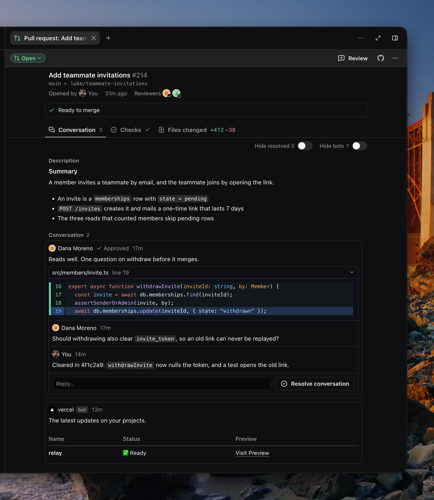

### Cards on every chip

Every chip shows a card of what it names when you point at it. An agent's
card works on any task of the workspace. A page's card previews the page and
names who showed each version. A pull request's card gives its files, age,
branches, labels, counts, and the lines it adds and removes. A pull request's
or an issue's card names its author by their GitHub face, and a Linear
issue's card names its assignee.
([#3102](https://github.com/ReviewStage/luke/pull/3102),
[#3106](https://github.com/ReviewStage/luke/pull/3106),
[#3109](https://github.com/ReviewStage/luke/pull/3109),
[#3126](https://github.com/ReviewStage/luke/pull/3126),
[#3140](https://github.com/ReviewStage/luke/pull/3140),
[#3161](https://github.com/ReviewStage/luke/pull/3161),
[#3191](https://github.com/ReviewStage/luke/pull/3191),
[#3234](https://github.com/ReviewStage/luke/pull/3234))

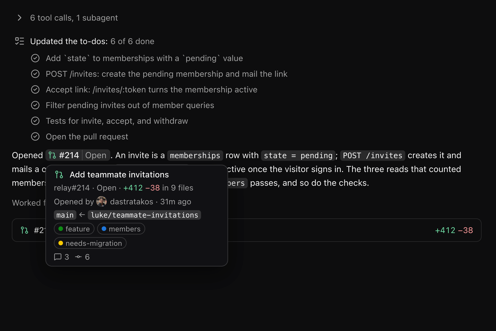

### Improvements

- Mention a workspace's people with @
  ([#3170](https://github.com/ReviewStage/luke/pull/3170))
- Select words in an agent's message and Reply to quote them in the message box
  ([#3025](https://github.com/ReviewStage/luke/pull/3025))
- Open an agent's pushed branch on this Mac in a terminal inside Luke
  ([#3137](https://github.com/ReviewStage/luke/pull/3137))
- Coding agents run an Electron app in their sandbox
  ([#3185](https://github.com/ReviewStage/luke/pull/3185))
- Coding agents send what is ready for review to your Inbox, and Inbox items
  say whose agent asks them
  ([#3162](https://github.com/ReviewStage/luke/pull/3162),
  [#3198](https://github.com/ReviewStage/luke/pull/3198))
- A plan's comment threads stay anchored to their words through every save
  ([#3034](https://github.com/ReviewStage/luke/pull/3034))
- Zoom and pan a picture in the image preview
  ([#3205](https://github.com/ReviewStage/luke/pull/3205))
- Drag the sidebar's pins into the order you want
  ([#3131](https://github.com/ReviewStage/luke/pull/3131))
- New task opens its dialog at once, its name field matches Linear issues,
  and its issue picker searches Linear
  ([#3149](https://github.com/ReviewStage/luke/pull/3149),
  [#3300](https://github.com/ReviewStage/luke/pull/3300))
- Go back and forward with a mouse's side buttons under Logi Options+
  ([#3316](https://github.com/ReviewStage/luke/pull/3316))
- Coding agents read another agent with `read_agent`, and have the `gh stack`
  extension in their sandbox
  ([#3291](https://github.com/ReviewStage/luke/pull/3291),
  [#3296](https://github.com/ReviewStage/luke/pull/3296))
- A coding agent's model is sent only its newest pictures
  ([#3253](https://github.com/ReviewStage/luke/pull/3253))
- A new task opens with the side panel hidden, closing the last tab shuts the
  panel, and Show panel opens the tab you last closed
  ([#3123](https://github.com/ReviewStage/luke/pull/3123),
  [#3159](https://github.com/ReviewStage/luke/pull/3159),
  [#3166](https://github.com/ReviewStage/luke/pull/3166))
- The plan's tab closes beside another tab
  ([#3204](https://github.com/ReviewStage/luke/pull/3204))
- A plan's document opens on its "Edited by" line
  ([#3240](https://github.com/ReviewStage/luke/pull/3240))
- An agent's plan card draws the plan's pictures
  ([#3186](https://github.com/ReviewStage/luke/pull/3186))
- ⌘K finds the open task's archived agents and opens each on its own page
  ([#3107](https://github.com/ReviewStage/luke/pull/3107))
- Settings opens with the caret in its search
  ([#3129](https://github.com/ReviewStage/luke/pull/3129))
- Workspace integrations show each GitHub account's photo
  ([#3139](https://github.com/ReviewStage/luke/pull/3139))
- A call's row names the agent it is about by its chip
  ([#3114](https://github.com/ReviewStage/luke/pull/3114))
- An agent turn's Copy and Copy link sit at its foot
  ([#3178](https://github.com/ReviewStage/luke/pull/3178))
- The window and every web page draw from shared themes
  ([#3119](https://github.com/ReviewStage/luke/pull/3119),
  [#3138](https://github.com/ReviewStage/luke/pull/3138),
  [#3142](https://github.com/ReviewStage/luke/pull/3142))

### Fixes

- Fixed Linear refusing a workspace's connection
  ([#3124](https://github.com/ReviewStage/luke/pull/3124))
- Fixed a refused sign-in renewal waiting on teardown before signing out
  ([#3082](https://github.com/ReviewStage/luke/pull/3082))
- Fixed an agent's pull request chip showing only after the next message
  ([#3081](https://github.com/ReviewStage/luke/pull/3081))
- Fixed toasts standing away from the window's bottom-right corner, and an
  agent's news staying until dismissed
  ([#3180](https://github.com/ReviewStage/luke/pull/3180))
- Fixed the agent's message box losing the caret after a send
  ([#3220](https://github.com/ReviewStage/luke/pull/3220))
- Fixed the @ list staying open when words past a space match nothing
  ([#3241](https://github.com/ReviewStage/luke/pull/3241))
- Fixed Luke's own GitHub App bot drawn as a person
  ([#3208](https://github.com/ReviewStage/luke/pull/3208))
- Fixed Escape leaving the Inbox, and the Inbox opening on a different item
  than the one last chosen
  ([#3183](https://github.com/ReviewStage/luke/pull/3183),
  [#3184](https://github.com/ReviewStage/luke/pull/3184))
- Fixed an Inbox image that lands before its item not being drawn
  ([#3177](https://github.com/ReviewStage/luke/pull/3177))
- Fixed the Draft pencil marking the task that is open
  ([#3145](https://github.com/ReviewStage/luke/pull/3145))
- Fixed the sender of a plan or task not named under its card
  ([#3158](https://github.com/ReviewStage/luke/pull/3158))
- Fixed a section's byline crowding its heading
  ([#3228](https://github.com/ReviewStage/luke/pull/3228))
- Fixed a reply quote in the message box set off differently from a sent quote
  ([#3143](https://github.com/ReviewStage/luke/pull/3143))
- Fixed a chip, an Inbox crumb, or a missing picture keeping a wide gap
  ([#3117](https://github.com/ReviewStage/luke/pull/3117))
- Fixed a tab shown as its glyph losing the glyph under the pointer
  ([#3127](https://github.com/ReviewStage/luke/pull/3127))
- Fixed the plan editor and the message box writing styles the panel refuses
  ([#3136](https://github.com/ReviewStage/luke/pull/3136))

### Misc

- Updated Sentry to its official setup, tracing one request in ten
  ([#3169](https://github.com/ReviewStage/luke/pull/3169),
  [#3247](https://github.com/ReviewStage/luke/pull/3247))

## 0.16.0 — 2026-10-16

### Links that say what they point at

Every Luke link in a plan, a transcript, an Inbox item, or the Call tab is a
chip named for its place: the task's, agent's, page's, or person's own name,
wearing its glyph. A Luke address pasted into a box becomes its chip, and a bare
one in a message is handed to the agent as its mention. A pull request's, a
GitHub issue's, or a Linear issue's link says its title and state, read through
the workspace's own GitHub App or Linear, in an Inbox item through that item's
own workspace. A Luke link pasted into Slack, iMessage, or X unfurls as Luke's
card.
([#3036](https://github.com/ReviewStage/luke/pull/3036),
[#3038](https://github.com/ReviewStage/luke/pull/3038),
[#3047](https://github.com/ReviewStage/luke/pull/3047),
[#3049](https://github.com/ReviewStage/luke/pull/3049),
[#3071](https://github.com/ReviewStage/luke/pull/3071),
[#3074](https://github.com/ReviewStage/luke/pull/3074),
[#3098](https://github.com/ReviewStage/luke/pull/3098))

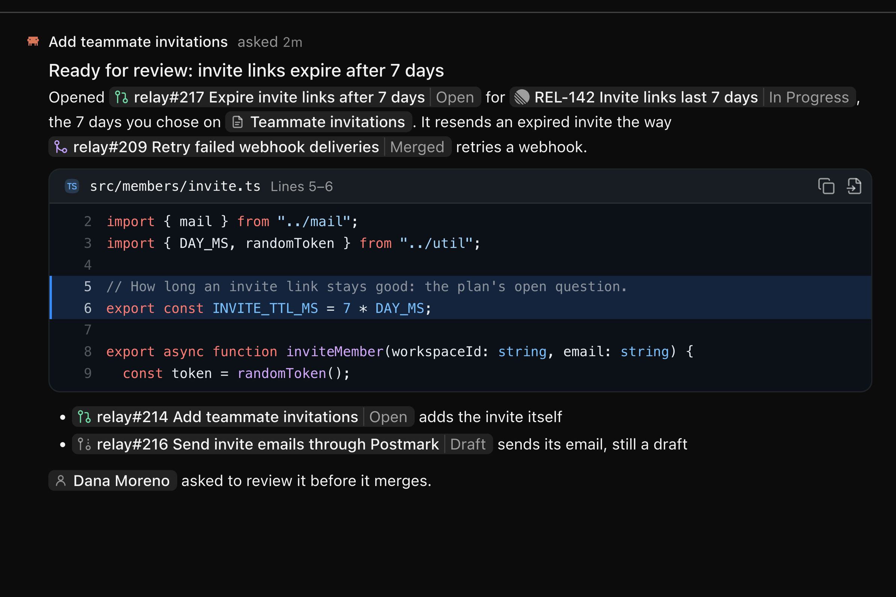

### Agents that start, mention, and archive agents

A coding agent starts another coding agent on its own task or on any task of
its workspace, which `list_tasks` finds, and the new agent reports back to it.
The @ list offers every coding agent of the workspace, labelled by its task,
and coding agents write mentions too. Luke and coding agents read any page of
the workspace with `read_page`, so a page mention points at the page rather
than carrying it. An agent can archive or unarchive another, and the archived
agent's card and banner say who archived it and why. A message from another
coding agent is drawn under that agent's mark.
([#3028](https://github.com/ReviewStage/luke/pull/3028),
[#3029](https://github.com/ReviewStage/luke/pull/3029),
[#3064](https://github.com/ReviewStage/luke/pull/3064),
[#3067](https://github.com/ReviewStage/luke/pull/3067),
[#3068](https://github.com/ReviewStage/luke/pull/3068),
[#3076](https://github.com/ReviewStage/luke/pull/3076),
[#3078](https://github.com/ReviewStage/luke/pull/3078),
[#3088](https://github.com/ReviewStage/luke/pull/3088),
[#3093](https://github.com/ReviewStage/luke/pull/3093))

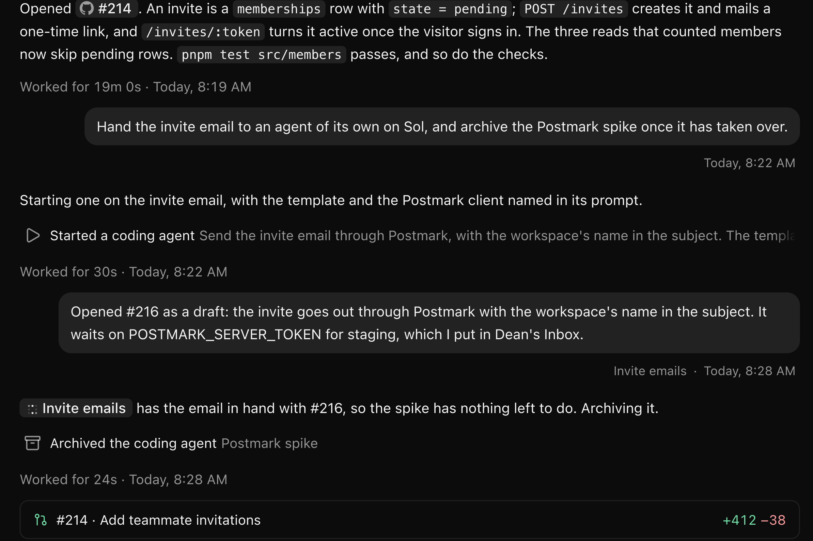

### Start a task without planning

New task has a Plan switch. Turn it off and the task starts with an empty
plan and no call, and the switch stays as you left it next time.
([#3083](https://github.com/ReviewStage/luke/pull/3083))

### Luke at any width

A narrow window or side panel keeps everything in reach. A side panel's file
tree, Changes tree, and Terminal shells float over a skinny tab, peeked by hover
and opened by their toggle, as the main sidebar does. Tab strips shrink, then
fold to glyphs, then scroll with the chosen tab in view. The plan, an agent's
transcript, the call bar, Settings, Home, the Inbox, and the sidebar's foot all
read in a narrow column, and toasts, dialogs, and menus stay on screen in a
short window.
([#3089](https://github.com/ReviewStage/luke/pull/3089),
[#3090](https://github.com/ReviewStage/luke/pull/3090),
[#3079](https://github.com/ReviewStage/luke/pull/3079),
[#3056](https://github.com/ReviewStage/luke/pull/3056),
[#3055](https://github.com/ReviewStage/luke/pull/3055),
[#3058](https://github.com/ReviewStage/luke/pull/3058),
[#3052](https://github.com/ReviewStage/luke/pull/3052),
[#3053](https://github.com/ReviewStage/luke/pull/3053),
[#3054](https://github.com/ReviewStage/luke/pull/3054),
[#3050](https://github.com/ReviewStage/luke/pull/3050),
[#3043](https://github.com/ReviewStage/luke/pull/3043),
[#3051](https://github.com/ReviewStage/luke/pull/3051),
[#3059](https://github.com/ReviewStage/luke/pull/3059))

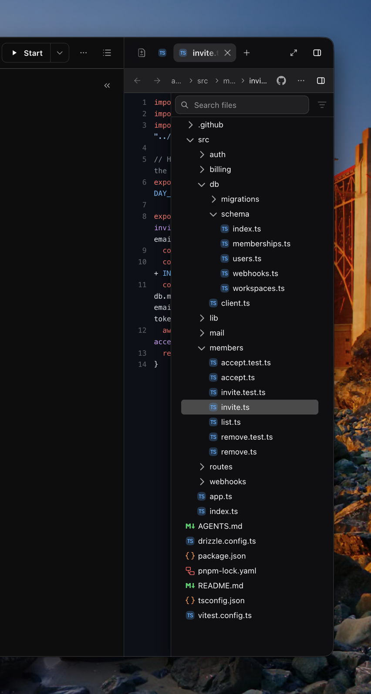

### Improvements

- An MCP server's chip shows the server's row and tools, and says whether the
  turn is handed it ([#3097](https://github.com/ReviewStage/luke/pull/3097))
- What scrolls fades beneath every pinned bar, banner, and call timer
  ([#3057](https://github.com/ReviewStage/luke/pull/3057))
- The keyboard's focus ring is drawn once, whole, on the shape you see, and
  scrolls its control in with room to spare
  ([#3044](https://github.com/ReviewStage/luke/pull/3044),
  [#3045](https://github.com/ReviewStage/luke/pull/3045),
  [#3046](https://github.com/ReviewStage/luke/pull/3046),
  [#3069](https://github.com/ReviewStage/luke/pull/3069))
- Settings, dialogs, and empty states say less and only what helps
  ([#3096](https://github.com/ReviewStage/luke/pull/3096))

### Fixes

- Fixed Open in Luke opening a bare Electron rather than Luke
  ([#3063](https://github.com/ReviewStage/luke/pull/3063))
- Fixed Reopen on an account still signing in adding a new account, and a
  disconnect deleting an account added under the same name
  ([#3039](https://github.com/ReviewStage/luke/pull/3039))
- Fixed an agent whose harness is not yet known wearing a stray glyph
  ([#3094](https://github.com/ReviewStage/luke/pull/3094))
- Fixed a plan picture's last editor drawn over the text rather than in the
  viewer ([#3073](https://github.com/ReviewStage/luke/pull/3073))
- Fixed an empty plan drawing a summary and its button
  ([#3072](https://github.com/ReviewStage/luke/pull/3072))
- Fixed a click on an empty plan's panel not putting the caret in its text
  ([#3075](https://github.com/ReviewStage/luke/pull/3075))
- Fixed an Inbox picture standing taller than a screenful
  ([#3065](https://github.com/ReviewStage/luke/pull/3065))
- Fixed a chip parting from the punctuation after it at a line's end
  ([#3060](https://github.com/ReviewStage/luke/pull/3060))

### Misc

- Added a View › Developer menu and named side-by-side instances to development
  builds ([#3080](https://github.com/ReviewStage/luke/pull/3080),
  [#3087](https://github.com/ReviewStage/luke/pull/3087))

## 0.15.0 — 2026-10-16

### Pictures in plans

Paste or drop a picture into a plan, or insert one with ⌥⌘I: it shows at
once while it uploads, with its alt text and caption in place, and a failed
upload offers Retry. A plan's pictures are drawn on its page and in its
versions, open over the window, and are served only to its workspace's
members. A coding agent adds a screenshot from its sandbox to the plan, and
coding agents and Luke look at a plan's pictures when the alt text is not
enough.
([#2895](https://github.com/ReviewStage/luke/pull/2895),
[#2913](https://github.com/ReviewStage/luke/pull/2913),
[#2914](https://github.com/ReviewStage/luke/pull/2914),
[#2943](https://github.com/ReviewStage/luke/pull/2943),
[#2945](https://github.com/ReviewStage/luke/pull/2945),
[#2991](https://github.com/ReviewStage/luke/pull/2991),
[#3008](https://github.com/ReviewStage/luke/pull/3008))

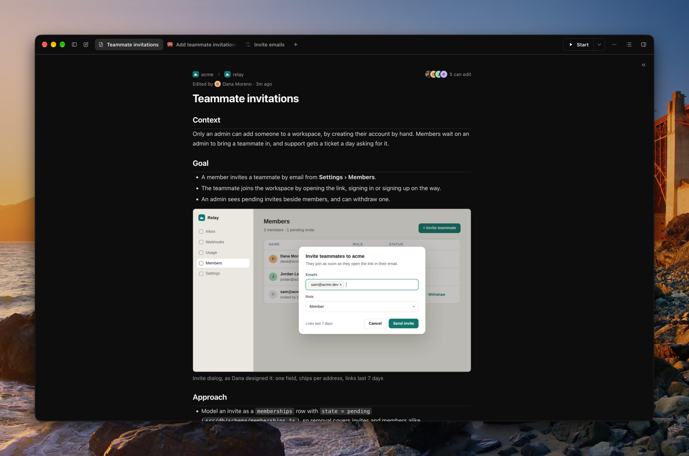

### Pictures from coding agents

A coding agent or its worker shows you pictures from its sandbox, such as a
screenshot of what it built, taken in the sandbox's own Chromium after a
change to anything visible, and its transcript draws them
in place: one picture large, a few in a row, many as thumbnails. An
integration's pictures stand as chips under its call. A picture opens in a
viewer that walks the whole set, and Add to plan puts it in the agent's plan,
with Undo.
([#2911](https://github.com/ReviewStage/luke/pull/2911),
[#2906](https://github.com/ReviewStage/luke/pull/2906),
[#2919](https://github.com/ReviewStage/luke/pull/2919),
[#2927](https://github.com/ReviewStage/luke/pull/2927),
[#2979](https://github.com/ReviewStage/luke/pull/2979),
[#3004](https://github.com/ReviewStage/luke/pull/3004))

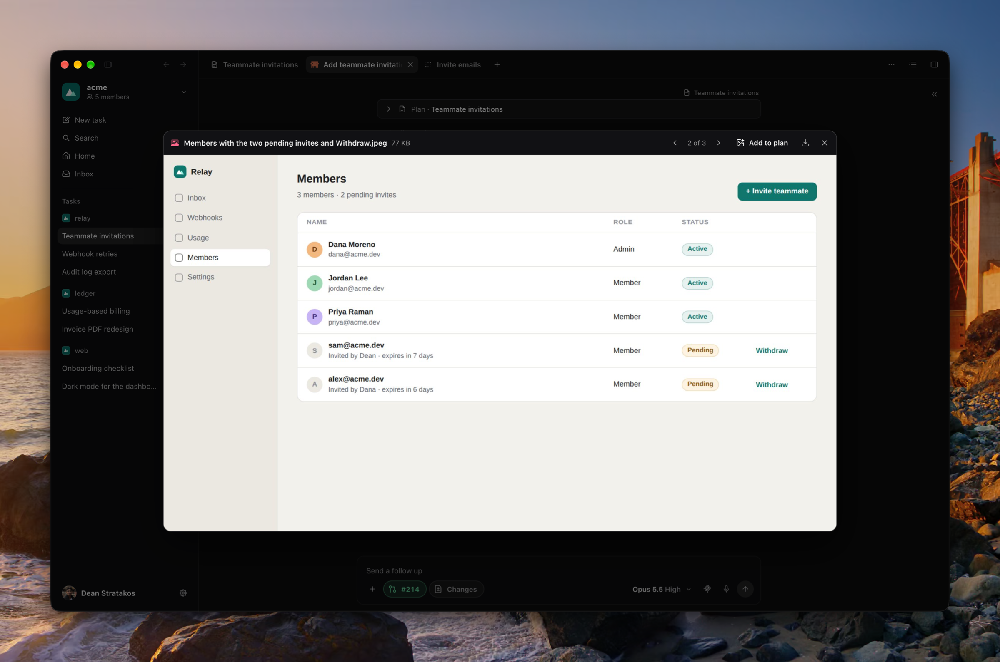

### A person's page

Press a person anywhere to open their page in the workspace: what they are
working on now, what waits on their answer, the tasks they created, and their
other agents. ⌘K's People filter, Settings › Workspace › Members, and Your
profile in the account menu lead there too. Their tasks in sidebar filters the
sidebar to them, and Copy link copies a link to their page. A member who left
keeps their picture, grayed, and their name says they left.
([#2982](https://github.com/ReviewStage/luke/pull/2982),
[#2983](https://github.com/ReviewStage/luke/pull/2983),
[#2984](https://github.com/ReviewStage/luke/pull/2984),
[#2985](https://github.com/ReviewStage/luke/pull/2985),
[#2986](https://github.com/ReviewStage/luke/pull/2986),
[#2995](https://github.com/ReviewStage/luke/pull/2995),
[#3001](https://github.com/ReviewStage/luke/pull/3001),
[#3015](https://github.com/ReviewStage/luke/pull/3015))

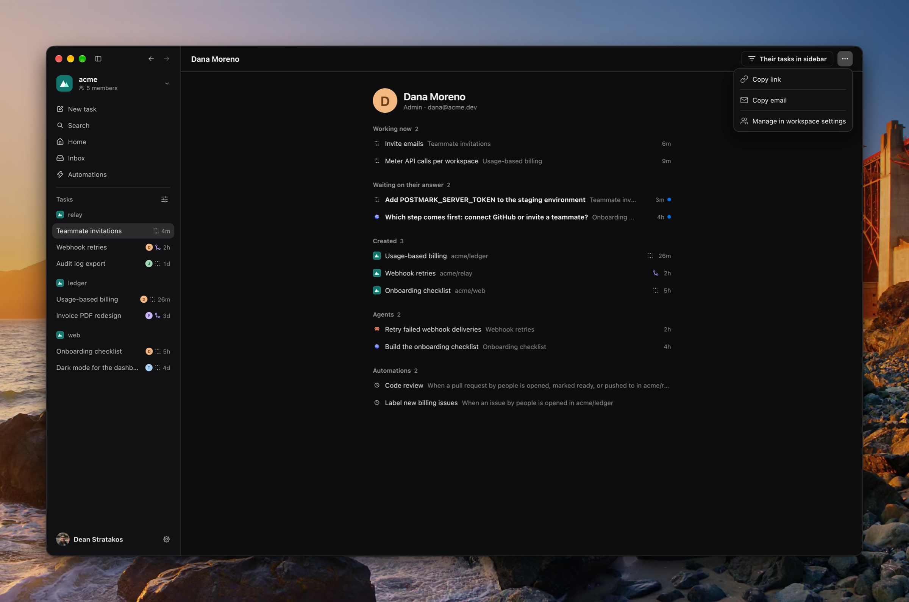

### Copy link to anything

Copy link now reaches nearly every place in Luke: an agent, its worker, its
Changes, a message in its transcript, a page, the Call tab, a version, an Inbox
item, and a Settings page. ⌥⌘C copies the link of what is open, ⌘K offers Copy
link to each thing at hand, and every copy says Link copied. A Luke link opens
its place in the window, and a place the reader cannot reach is Not found.
([#2950](https://github.com/ReviewStage/luke/pull/2950),
[#2969](https://github.com/ReviewStage/luke/pull/2969),
[#2970](https://github.com/ReviewStage/luke/pull/2970),
[#2971](https://github.com/ReviewStage/luke/pull/2971),
[#2972](https://github.com/ReviewStage/luke/pull/2972),
[#2973](https://github.com/ReviewStage/luke/pull/2973),
[#2974](https://github.com/ReviewStage/luke/pull/2974),
[#2975](https://github.com/ReviewStage/luke/pull/2975),
[#3017](https://github.com/ReviewStage/luke/pull/3017))

### Pull requests as you

A coding agent you start commits as you, with Luke as co-author, and its pull
request is opened as you, so it is yours on GitHub. The Changes tab names Luke
beside you, and where an agent had to write as the GitHub App, it says why.
([#2952](https://github.com/ReviewStage/luke/pull/2952),
[#2963](https://github.com/ReviewStage/luke/pull/2963),
[#2976](https://github.com/ReviewStage/luke/pull/2976))

### Start a task from Linear

An owner or admin connects Linear once for the whole workspace in Settings ›
Workspace › Integrations. Then New task in the sidebar offers the workspace's
Linear issues, and picking one starts the task with that issue as Luke's
context. Agents in the workspace use its Linear connection.
([#2859](https://github.com/ReviewStage/luke/pull/2859))

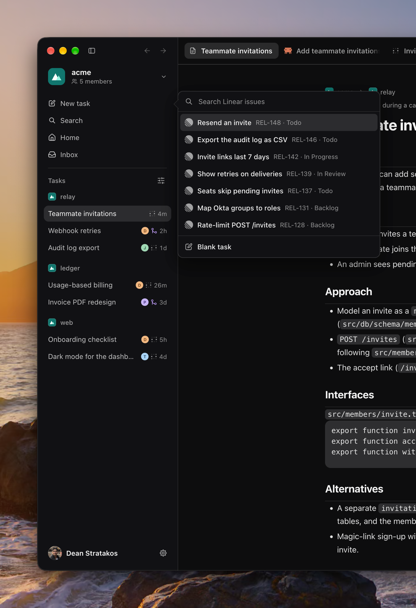

### Several accounts at one integration

Connect more than one account at a provider, such as a work and a personal
Notion, in Settings › Integrations. Each stands as a row of its own, named for
its workspace there, in Settings and in the MCP popover, and agents are handed
each as a connection of its own, asking which one you mean where you have not
said.
([#2858](https://github.com/ReviewStage/luke/pull/2858),
[#2864](https://github.com/ReviewStage/luke/pull/2864),
[#2867](https://github.com/ReviewStage/luke/pull/2867),
[#2868](https://github.com/ReviewStage/luke/pull/2868),
[#2869](https://github.com/ReviewStage/luke/pull/2869),
[#2896](https://github.com/ReviewStage/luke/pull/2896),
[#2897](https://github.com/ReviewStage/luke/pull/2897),
[#2915](https://github.com/ReviewStage/luke/pull/2915),
[#2994](https://github.com/ReviewStage/luke/pull/2994))

### Agents that talk to each other

On a call, Luke lists, reads, and messages every coding agent in the task's
workspace, each named with its task, and coding agents list and message the
other coding agents of their workspace. In an agent's box, @ also offers the
task's pages and its other agents.
([#3026](https://github.com/ReviewStage/luke/pull/3026),
[#3027](https://github.com/ReviewStage/luke/pull/3027),
[#2822](https://github.com/ReviewStage/luke/pull/2822),
[#3031](https://github.com/ReviewStage/luke/pull/3031))

### Drafts kept

What you type in an agent's box or an Inbox answer stays when you switch tabs
or tasks, kept per agent, task, and item on this Mac, and a pencil marks
a draft waiting out of sight.
([#2925](https://github.com/ReviewStage/luke/pull/2925),
[#2948](https://github.com/ReviewStage/luke/pull/2948),
[#3005](https://github.com/ReviewStage/luke/pull/3005))

### Improvements

- A review, a comment, or a later failed check on an agent's pull request
  reaches the agent as a message from GitHub
  ([#3007](https://github.com/ReviewStage/luke/pull/3007))
- A coding agent waits on its checks or a deploy without spending a model step
  on each look ([#3000](https://github.com/ReviewStage/luke/pull/3000))
- Settings › Notifications sends a test notification and says when macOS has
  Luke's notifications off
  ([#3011](https://github.com/ReviewStage/luke/pull/3011))
- ⌘F finds on every page that stands in the window
  ([#2964](https://github.com/ReviewStage/luke/pull/2964))
- ⌘K groups, orders, and filters the sidebar's tasks, and archived tasks are a
  view of the sidebar's list rather than a group at its foot
  ([#2904](https://github.com/ReviewStage/luke/pull/2904),
  [#2905](https://github.com/ReviewStage/luke/pull/2905),
  [#2966](https://github.com/ReviewStage/luke/pull/2966))
- Luke and coding agents edit anywhere in the plan, headings included, and a
  batch of their edits lands whole or not at all
  ([#2916](https://github.com/ReviewStage/luke/pull/2916))
- ⌘K offers Pin task or Unpin task for the task on screen
  ([#3021](https://github.com/ReviewStage/luke/pull/3021))
- A GitHub bot wears a bot badge beside its own GitHub picture
  ([#3022](https://github.com/ReviewStage/luke/pull/3022))
- Mark a task unread from its menus and ⌘K, and read again
  ([#2961](https://github.com/ReviewStage/luke/pull/2961))
- A task's last update counts its agents' finished turns, so a task moves up
  the sidebar when its agent finishes
  ([#2935](https://github.com/ReviewStage/luke/pull/2935))
- A task row grouped by creator names no repository
  ([#3003](https://github.com/ReviewStage/luke/pull/3003))
- A note typed on an Inbox item that asks nothing back reaches the agent, and
  the box says so ([#2946](https://github.com/ReviewStage/luke/pull/2946))
- A task's Inbox heads its list with the Inbox's name and Needs you, as the
  window's Inbox does ([#2918](https://github.com/ReviewStage/luke/pull/2918))
- An integration's MCP call wears its logo and names its own tool
  ([#2934](https://github.com/ReviewStage/luke/pull/2934))
- New task's workspace and repository chips are the searchable pickers
  Settings uses, and the repository list drops its "on GitHub" heading
  ([#2930](https://github.com/ReviewStage/luke/pull/2930),
  [#2928](https://github.com/ReviewStage/luke/pull/2928))
- Luke's and an agent's marks stand bare where nothing overlaps them
  ([#2990](https://github.com/ReviewStage/luke/pull/2990),
  [#3014](https://github.com/ReviewStage/luke/pull/3014))
- A hover card offers no Open of its own, since a press on what it hangs from
  opens it ([#2992](https://github.com/ReviewStage/luke/pull/2992))

### Fixes

- Fixed the agent composer's and the Inbox answer box's controls piling on
  each other in a narrow column, a ⋯ now taking in what does not fit
  ([#3013](https://github.com/ReviewStage/luke/pull/3013))
- Fixed Needs you keeping an answered item in the list, and it now says when
  nothing needs you ([#3002](https://github.com/ReviewStage/luke/pull/3002))
- Fixed a message that reached an agent mid-turn being drawn above the turn
  rather than where it arrived
  ([#3023](https://github.com/ReviewStage/luke/pull/3023))
- Fixed a coding agent sometimes never getting its title
  ([#3024](https://github.com/ReviewStage/luke/pull/3024))
- Fixed a quote in a transcript or plan standing far indented and in italics
  ([#3033](https://github.com/ReviewStage/luke/pull/3033))
- Fixed the page a pasted Luke link opens, and the sign-in pages, showing no
  icon in the browser's tab
  ([#3035](https://github.com/ReviewStage/luke/pull/3035))
- Fixed a message to a coding agent started before October 15 staying at
  Starting ([#3010](https://github.com/ReviewStage/luke/pull/3010))

### Misc

- Added repository checks that keep logic out of the agents' apps and refuse a
  tracked literal shaped like a provider's credential
  ([#2889](https://github.com/ReviewStage/luke/pull/2889),
  [#2988](https://github.com/ReviewStage/luke/pull/2988))

## 0.14.0 — 2026-10-15

### The Terminal tab

Every coding agent has a Terminal tab: a shell in the agent's own sandbox,
with its repository checked out and its GitHub sign-in kept fresh. Start,
rename, and end more shells beside it, each marked while it runs, and ⌘F
finds in a shell's scrollback. ⌘J, ⌘K's New terminal, the panel's +, and an
agent's ⋯ and right-click open one. A shell Luke cannot reach says why, and
the sandbox stays up while a terminal is open, stopping five idle minutes
after.
([#2575](https://github.com/ReviewStage/luke/pull/2575),
[#2592](https://github.com/ReviewStage/luke/pull/2592),
[#2599](https://github.com/ReviewStage/luke/pull/2599),
[#2591](https://github.com/ReviewStage/luke/pull/2591),
[#2639](https://github.com/ReviewStage/luke/pull/2639),
[#2600](https://github.com/ReviewStage/luke/pull/2600),
[#2611](https://github.com/ReviewStage/luke/pull/2611),
[#2622](https://github.com/ReviewStage/luke/pull/2622),
[#2640](https://github.com/ReviewStage/luke/pull/2640),
[#2703](https://github.com/ReviewStage/luke/pull/2703),
[#2814](https://github.com/ReviewStage/luke/pull/2814),
[#2817](https://github.com/ReviewStage/luke/pull/2817))

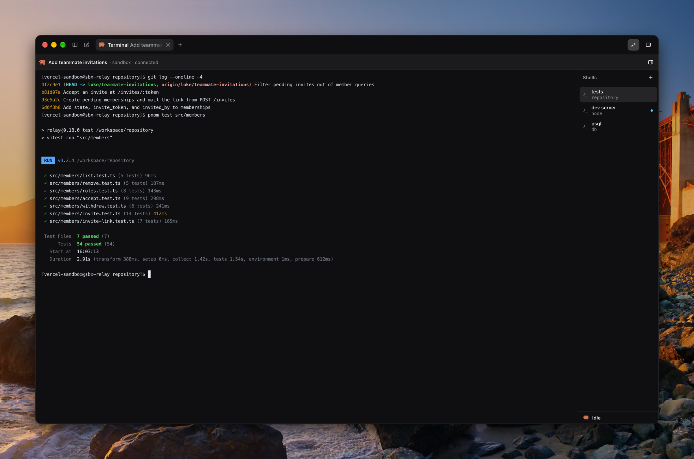

### @-mentions

Type @ in the plan or in a coding agent's message box to mention a file, a
folder, or one of the plan's sections; in the agent's box, @ also offers the
repository's skills and your MCP servers and their tools. A mention is a chip
wherever it is drawn, a renamed heading renames its mentions, and Luke never
drops one when he corrects the plan. The agent is handed what it cannot read
itself, and a server or tool mentioned rides along on the next turn alone. In
a File tab, ⌥⌘K mentions the selected lines, pinned to their commit, and a
pasted link to an integration's page is a chip that brings its server along.
([#2593](https://github.com/ReviewStage/luke/pull/2593),
[#2603](https://github.com/ReviewStage/luke/pull/2603),
[#2586](https://github.com/ReviewStage/luke/pull/2586),
[#2624](https://github.com/ReviewStage/luke/pull/2624),
[#2653](https://github.com/ReviewStage/luke/pull/2653),
[#2664](https://github.com/ReviewStage/luke/pull/2664),
[#2643](https://github.com/ReviewStage/luke/pull/2643),
[#2668](https://github.com/ReviewStage/luke/pull/2668),
[#2683](https://github.com/ReviewStage/luke/pull/2683),
[#2721](https://github.com/ReviewStage/luke/pull/2721),
[#2792](https://github.com/ReviewStage/luke/pull/2792),
[#2795](https://github.com/ReviewStage/luke/pull/2795))

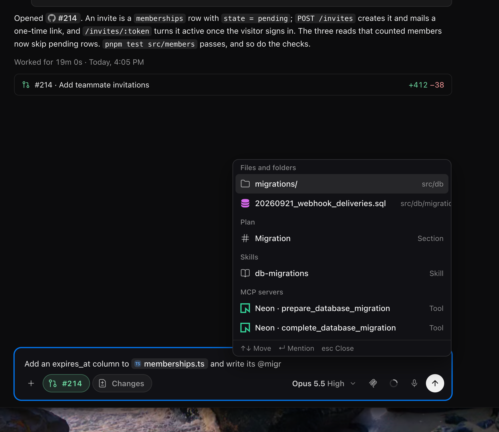

### Who did what

Everyone is drawn one way: a person on a circle with their picture, and Luke or
a coding agent on a rounded square. A plan's "Edited by" line and its section
bylines name whoever wrote it, the time opening the history, and a task's ⋯ menu
ends with who created and last edited it. A teammate's call is headed by their
face and name, their messages in an agent's tab carry it, and an agent a
teammate started, an Inbox answer, and a command run on someone's Mac each say
whose it was. A task someone else created wears their face in the sidebar, and
its card, crumb, Home, and ⌘K name who created it.
([#2784](https://github.com/ReviewStage/luke/pull/2784),
[#2794](https://github.com/ReviewStage/luke/pull/2794),
[#2796](https://github.com/ReviewStage/luke/pull/2796),
[#2793](https://github.com/ReviewStage/luke/pull/2793),
[#2779](https://github.com/ReviewStage/luke/pull/2779),
[#2774](https://github.com/ReviewStage/luke/pull/2774),
[#2775](https://github.com/ReviewStage/luke/pull/2775),
[#2773](https://github.com/ReviewStage/luke/pull/2773),
[#2742](https://github.com/ReviewStage/luke/pull/2742),
[#2748](https://github.com/ReviewStage/luke/pull/2748),
[#2702](https://github.com/ReviewStage/luke/pull/2702),
[#2715](https://github.com/ReviewStage/luke/pull/2715),
[#2638](https://github.com/ReviewStage/luke/pull/2638),
[#2853](https://github.com/ReviewStage/luke/pull/2853),
[#2854](https://github.com/ReviewStage/luke/pull/2854),
[#2873](https://github.com/ReviewStage/luke/pull/2873),
[#2875](https://github.com/ReviewStage/luke/pull/2875),
[#2877](https://github.com/ReviewStage/luke/pull/2877))

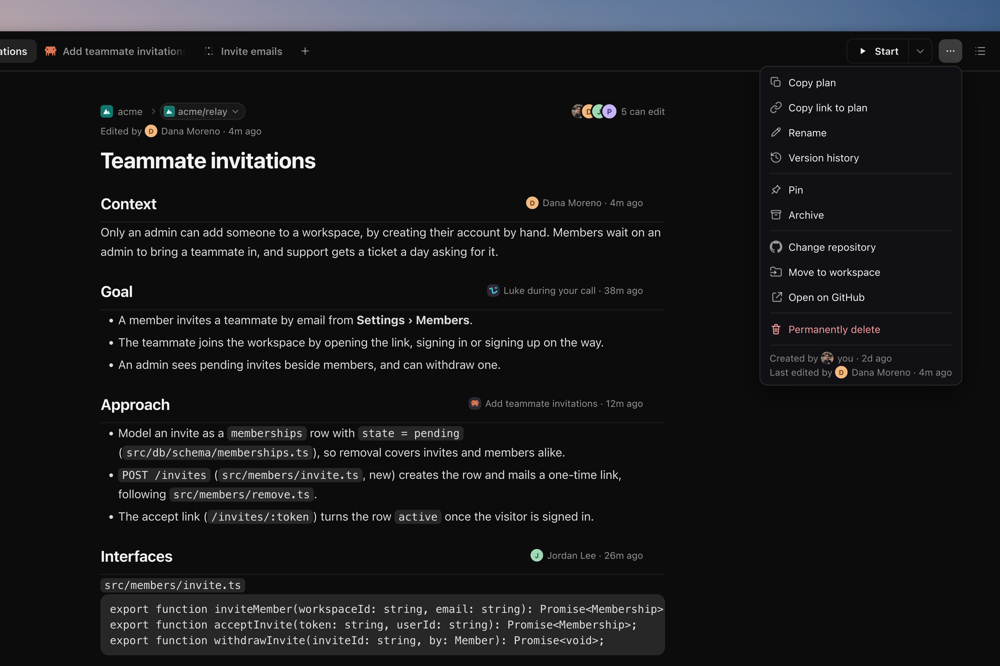

### Workspaces, clearer

The workspace heads the sidebar by its tile, its photo or first letter, and
who shares it, and the window's title, New task, and a task's crumbs say
where you are: "acme › relay" and "5 can edit" over its title. Switching
workspaces opens its last task or its home, the Inbox follows, and Search
names the others. A personal workspace takes your name. Owners and admins
rename a workspace and set its photo, the owner makes members admins and hands
the workspace over to leave it, and an invite stays good after whoever sent it
leaves. A task whose repository its workspace cannot reach says so over every
tab and offers Move to workspace, which says who loses and gains it.
([#2718](https://github.com/ReviewStage/luke/pull/2718),
[#2712](https://github.com/ReviewStage/luke/pull/2712),
[#2802](https://github.com/ReviewStage/luke/pull/2802),
[#2719](https://github.com/ReviewStage/luke/pull/2719),
[#2723](https://github.com/ReviewStage/luke/pull/2723),
[#2730](https://github.com/ReviewStage/luke/pull/2730),
[#2808](https://github.com/ReviewStage/luke/pull/2808),
[#2733](https://github.com/ReviewStage/luke/pull/2733),
[#2736](https://github.com/ReviewStage/luke/pull/2736),
[#2741](https://github.com/ReviewStage/luke/pull/2741),
[#2764](https://github.com/ReviewStage/luke/pull/2764),
[#2786](https://github.com/ReviewStage/luke/pull/2786),
[#2788](https://github.com/ReviewStage/luke/pull/2788),
[#2789](https://github.com/ReviewStage/luke/pull/2789),
[#2772](https://github.com/ReviewStage/luke/pull/2772),
[#2749](https://github.com/ReviewStage/luke/pull/2749),
[#2750](https://github.com/ReviewStage/luke/pull/2750),
[#2757](https://github.com/ReviewStage/luke/pull/2757),
[#2820](https://github.com/ReviewStage/luke/pull/2820),
[#2824](https://github.com/ReviewStage/luke/pull/2824),
[#2840](https://github.com/ReviewStage/luke/pull/2840),
[#2845](https://github.com/ReviewStage/luke/pull/2845),
[#2761](https://github.com/ReviewStage/luke/pull/2761),
[#2771](https://github.com/ReviewStage/luke/pull/2771),
[#2803](https://github.com/ReviewStage/luke/pull/2803),
[#2804](https://github.com/ReviewStage/luke/pull/2804),
[#2870](https://github.com/ReviewStage/luke/pull/2870))

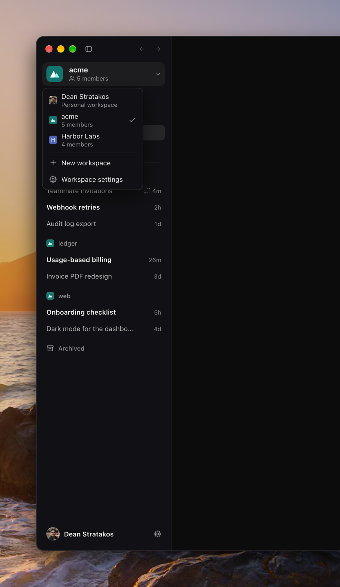

### Tasks

What you work through with Luke is now a task, and the plan is the document
inside it: the sidebar, New task, ⌘K, the Tasks menu, and every notice say
so. A coding agent's own instructions are its Prompt.
([#2835](https://github.com/ReviewStage/luke/pull/2835),
[#2841](https://github.com/ReviewStage/luke/pull/2841),
[#2844](https://github.com/ReviewStage/luke/pull/2844),
[#2848](https://github.com/ReviewStage/luke/pull/2848))

### Luke links

Copy link to task, in a task's ⋯ menu or the ⋯ beside its title, copies a
link that opens the task in Luke at its section: pressed in the window, from
another app through tryluke://, or from a browser through a page whose one
press opens Luke and which says what to check when nothing opens.
([#2695](https://github.com/ReviewStage/luke/pull/2695),
[#2696](https://github.com/ReviewStage/luke/pull/2696),
[#2697](https://github.com/ReviewStage/luke/pull/2697),
[#2819](https://github.com/ReviewStage/luke/pull/2819),
[#2831](https://github.com/ReviewStage/luke/pull/2831))

### Improvements

- The sidebar lists tasks in one section, grouped by repository, by creator,
  or not at all, in the order you choose, and filters them by who created them
  ([#2893](https://github.com/ReviewStage/luke/pull/2893),
  [#2899](https://github.com/ReviewStage/luke/pull/2899))
- The Changes tab and card name who opened the pull request, its reviewers by
  where each stands, its commit authors, and its review comments
  ([#2862](https://github.com/ReviewStage/luke/pull/2862),
  [#2863](https://github.com/ReviewStage/luke/pull/2863),
  [#2865](https://github.com/ReviewStage/luke/pull/2865),
  [#2878](https://github.com/ReviewStage/luke/pull/2878))
- A Mermaid fence in a plan draws as its diagram, in the read view and under
  its code in the editor
  ([#2890](https://github.com/ReviewStage/luke/pull/2890))
- A workspace holds several GitHub installations, listed in Settings ›
  Workspace and managed on GitHub
  ([#2642](https://github.com/ReviewStage/luke/pull/2642),
  [#2644](https://github.com/ReviewStage/luke/pull/2644))
- Start a task without a name: it stands as Untitled until you name it
  ([#2888](https://github.com/ReviewStage/luke/pull/2888))
- An Inbox item standing alone says where it stands, 2 of 8, and steps through
  the list by its arrows, J, and K, and a settled one offers the next that
  needs you where its box stood
  ([#2882](https://github.com/ReviewStage/luke/pull/2882),
  [#2885](https://github.com/ReviewStage/luke/pull/2885))
- A task counts as read the moment it opens, on whichever of its tabs
  ([#2900](https://github.com/ReviewStage/luke/pull/2900))
- A pinned task is pinned for you alone, not for the whole workspace
  ([#2901](https://github.com/ReviewStage/luke/pull/2901))
- Luke answers sooner on a call, his replies waiting on nothing earlier, and a
  call greets you from where the last one left off
  ([#2623](https://github.com/ReviewStage/luke/pull/2623))
- A link is one quiet underline, a bare address says its host and path with a
  ↗, and cards, Inbox rows, and notifications name a link rather than print it
  ([#2800](https://github.com/ReviewStage/luke/pull/2800),
  [#2815](https://github.com/ReviewStage/luke/pull/2815),
  [#2798](https://github.com/ReviewStage/luke/pull/2798),
  [#2797](https://github.com/ReviewStage/luke/pull/2797))
- Executor joins Settings › Integrations, every tool offered and its approvals
  put to you ([#2590](https://github.com/ReviewStage/luke/pull/2590))
- Settings › Integrations searches integrations and tools on its own, and a
  tool opens onto a page of its own there and in the MCP popover
  ([#2635](https://github.com/ReviewStage/luke/pull/2635),
  [#2700](https://github.com/ReviewStage/luke/pull/2700))
- A window too narrow for the sidebar folds it to float over the work, and a
  narrow Inbox opens on its item, the list a press of ‹ Inbox away
  ([#2679](https://github.com/ReviewStage/luke/pull/2679),
  [#2680](https://github.com/ReviewStage/luke/pull/2680),
  [#2879](https://github.com/ReviewStage/luke/pull/2879))
- An Inbox option the agent recommends wears a Recommended badge
  ([#2881](https://github.com/ReviewStage/luke/pull/2881))
- A repository out of reach says why under the composer and offers what mends
  it ([#2573](https://github.com/ReviewStage/luke/pull/2573),
  [#2588](https://github.com/ReviewStage/luke/pull/2588))
- A sign-in Connect cancelled or refused says so, with Try again
  ([#2595](https://github.com/ReviewStage/luke/pull/2595),
  [#2604](https://github.com/ReviewStage/luke/pull/2604))
- The repository chip says when a workspace's GitHub was removed or suspended
  on GitHub, rather than that none is connected
  ([#2834](https://github.com/ReviewStage/luke/pull/2834))
- Each column's ⋯ offers the chosen tab's actions, and tab housekeeping stays
  on the right-click ([#2783](https://github.com/ReviewStage/luke/pull/2783))
- The sidebar sets an unread task in semibold and a read one in a quieter ink,
  every row 30px tall ([#2801](https://github.com/ReviewStage/luke/pull/2801))
- Every window draws its words without the Mac's font smoothing
  ([#2807](https://github.com/ReviewStage/luke/pull/2807))
- The sign-in's buttons stand taller and wear "Last used" on the corner of the
  one it marks ([#2782](https://github.com/ReviewStage/luke/pull/2782),
  [#2785](https://github.com/ReviewStage/luke/pull/2785))
- A tool-call group leads with its fold's chevron, wears the failed mark where
  a call it holds failed, and a subagent's tab groups its calls as its agent's
  does ([#2892](https://github.com/ReviewStage/luke/pull/2892),
  [#2907](https://github.com/ReviewStage/luke/pull/2907))
- No button, menu item, or command ends its name with an ellipsis
  ([#2821](https://github.com/ReviewStage/luke/pull/2821))

### Fixes

- Fixed a sidebar group not listing its tasks newest updated first
  ([#2818](https://github.com/ReviewStage/luke/pull/2818))
- Fixed Settings saying Connected for a GitHub installation that GitHub
  removed or suspended
  ([#2828](https://github.com/ReviewStage/luke/pull/2828),
  [#2829](https://github.com/ReviewStage/luke/pull/2829))
- Fixed an agent's terminals failing to list in a busy account
  ([#2809](https://github.com/ReviewStage/luke/pull/2809))
- Fixed "Changed since you last looked" missing a teammate's saves
  ([#2689](https://github.com/ReviewStage/luke/pull/2689))
- Fixed Home missing a teammate's agent's open items
  ([#2755](https://github.com/ReviewStage/luke/pull/2755))
- Fixed the Call tab not naming a teammate's call
  ([#2694](https://github.com/ReviewStage/luke/pull/2694))
- Fixed Choose a model's menu hanging away from its button and showing a stale
  catalog ([#2763](https://github.com/ReviewStage/luke/pull/2763))
- Fixed an open popover jumping as its button grew or shrank
  ([#2629](https://github.com/ReviewStage/luke/pull/2629))
- Fixed a call's card floating over a version history's versions
  ([#2816](https://github.com/ReviewStage/luke/pull/2816))
- Fixed Contact us opening inside the account menu rather than beside it
  ([#2649](https://github.com/ReviewStage/luke/pull/2649))
- Fixed Settings › Profile and Settings › Workspace drawing you unlike the rest
  of the window, and offering Remove on your own row
  ([#2810](https://github.com/ReviewStage/luke/pull/2810),
  [#2813](https://github.com/ReviewStage/luke/pull/2813))
- Fixed a transparent workspace photo showing its letter tile behind it
  ([#2769](https://github.com/ReviewStage/luke/pull/2769))
- Fixed a picture on its own line opening in the plan editor as something you
  could not edit ([#2886](https://github.com/ReviewStage/luke/pull/2886))
- Fixed a menu's second submenu item not opening its submenu on hover
  ([#2917](https://github.com/ReviewStage/luke/pull/2917))
- Fixed Luke's face moving on the sign-in screen
  ([#2891](https://github.com/ReviewStage/luke/pull/2891))
- Fixed an agent's to-do list sitting off its rows' text, its item in progress
  now wearing the working mark
  ([#2874](https://github.com/ReviewStage/luke/pull/2874))
- Fixed an inline chip sitting off its line's baseline, a section's byline
  sitting off its ⋯, and a page's empty state sitting low
  ([#2856](https://github.com/ReviewStage/luke/pull/2856),
  [#2658](https://github.com/ReviewStage/luke/pull/2658),
  [#2832](https://github.com/ReviewStage/luke/pull/2832))

### Misc

- Updated the renderer to load Settings, analytics, and the markdown parser as
  chunks of their own, its main bundle 18% smaller
  ([#2738](https://github.com/ReviewStage/luke/pull/2738),
  [#2743](https://github.com/ReviewStage/luke/pull/2743))
- Updated the code's layout so application logic lives in `packages/`, under
  one `@luke/*` scope ([#2648](https://github.com/ReviewStage/luke/pull/2648),
  [#2652](https://github.com/ReviewStage/luke/pull/2652),
  [#2654](https://github.com/ReviewStage/luke/pull/2654),
  [#2659](https://github.com/ReviewStage/luke/pull/2659),
  [#2728](https://github.com/ReviewStage/luke/pull/2728))
- Added screenshots to 0.13.0 from its own build
  ([#2645](https://github.com/ReviewStage/luke/pull/2645))

## 0.13.0 — 2026-10-14

### Workspaces

Plans now live in workspaces you share with your team. Every account starts
with a personal workspace, and the sidebar switches between workspaces and
creates new ones. A workspace's members read and write its plans, its coding
agents, and their calls. Settings › Workspace invites people by link, lists
the invites still pending, removes members, and connects the workspace's own
GitHub organization, whose installation is the only source of its
repositories. Your personal GitHub link moves to Settings › Integrations, and
the Mac signs in once and holds a session of its own.
([#2110](https://github.com/ReviewStage/luke/pull/2110),
[#2111](https://github.com/ReviewStage/luke/pull/2111),
[#2122](https://github.com/ReviewStage/luke/pull/2122),
[#2133](https://github.com/ReviewStage/luke/pull/2133),
[#2151](https://github.com/ReviewStage/luke/pull/2151),
[#2152](https://github.com/ReviewStage/luke/pull/2152),
[#2124](https://github.com/ReviewStage/luke/pull/2124),
[#2250](https://github.com/ReviewStage/luke/pull/2250),
[#2268](https://github.com/ReviewStage/luke/pull/2268),
[#2274](https://github.com/ReviewStage/luke/pull/2274),
[#2396](https://github.com/ReviewStage/luke/pull/2396),
[#2135](https://github.com/ReviewStage/luke/pull/2135),
[#2153](https://github.com/ReviewStage/luke/pull/2153),
[#2414](https://github.com/ReviewStage/luke/pull/2414),
[#2418](https://github.com/ReviewStage/luke/pull/2418),
[#2427](https://github.com/ReviewStage/luke/pull/2427),
[#2500](https://github.com/ReviewStage/luke/pull/2500),
[#2501](https://github.com/ReviewStage/luke/pull/2501),
[#2502](https://github.com/ReviewStage/luke/pull/2502),
[#2503](https://github.com/ReviewStage/luke/pull/2503),
[#2504](https://github.com/ReviewStage/luke/pull/2504),
[#2505](https://github.com/ReviewStage/luke/pull/2505),
[#2508](https://github.com/ReviewStage/luke/pull/2508),
[#2524](https://github.com/ReviewStage/luke/pull/2524),
[#2539](https://github.com/ReviewStage/luke/pull/2539),
[#2566](https://github.com/ReviewStage/luke/pull/2566))

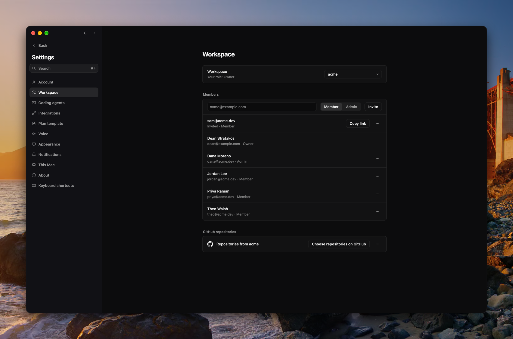

### Eight more integrations

GitHub, Granola, Mercury, Neon, PostHog, Supabase, Vercel, and Y Combinator
join Linear, Notion, Sentry, and Slack in Settings › Integrations. Every tool
a server offers is now offered to Luke and coding agents, Slack's writes
included. GitHub connects through your own GitHub sign-in. An integration
reads Connected only once its server answers with tools, and says the server's
own reason when it does not.
([#2495](https://github.com/ReviewStage/luke/pull/2495),
[#2499](https://github.com/ReviewStage/luke/pull/2499),
[#2479](https://github.com/ReviewStage/luke/pull/2479),
[#2490](https://github.com/ReviewStage/luke/pull/2490),
[#2532](https://github.com/ReviewStage/luke/pull/2532))

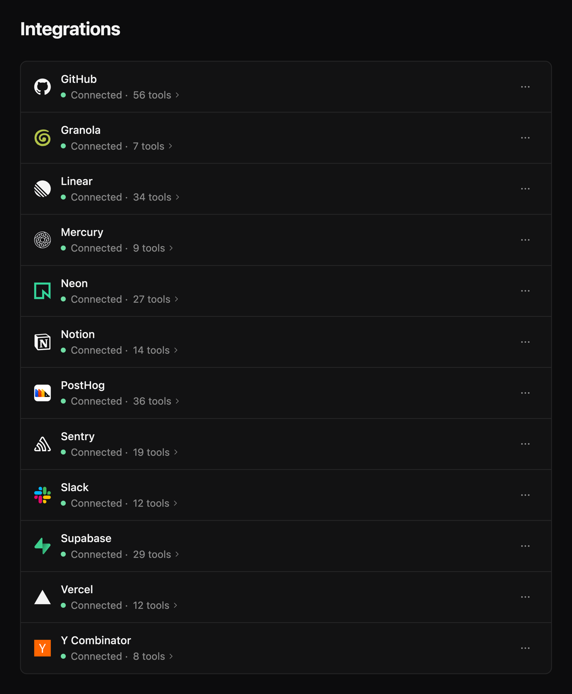

### The MCP popover

The MCP button in a coding agent's message box searches servers and their
tools, lists Connected apart from Not connected, and opens a server onto its
tools in place, each tool onto its whole description. Settings › Integrations
searches the same way, and a connected row opens onto its tools.
([#2527](https://github.com/ReviewStage/luke/pull/2527),
[#2528](https://github.com/ReviewStage/luke/pull/2528),
[#2542](https://github.com/ReviewStage/luke/pull/2542),
[#2554](https://github.com/ReviewStage/luke/pull/2554))

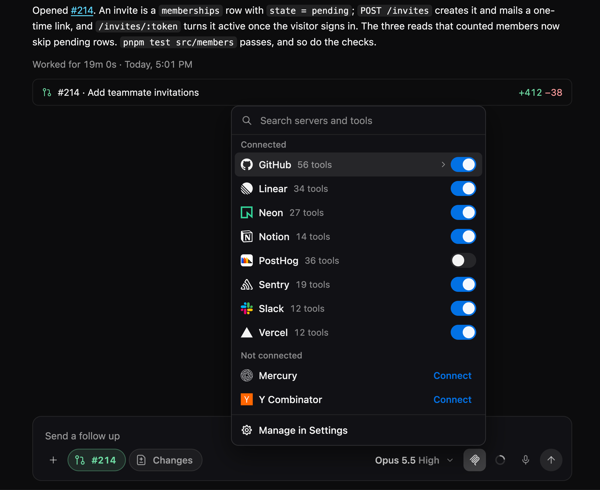

### Home

With no plan open, Luke rests on a home page that greets you with New plan,
what needs you, and your recent plans, which ↑ and ↓ move through. The
sidebar's Home row and ⇧⌘H go there. A launch reopens the plan you last had
open, its tabs and side panel as they were. New plan is now a dialog over the
window with the plan's name and a repository chip.
([#2468](https://github.com/ReviewStage/luke/pull/2468),
[#2485](https://github.com/ReviewStage/luke/pull/2485),
[#2494](https://github.com/ReviewStage/luke/pull/2494),
[#2543](https://github.com/ReviewStage/luke/pull/2543),
[#2550](https://github.com/ReviewStage/luke/pull/2550),
[#2562](https://github.com/ReviewStage/luke/pull/2562))

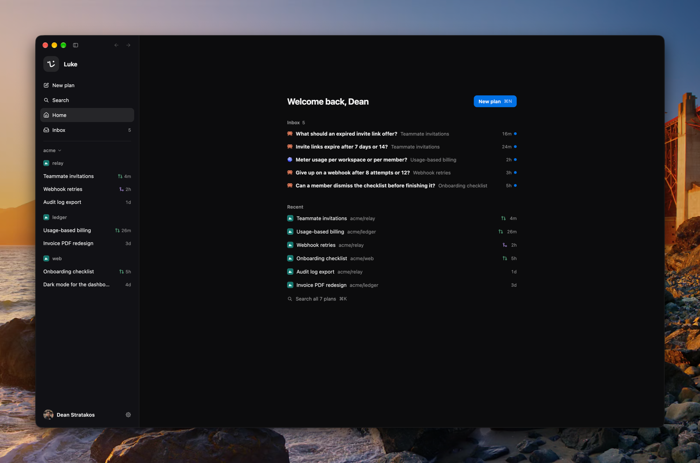

### The Inbox, one item at a time

The Inbox reads one item at a time beside a list grouped by plan or newest
first. What needs you wears a dot and a bold title, and the Needs you toggle
narrows the list to it. A settled item shows what it offered with your pick
marked, and the list resizes.
([#2442](https://github.com/ReviewStage/luke/pull/2442),
[#2465](https://github.com/ReviewStage/luke/pull/2465),
[#2497](https://github.com/ReviewStage/luke/pull/2497),
[#2551](https://github.com/ReviewStage/luke/pull/2551))

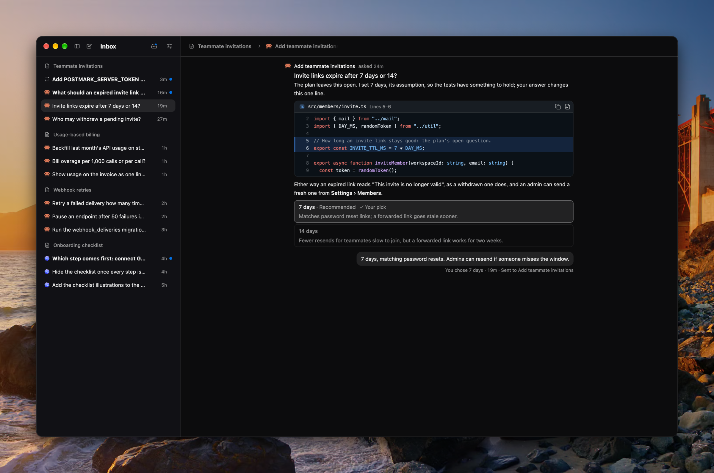

### Fast on your own key

Saving an Anthropic key asks once whether its organization runs fast mode, and
Fast is offered on any key that does. When the organization was never granted
fast mode, the Fast row says so and links to where you ask for it. A fast step
Anthropic refuses runs again at standard speed, and its turn's card says so.
([#2544](https://github.com/ReviewStage/luke/pull/2544),
[#2552](https://github.com/ReviewStage/luke/pull/2552),
[#2555](https://github.com/ReviewStage/luke/pull/2555),
[#2556](https://github.com/ReviewStage/luke/pull/2556))

### Improvements

- ⇧⌘T reopens the tabs you closed, the latest first, each where it stood
  ([#2429](https://github.com/ReviewStage/luke/pull/2429))
- The update pill shows only what there is to press, a failed check says so,
  and Luke's menu can check for updates
  ([#2428](https://github.com/ReviewStage/luke/pull/2428))
- An agent's GitHub error offers the GitHub sign-in, and the start or message
  goes through once you sign in
  ([#2415](https://github.com/ReviewStage/luke/pull/2415))
- An integration's sign-in waits with Reopen and Cancel, and says when it
  failed or did not finish
  ([#2521](https://github.com/ReviewStage/luke/pull/2521))
- Every setting has one home in Settings, and Open Settings mends every GitHub
  and integration refusal
  ([#2418](https://github.com/ReviewStage/luke/pull/2418),
  [#2501](https://github.com/ReviewStage/luke/pull/2501))
- ⌘K lists the Settings pages, and steps its filters with ⌘[ and ⌘], or ← and
  → while the field is empty
  ([#2489](https://github.com/ReviewStage/luke/pull/2489),
  [#2496](https://github.com/ReviewStage/luke/pull/2496))
- A tool row about a page, the board, an agent, code, the plan, or the Inbox
  opens it ([#2484](https://github.com/ReviewStage/luke/pull/2484))
- An agent named anywhere, in the Inbox, a transcript, ⌘K, or the archived
  list, hangs its card and opens its tab
  ([#2523](https://github.com/ReviewStage/luke/pull/2523))
- A file is named one way wherever it stands, hangs its card, and opens in the
  side panel ([#2559](https://github.com/ReviewStage/luke/pull/2559))
- Copy a link to a plan section from its heading's ⋯, and a mention of it in
  the plan opens it ([#2577](https://github.com/ReviewStage/luke/pull/2577))
- A page tab's code toggle shows its version's HTML as a File tab draws a file
  ([#2487](https://github.com/ReviewStage/luke/pull/2487))
- An agent's Changes tab is kept, pinned, and named for its agent like the
  side panel's other tabs
  ([#2439](https://github.com/ReviewStage/luke/pull/2439))
- A press on a skill's chip opens its SKILL.md, and a coding agent's Loaded
  skill row names the skill as /name with its card
  ([#2473](https://github.com/ReviewStage/luke/pull/2473),
  [#2557](https://github.com/ReviewStage/luke/pull/2557),
  [#2578](https://github.com/ReviewStage/luke/pull/2578))
- The Call tab stands a call's first ask and opening look-around where they
  happened, and folds a spoken turn's words with its work
  ([#2433](https://github.com/ReviewStage/luke/pull/2433),
  [#2486](https://github.com/ReviewStage/luke/pull/2486),
  [#2436](https://github.com/ReviewStage/luke/pull/2436),
  [#2437](https://github.com/ReviewStage/luke/pull/2437),
  [#2453](https://github.com/ReviewStage/luke/pull/2453),
  [#2449](https://github.com/ReviewStage/luke/pull/2449))
- The notetaker writes a correction in place of exactly what it names, and may
  write a point's parts as sub-bullets
  ([#2460](https://github.com/ReviewStage/luke/pull/2460),
  [#2463](https://github.com/ReviewStage/luke/pull/2463),
  [#2459](https://github.com/ReviewStage/luke/pull/2459))
- Switches turn on in the accent blue
  ([#2518](https://github.com/ReviewStage/luke/pull/2518))
- Every menu, modal, hover card, tab, fold, chip, and segmented control is drawn
  one way across the app
  ([#2536](https://github.com/ReviewStage/luke/pull/2536),
  [#2538](https://github.com/ReviewStage/luke/pull/2538),
  [#2549](https://github.com/ReviewStage/luke/pull/2549),
  [#2553](https://github.com/ReviewStage/luke/pull/2553),
  [#2558](https://github.com/ReviewStage/luke/pull/2558),
  [#2560](https://github.com/ReviewStage/luke/pull/2560),
  [#2531](https://github.com/ReviewStage/luke/pull/2531))
- Working, failed, unread, a pull request, a provider, and a time each wear one
  mark wherever they are drawn
  ([#2526](https://github.com/ReviewStage/luke/pull/2526),
  [#2530](https://github.com/ReviewStage/luke/pull/2530),
  [#2535](https://github.com/ReviewStage/luke/pull/2535),
  [#2546](https://github.com/ReviewStage/luke/pull/2546))
- A read that did not land says so the same way everywhere, then offers Retry
  ([#2534](https://github.com/ReviewStage/luke/pull/2534))
- Fewer lines describe the screen back to you
  ([#2567](https://github.com/ReviewStage/luke/pull/2567))

### Fixes

- Fixed a goodbye's turn reading as failed rather than settled
  ([#2433](https://github.com/ReviewStage/luke/pull/2433))
- Fixed the voice and call windows being sent the planning conversation
  ([#2464](https://github.com/ReviewStage/luke/pull/2464))
- Fixed Settings pages drawing at the wrong size on their first frame
  ([#2425](https://github.com/ReviewStage/luke/pull/2425))
- Fixed menus scrolling sideways and the MCP popover's title sitting off
  ([#2475](https://github.com/ReviewStage/luke/pull/2475))
- Fixed the Inbox's crumbs and name drawn out of place, in a window and in full
  screen ([#2488](https://github.com/ReviewStage/luke/pull/2488),
  [#2493](https://github.com/ReviewStage/luke/pull/2493))
- Fixed the account menu and the in-place GitHub and integration remedies
  missing after the workspaces change
  ([#2517](https://github.com/ReviewStage/luke/pull/2517),
  [#2520](https://github.com/ReviewStage/luke/pull/2520))
- Fixed Granola's and PostHog's marks
  ([#2519](https://github.com/ReviewStage/luke/pull/2519),
  [#2529](https://github.com/ReviewStage/luke/pull/2529))

### Misc

- Updated PRIVACY.md to describe what shipped on 13 October and what the new
  integrations can do ([#2462](https://github.com/ReviewStage/luke/pull/2462),
  [#2495](https://github.com/ReviewStage/luke/pull/2495))
- Updated Better Auth to 1.7.7, Effect to 4.0.4, and Drizzle to v1
  ([#2409](https://github.com/ReviewStage/luke/pull/2409),
  [#2412](https://github.com/ReviewStage/luke/pull/2412),
  [#2424](https://github.com/ReviewStage/luke/pull/2424))
- Updated the renderer to ship as ES modules, with a smaller bundle
  ([#2506](https://github.com/ReviewStage/luke/pull/2506))
- Added screenshots to 0.12.0 and retook 0.2.0 through 0.11.0's from each
  release's own build
  ([#2435](https://github.com/ReviewStage/luke/pull/2435),
  [#2481](https://github.com/ReviewStage/luke/pull/2481),
  [#2482](https://github.com/ReviewStage/luke/pull/2482),
  [#2492](https://github.com/ReviewStage/luke/pull/2492))
- Added changelog pages ten releases at a time, a page for each release, and an
  RSS feed ([#2498](https://github.com/ReviewStage/luke/pull/2498),
  [#2507](https://github.com/ReviewStage/luke/pull/2507))

## 0.12.0 — 2026-10-13

### The Call tab

Each plan's calls now read as one thread in the Call tab, which takes the place
of Transcript and Work. What you and Luke said stand as messages, and the work
Luke did for a line, his thinking, commands, and subagents, sits right under the
line that asked for it, drawn as a coding agent's turn is. Each call ends on how
long it ran, and its card says why it ended and the model it ran on.
([#2365](https://github.com/ReviewStage/luke/pull/2365),
[#2368](https://github.com/ReviewStage/luke/pull/2368),
[#2369](https://github.com/ReviewStage/luke/pull/2369),
[#2378](https://github.com/ReviewStage/luke/pull/2378),
[#2404](https://github.com/ReviewStage/luke/pull/2404),
[#2242](https://github.com/ReviewStage/luke/pull/2242),
[#2246](https://github.com/ReviewStage/luke/pull/2246),
[#2410](https://github.com/ReviewStage/luke/pull/2410),
[#2417](https://github.com/ReviewStage/luke/pull/2417))

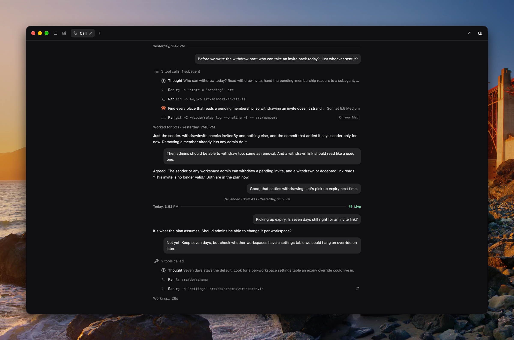

### The plan is one document

A plan is now one Markdown document you edit in place, its title inline, and the
tab, the sidebar, and ⌘K follow the title as you type. New plans start as a copy
of your account's template, which you write in Settings › Plan template, with a
version history of its own. The default template reads like a design doc between
teammates: context, goal, approach, interfaces, alternatives, hard parts,
testing, and open questions. Luke writes each note under whichever of your
headings it belongs to, and plans from earlier releases carry over as documents.
([#2114](https://github.com/ReviewStage/luke/pull/2114),
[#2182](https://github.com/ReviewStage/luke/pull/2182),
[#2186](https://github.com/ReviewStage/luke/pull/2186),
[#2190](https://github.com/ReviewStage/luke/pull/2190),
[#2193](https://github.com/ReviewStage/luke/pull/2193),
[#2219](https://github.com/ReviewStage/luke/pull/2219),
[#2220](https://github.com/ReviewStage/luke/pull/2220),
[#2226](https://github.com/ReviewStage/luke/pull/2226),
[#2248](https://github.com/ReviewStage/luke/pull/2248),
[#2275](https://github.com/ReviewStage/luke/pull/2275),
[#2315](https://github.com/ReviewStage/luke/pull/2315),
[#2317](https://github.com/ReviewStage/luke/pull/2317),
[#2320](https://github.com/ReviewStage/luke/pull/2320),
[#2331](https://github.com/ReviewStage/luke/pull/2331))

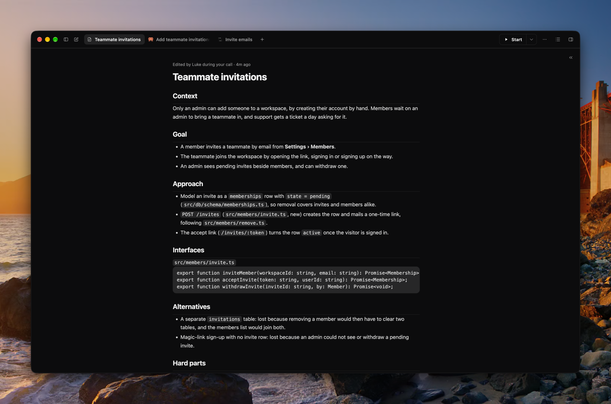

### Version history

Every save to a plan is kept. Version history, in the plan's ⋯ menu, takes the
whole window the way Settings does: each version stands under who wrote it, a
version of several changes opens the sections it changed, Open goes to where it
was written, and Restore puts it back as a new version, so a restore can be
undone too. Each section says who last edited it, and that line opens the
version.
([#2011](https://github.com/ReviewStage/luke/pull/2011),
[#2017](https://github.com/ReviewStage/luke/pull/2017),
[#2025](https://github.com/ReviewStage/luke/pull/2025),
[#2042](https://github.com/ReviewStage/luke/pull/2042),
[#2063](https://github.com/ReviewStage/luke/pull/2063),
[#2147](https://github.com/ReviewStage/luke/pull/2147),
[#2254](https://github.com/ReviewStage/luke/pull/2254),
[#2261](https://github.com/ReviewStage/luke/pull/2261),
[#2272](https://github.com/ReviewStage/luke/pull/2272),
[#2292](https://github.com/ReviewStage/luke/pull/2292))

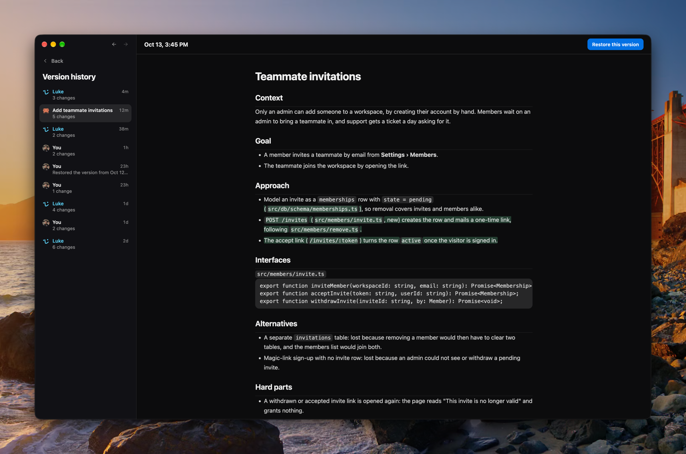

### The Inbox

Coding agents post what they need from you, a decision, a manual step, or a
question, to the plan's Inbox rather than leaving it in a transcript. An item
can carry text, links, exact lines of the repository, and pictures the agent
took in its sandbox, and you answer it in the plan's Inbox tab. The sidebar's
Inbox lists every plan with items waiting and counts them, and a new item raises
a notification and a badge on Luke's Dock icon.
([#2161](https://github.com/ReviewStage/luke/pull/2161),
[#2162](https://github.com/ReviewStage/luke/pull/2162),
[#2163](https://github.com/ReviewStage/luke/pull/2163),
[#2216](https://github.com/ReviewStage/luke/pull/2216),
[#2218](https://github.com/ReviewStage/luke/pull/2218),
[#2228](https://github.com/ReviewStage/luke/pull/2228),
[#2238](https://github.com/ReviewStage/luke/pull/2238),
[#2258](https://github.com/ReviewStage/luke/pull/2258),
[#2288](https://github.com/ReviewStage/luke/pull/2288),
[#2312](https://github.com/ReviewStage/luke/pull/2312),
[#2327](https://github.com/ReviewStage/luke/pull/2327),
[#2392](https://github.com/ReviewStage/luke/pull/2392))

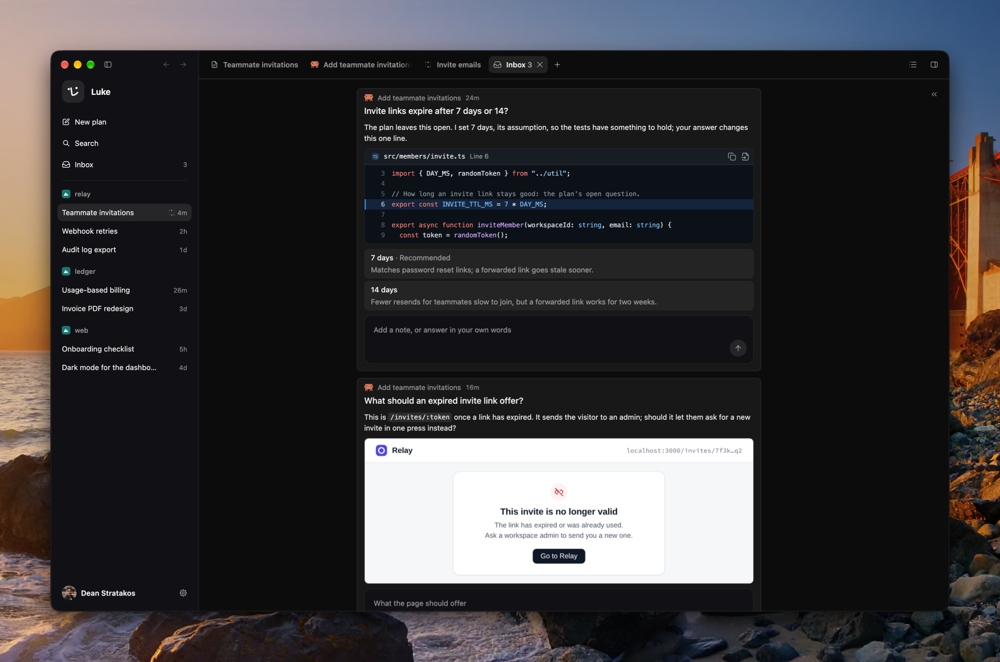

### The Changes tab

Once a coding agent opens a pull request, its Changes tab shows the diff file by
file, beside the file tree narrowed to the changed files, with the file count,
the lines added and removed, and a link to the files on GitHub. Open it from the
agent's Changes chip, the side panel's +, the summary, or ⌘K.
([#2307](https://github.com/ReviewStage/luke/pull/2307),
[#2395](https://github.com/ReviewStage/luke/pull/2395))

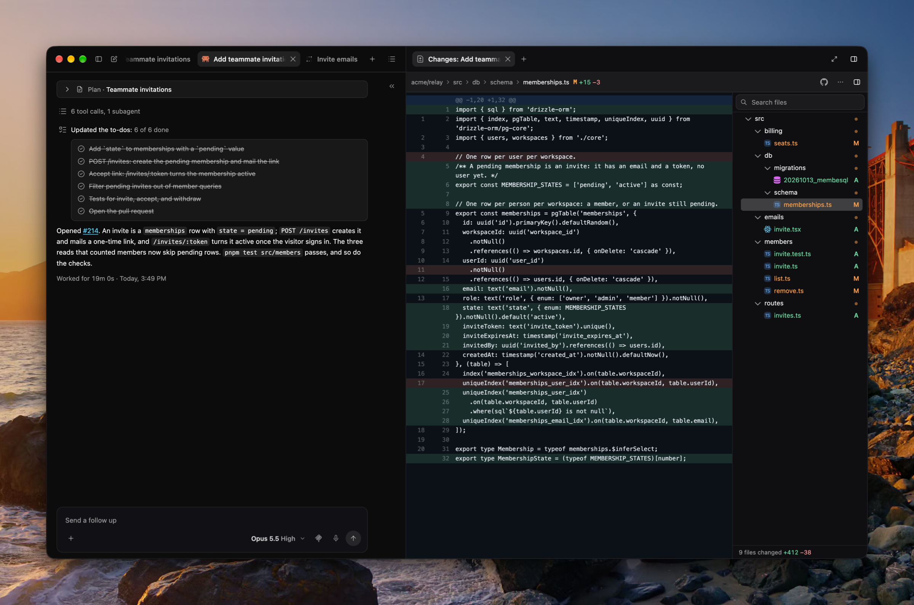

### Skills

Type / in a coding agent's message box to list the agent skills in the plan's
repository (.agents/skills and .claude/skills). The one you pick is a chip the
agent loads, and a chip in a sent message opens the skill's SKILL.md in a File
tab. Luke and coding agents are offered the repository's skills on their own
too, and load one when it fits.
([#2325](https://github.com/ReviewStage/luke/pull/2325),
[#2334](https://github.com/ReviewStage/luke/pull/2334),
[#2337](https://github.com/ReviewStage/luke/pull/2337),
[#2375](https://github.com/ReviewStage/luke/pull/2375),
[#2394](https://github.com/ReviewStage/luke/pull/2394))

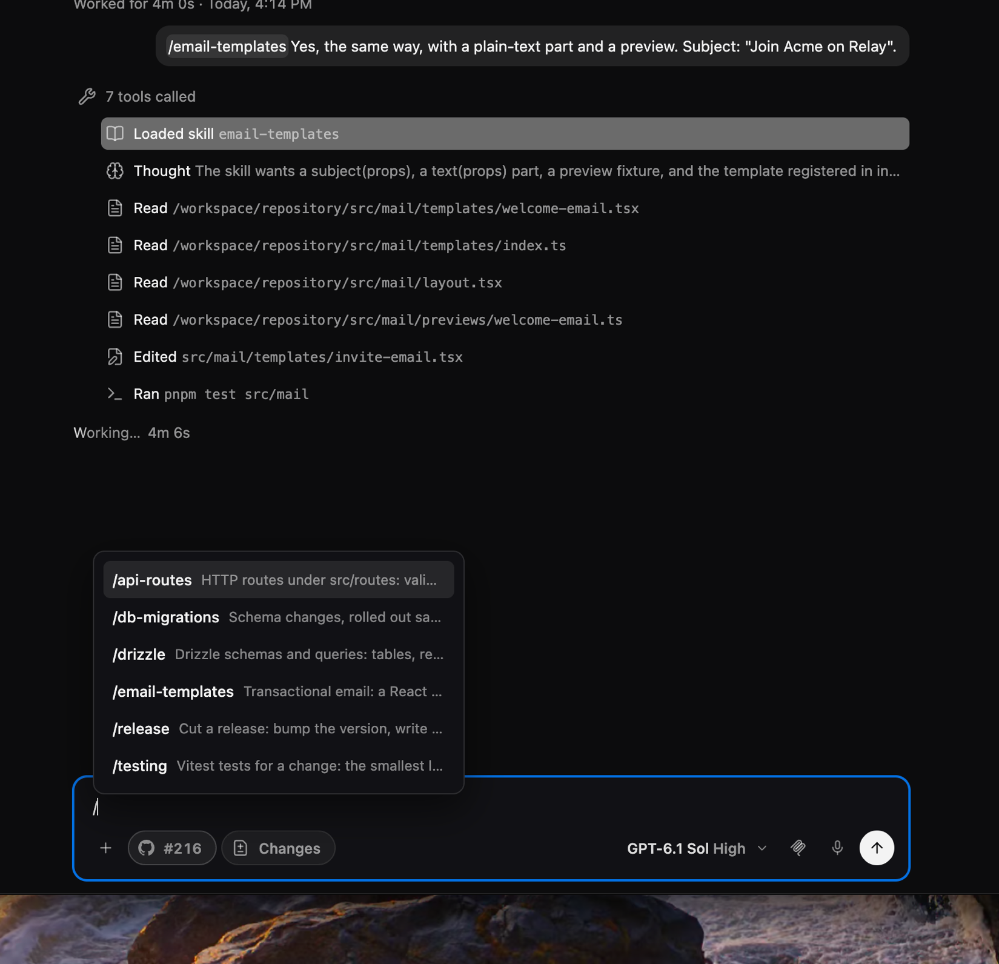

### Commands on your Mac

Luke, coding agents, and their subagents can run a shell command on your Mac. It
runs in your login shell from your home folder, with no approval step, and draws
in the transcript as a command row tagged On your Mac, with what it printed. It
is on by default, and Settings › General › Let agents run commands on this Mac
turns it off.
([#2359](https://github.com/ReviewStage/luke/pull/2359),
[#2374](https://github.com/ReviewStage/luke/pull/2374),
[#2376](https://github.com/ReviewStage/luke/pull/2376),
[#2388](https://github.com/ReviewStage/luke/pull/2388))

### Luke and coding agents share one runtime

Luke's planning model now runs on the same agent runtime as coding agents, so
both have the same tools: the repository's skills, your integrations, the web,
commands on your Mac, and pages. Both hand work to subagents the same way:
Luke's subagents run in the background so the call keeps going, and a coding
agent can wait on its subagent or work beside it. A message to a coding agent no
longer stops a subagent it is waiting on, and every subagent row names the model
and effort it ran on. Every model call on Luke's key, a coding agent's and each
generated title included, now counts toward your account's usage.
([#2132](https://github.com/ReviewStage/luke/pull/2132),
[#2244](https://github.com/ReviewStage/luke/pull/2244),
[#2363](https://github.com/ReviewStage/luke/pull/2363),
[#2365](https://github.com/ReviewStage/luke/pull/2365),
[#2367](https://github.com/ReviewStage/luke/pull/2367),
[#2372](https://github.com/ReviewStage/luke/pull/2372),
[#2386](https://github.com/ReviewStage/luke/pull/2386),
[#2387](https://github.com/ReviewStage/luke/pull/2387),
[#2402](https://github.com/ReviewStage/luke/pull/2402),
[#2403](https://github.com/ReviewStage/luke/pull/2403))

### Pages

Luke and coding agents can show you an interactive page, such as a mockup or a
comparison, in a Page tab in the side panel, drawn in a sandboxed frame. Each
page keeps its versions, and the side panel's + lists the plan's pages.
([#2360](https://github.com/ReviewStage/luke/pull/2360),
[#2362](https://github.com/ReviewStage/luke/pull/2362),
[#2364](https://github.com/ReviewStage/luke/pull/2364),
[#2370](https://github.com/ReviewStage/luke/pull/2370))

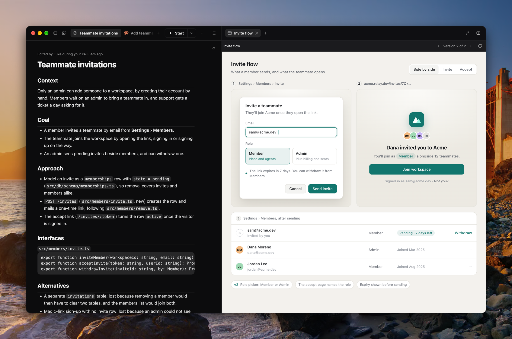

### Integrations

Connect Linear, Notion, and Sentry in Settings › Integrations, and Luke, coding
agents, and their subagents use them through each service's own MCP server. The
MCP button in a coding agent's message box lists each server's tools, switches a
server off for that chat, and connects one in place.
([#2070](https://github.com/ReviewStage/luke/pull/2070),
[#2319](https://github.com/ReviewStage/luke/pull/2319),
[#2328](https://github.com/ReviewStage/luke/pull/2328),
[#2329](https://github.com/ReviewStage/luke/pull/2329),
[#2333](https://github.com/ReviewStage/luke/pull/2333),
[#2336](https://github.com/ReviewStage/luke/pull/2336),
[#2358](https://github.com/ReviewStage/luke/pull/2358))

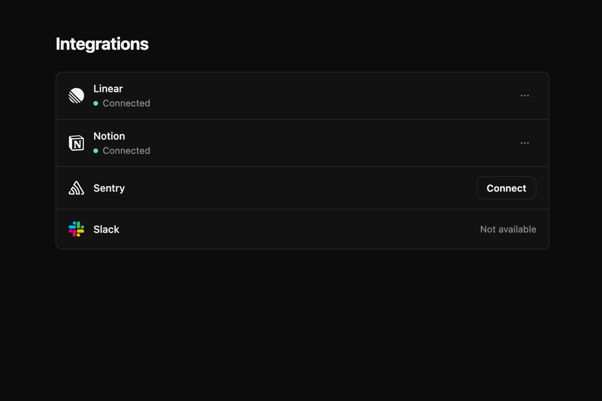

### The call follows you

A call keeps going when you switch plans, open Settings, or leave Luke. While
its plan is out of sight, the call bar stands at the foot of the sidebar, in the
window's corner, or in a floating window over other apps, with a button back to
the call's plan. Starting a call on another plan asks first.
([#2123](https://github.com/ReviewStage/luke/pull/2123),
[#2136](https://github.com/ReviewStage/luke/pull/2136),
[#2169](https://github.com/ReviewStage/luke/pull/2169),
[#2185](https://github.com/ReviewStage/luke/pull/2185),
[#2209](https://github.com/ReviewStage/luke/pull/2209),
[#2224](https://github.com/ReviewStage/luke/pull/2224),
[#2251](https://github.com/ReviewStage/luke/pull/2251))

### Pin, archive, and group plans

The sidebar groups plans by repository, each row with when it last changed, and
each repository has a + that starts a plan on it. Pin a plan or a repository to
keep it on top on every Mac you sign in on, and archive a plan to put it away
read-only; Delete is now Permanently delete. A plan's hover card shows its
repository, its coding agents, and their pull requests.
([#1992](https://github.com/ReviewStage/luke/pull/1992),
[#2001](https://github.com/ReviewStage/luke/pull/2001),
[#2027](https://github.com/ReviewStage/luke/pull/2027),
[#2028](https://github.com/ReviewStage/luke/pull/2028),
[#2034](https://github.com/ReviewStage/luke/pull/2034),
[#2060](https://github.com/ReviewStage/luke/pull/2060),
[#2064](https://github.com/ReviewStage/luke/pull/2064),
[#2068](https://github.com/ReviewStage/luke/pull/2068),
[#2074](https://github.com/ReviewStage/luke/pull/2074),
[#2120](https://github.com/ReviewStage/luke/pull/2120))

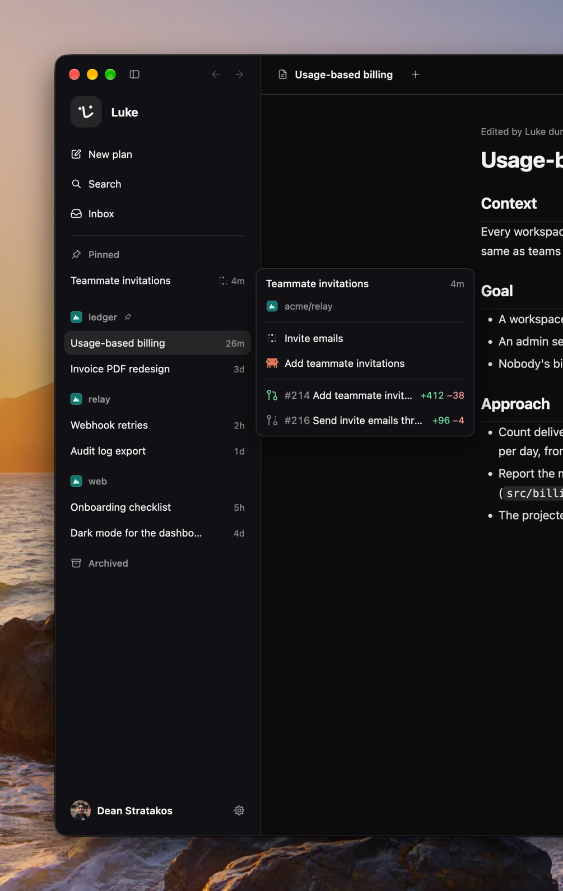

### A command palette

⌘K opens any plan, coding agent, subagent, setting, or command, and any file in
the open plan's repository, with a filter for each kind.
([#2010](https://github.com/ReviewStage/luke/pull/2010),
[#2192](https://github.com/ReviewStage/luke/pull/2192),
[#2212](https://github.com/ReviewStage/luke/pull/2212),
[#2399](https://github.com/ReviewStage/luke/pull/2399))

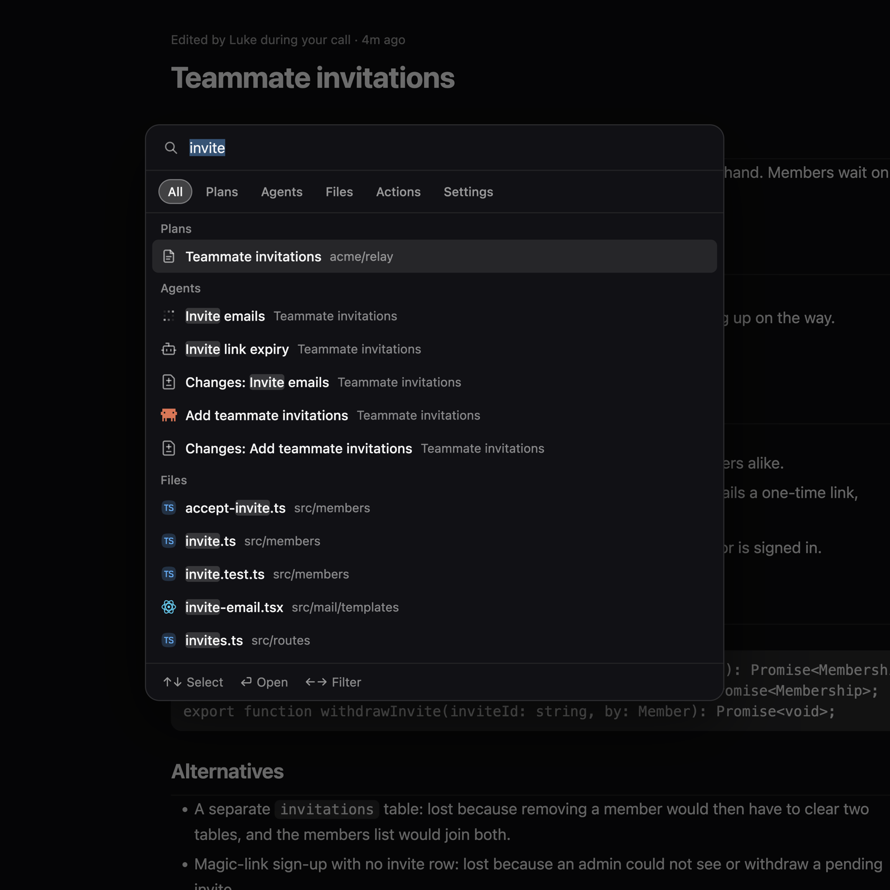

### Improvements

- Coding agents open as tabs in the plan's own column, beside the plan, with a +
  of their own ([#2076](https://github.com/ReviewStage/luke/pull/2076),
  [#2077](https://github.com/ReviewStage/luke/pull/2077))
- A summary at the plan column's right lists its tabs, coding agents, subagents,
  and files, pinned open, folded to a rail, or hung as a card
  ([#2105](https://github.com/ReviewStage/luke/pull/2105),
  [#2115](https://github.com/ReviewStage/luke/pull/2115),
  [#2318](https://github.com/ReviewStage/luke/pull/2318))
- Attach files to a message to a coding agent with the + beside Send, by
  pasting, or by dropping them
  ([#2083](https://github.com/ReviewStage/luke/pull/2083),
  [#2085](https://github.com/ReviewStage/luke/pull/2085),
  [#2116](https://github.com/ReviewStage/luke/pull/2116),
  [#2159](https://github.com/ReviewStage/luke/pull/2159))
- Dictate into a coding agent's message box or the new-plan composer with the
  mic button ([#2106](https://github.com/ReviewStage/luke/pull/2106),
  [#2107](https://github.com/ReviewStage/luke/pull/2107))
- A coding agent keeps a live to-do list in its transcript
  ([#2075](https://github.com/ReviewStage/luke/pull/2075))
- A coding agent watches its pull request's CI and fixes what fails, where the
  GitHub App may read the checks
  ([#2058](https://github.com/ReviewStage/luke/pull/2058))
- Archive a coding agent from its tab or the summary, and bring it back from the
  summary's Archived fold
  ([#2252](https://github.com/ReviewStage/luke/pull/2252),
  [#2276](https://github.com/ReviewStage/luke/pull/2276))
- Settings › Coding agents takes your own Anthropic and OpenAI API keys, and
  coding agents run on them
  ([#2078](https://github.com/ReviewStage/luke/pull/2078),
  [#2079](https://github.com/ReviewStage/luke/pull/2079),
  [#2080](https://github.com/ReviewStage/luke/pull/2080),
  [#2335](https://github.com/ReviewStage/luke/pull/2335))
- The model picker offers a model's smaller context window, per agent or as the
  default ([#2046](https://github.com/ReviewStage/luke/pull/2046),
  [#2047](https://github.com/ReviewStage/luke/pull/2047))
- The File tab has a file tree that searches the whole repository, breadcrumbs,
  back and forward, copy and download, and a link to the file on GitHub
  ([#2051](https://github.com/ReviewStage/luke/pull/2051),
  [#2081](https://github.com/ReviewStage/luke/pull/2081),
  [#2082](https://github.com/ReviewStage/luke/pull/2082),
  [#2086](https://github.com/ReviewStage/luke/pull/2086),
  [#2125](https://github.com/ReviewStage/luke/pull/2125),
  [#2131](https://github.com/ReviewStage/luke/pull/2131),
  [#2139](https://github.com/ReviewStage/luke/pull/2139),
  [#2154](https://github.com/ReviewStage/luke/pull/2154))
- A file Luke showed opens with his note over the lines he showed
  ([#2264](https://github.com/ReviewStage/luke/pull/2264))
- ⌘F finds within the tab you are in
  ([#2156](https://github.com/ReviewStage/luke/pull/2156))
- A Zoom setting under Settings › Appearance, stepped by ⌘+, ⌘−, and ⌘0
  ([#2053](https://github.com/ReviewStage/luke/pull/2053))
- The window reopens where you left it, ⌘W with no tab open closes it, ⌃⌘F goes
  full screen, and Quit asks first during a call
  ([#2160](https://github.com/ReviewStage/luke/pull/2160))
- Settings pages name themselves at their top and group their rows in cards, and
  anything that cannot be undone asks in a dialog
  ([#2340](https://github.com/ReviewStage/luke/pull/2340),
  [#2346](https://github.com/ReviewStage/luke/pull/2346),
  [#2347](https://github.com/ReviewStage/luke/pull/2347),
  [#2348](https://github.com/ReviewStage/luke/pull/2348),
  [#2349](https://github.com/ReviewStage/luke/pull/2349))
- The sidebar's account opens a menu with Settings, the changelog, and feedback,
  and the gear beside it goes straight to Settings
  ([#2232](https://github.com/ReviewStage/luke/pull/2232))
- Toasts stack in the window's corner, and archiving, deleting, and an agent's
  end offer an action in theirs
  ([#2013](https://github.com/ReviewStage/luke/pull/2013),
  [#2118](https://github.com/ReviewStage/luke/pull/2118))
- Side panel tabs drag to any place, have a right-click menu, and pin to the
  sidebar ([#1991](https://github.com/ReviewStage/luke/pull/1991),
  [#2057](https://github.com/ReviewStage/luke/pull/2057),
  [#2061](https://github.com/ReviewStage/luke/pull/2061))
- Each coding agent wears its harness's mark and each subagent its model's, with
  a ring while it works and an alert when it fails
  ([#2067](https://github.com/ReviewStage/luke/pull/2067),
  [#2189](https://github.com/ReviewStage/luke/pull/2189),
  [#2290](https://github.com/ReviewStage/luke/pull/2290))
- An agent's tab hovers a card with its model, its latest step, and when it last
  moved ([#2049](https://github.com/ReviewStage/luke/pull/2049))
- A finished turn says how long it worked, and that line's card names its model,
  its tokens, and what it cached
  ([#1986](https://github.com/ReviewStage/luke/pull/1986),
  [#2038](https://github.com/ReviewStage/luke/pull/2038),
  [#2155](https://github.com/ReviewStage/luke/pull/2155),
  [#2167](https://github.com/ReviewStage/luke/pull/2167))
- A context ring beside the agent's model shows how full its context window is
  ([#2014](https://github.com/ReviewStage/luke/pull/2014))
- The model picker shows the newest model of each family until you search
  ([#2031](https://github.com/ReviewStage/luke/pull/2031))
- Coding agents are titled from their first exchange, and subagents get short
  titles too ([#2069](https://github.com/ReviewStage/luke/pull/2069),
  [#2150](https://github.com/ReviewStage/luke/pull/2150))
- Luke asks one question at a time on a call
  ([#1994](https://github.com/ReviewStage/luke/pull/1994))
- Links in a transcript or an Inbox item open in your browser
  ([#2300](https://github.com/ReviewStage/luke/pull/2300),
  [#2352](https://github.com/ReviewStage/luke/pull/2352))
- Folds and popovers open and close with motion, and every scroller draws one
  thin scrollbar ([#2253](https://github.com/ReviewStage/luke/pull/2253),
  [#2311](https://github.com/ReviewStage/luke/pull/2311),
  [#2321](https://github.com/ReviewStage/luke/pull/2321))
- One focus ring for every control and every field
  ([#2304](https://github.com/ReviewStage/luke/pull/2304),
  [#2357](https://github.com/ReviewStage/luke/pull/2357))
- Settings › Updates names the commit a build was cut from
  ([#2408](https://github.com/ReviewStage/luke/pull/2408))
- A repository is drawn with its owner's picture
  ([#2026](https://github.com/ReviewStage/luke/pull/2026))
- Actions in Luke's own menus are named without a trailing ellipsis
  ([#2416](https://github.com/ReviewStage/luke/pull/2416))

### Fixes

- Fixed a coding agent on Fast failing at its first step: Fast now runs on
  Luke's Anthropic key, and says it is unavailable on your own key
  ([#2239](https://github.com/ReviewStage/luke/pull/2239),
  [#2366](https://github.com/ReviewStage/luke/pull/2366))
- Fixed Luke not ending the call when you asked him to
  ([#2054](https://github.com/ReviewStage/luke/pull/2054))
- Fixed the notetaker leaving out what a call settled unless you said yes to it
  ([#2040](https://github.com/ReviewStage/luke/pull/2040))
- Fixed coding agent notifications not arriving
  ([#2052](https://github.com/ReviewStage/luke/pull/2052))
- Fixed a deleted plan keeping its calls, its running coding agents, and their
  sandboxes ([#2298](https://github.com/ReviewStage/luke/pull/2298),
  [#2303](https://github.com/ReviewStage/luke/pull/2303),
  [#2326](https://github.com/ReviewStage/luke/pull/2326))
- Fixed a deleted account keeping its Linear grant
  ([#2299](https://github.com/ReviewStage/luke/pull/2299))
- Fixed a coding agent started with only a file never starting
  ([#2119](https://github.com/ReviewStage/luke/pull/2119))
- Fixed a coding agent reading as running after its messages were merged into
  one ([#2048](https://github.com/ReviewStage/luke/pull/2048))
- Fixed asking for a coding agent also starting a background worker
  ([#2127](https://github.com/ReviewStage/luke/pull/2127))
- Fixed a File tab that could not read its file
  ([#2030](https://github.com/ReviewStage/luke/pull/2030))
- Fixed a file Luke showed opening at main's head rather than the commit he read
  ([#2316](https://github.com/ReviewStage/luke/pull/2316))
- Fixed the File tab copying line numbers with the code
  ([#2330](https://github.com/ReviewStage/luke/pull/2330))
- Fixed a coding agent's sandbox too small to run the repository's linter
  ([#2016](https://github.com/ReviewStage/luke/pull/2016))
- Fixed the sidebar saying there were no plans before the list was read
  ([#2294](https://github.com/ReviewStage/luke/pull/2294))
- Fixed popovers opening under the whiteboard
  ([#2045](https://github.com/ReviewStage/luke/pull/2045))
- Fixed the message box's popovers opening away from their button
  ([#2037](https://github.com/ReviewStage/luke/pull/2037))
- Fixed Luke failing to read a newer service's answers
  ([#2210](https://github.com/ReviewStage/luke/pull/2210))

### Misc

- Updated the avatar set with room around the face for profile photos
  ([#2021](https://github.com/ReviewStage/luke/pull/2021))
- Added screenshots to the 0.7.0 through 0.11.0 entries, and linked every entry
  to its pull requests ([#2041](https://github.com/ReviewStage/luke/pull/2041),
  [#2062](https://github.com/ReviewStage/luke/pull/2062))
- Updated PRIVACY.md to describe what Luke keeps today
  ([#2287](https://github.com/ReviewStage/luke/pull/2287))
- Updated the service to delete a finished agent run's history at once, and to
  log a failure's kind but never its detail
  ([#2310](https://github.com/ReviewStage/luke/pull/2310),
  [#2332](https://github.com/ReviewStage/luke/pull/2332))

## 0.11.0 — 2026-10-11

### Coding agents work alongside you

Ask Luke in a planning call how a coding agent is doing, or tell one what to
do, and Luke answers or steers the right agent. A coding agent can now edit
the plan the way Luke's notetaker does, and the plan says which agent made
each edit. New coding agent in the side panel's + opens a draft agent whose
first message is its task, so it starts on your task instead of the plan.
Each agent gets a generated title, and you can rename it from its tab's
right-click menu.
([#1958](https://github.com/ReviewStage/luke/pull/1958),
[#1959](https://github.com/ReviewStage/luke/pull/1959),
[#1960](https://github.com/ReviewStage/luke/pull/1960),
[#1962](https://github.com/ReviewStage/luke/pull/1962),
[#1964](https://github.com/ReviewStage/luke/pull/1964))

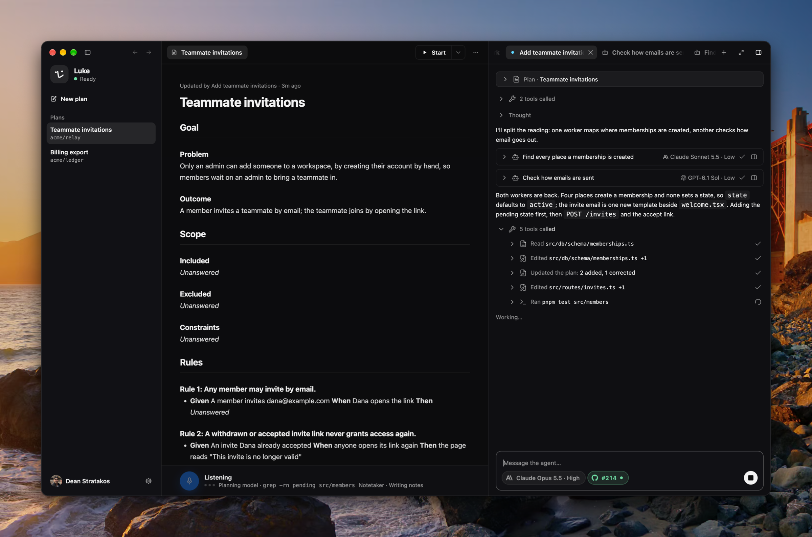

### Subagents

A coding agent hands scoped work to read-only workers and picks each one's
model and effort. Each worker draws as a subagent row in the agent's
transcript, and the row opens the worker's own tab in the side panel.
([#1954](https://github.com/ReviewStage/luke/pull/1954),
[#1961](https://github.com/ReviewStage/luke/pull/1961))

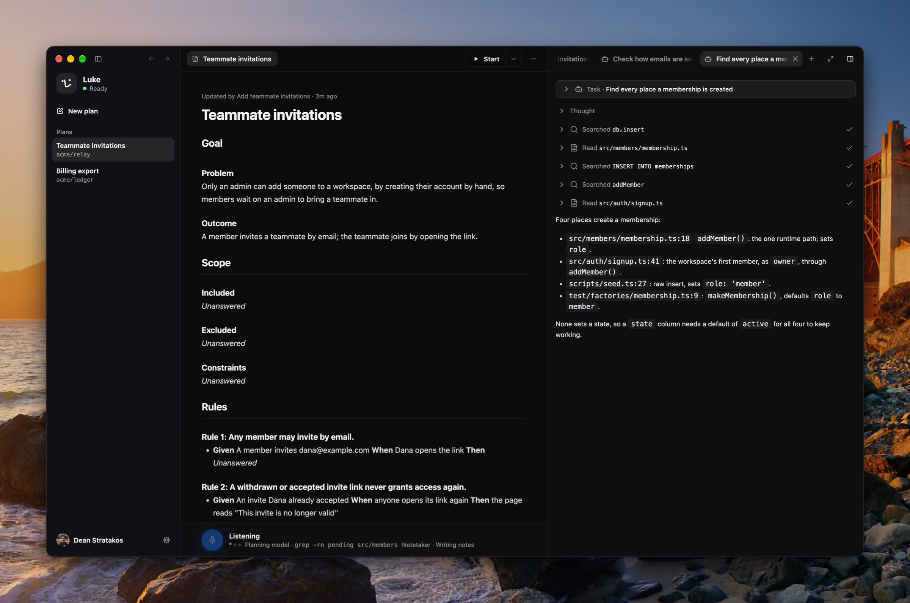

### Improvements

- Each coding agent shows what it costs in tokens and dollars
  ([#1957](https://github.com/ReviewStage/luke/pull/1957))
- The pull request pill shows the pull request of the branch checked out in
  the agent's sandbox, whatever branches it moved through
  ([#1965](https://github.com/ReviewStage/luke/pull/1965))
- The Code tab shows every snippet Luke showed on the plan, and a snippet
  opens its whole file in a File tab
  ([#1956](https://github.com/ReviewStage/luke/pull/1956),
  [#1967](https://github.com/ReviewStage/luke/pull/1967))
- The side panel's + opens and closes coding agent and subagent tabs, with
  the same searchable menu the pickers use
  ([#1950](https://github.com/ReviewStage/luke/pull/1950),
  [#1952](https://github.com/ReviewStage/luke/pull/1952))
- Side panel tabs scroll sideways instead of shrinking to icons, and the tab
  strip fades only an edge that hides a tab
  ([#1947](https://github.com/ReviewStage/luke/pull/1947),
  [#1955](https://github.com/ReviewStage/luke/pull/1955))
- Every transcript uses the Work tab's style
  ([#1943](https://github.com/ReviewStage/luke/pull/1943))
- The agent's model shows in the message box
  ([#1944](https://github.com/ReviewStage/luke/pull/1944))
- Luke starts reading the plan's repository the moment a call starts, while
  he greets you ([#1938](https://github.com/ReviewStage/luke/pull/1938))
- Luke always shows in the Dock and ⌘Tab
  ([#1941](https://github.com/ReviewStage/luke/pull/1941))
- The theme defaults to System
  ([#1949](https://github.com/ReviewStage/luke/pull/1949))

### Fixes

- Fixed the Code tab jittering as it scrolled
  ([#1972](https://github.com/ReviewStage/luke/pull/1972))
- Fixed the Work and Code tabs losing a plan's work after a restart
  ([#1951](https://github.com/ReviewStage/luke/pull/1951))
- Fixed a dragged tab stopping short of either end of the tab strip
  ([#1955](https://github.com/ReviewStage/luke/pull/1955))
- Fixed a coding agent's shell starting outside its checkout
  ([#1946](https://github.com/ReviewStage/luke/pull/1946))
- Fixed a shadow behind the composer's card
  ([#1939](https://github.com/ReviewStage/luke/pull/1939))

### Misc

- Removed the Show Luke in the Dock setting
  ([#1941](https://github.com/ReviewStage/luke/pull/1941))
- Removed the PostHog extensions Luke never used from the app bundle
  ([#1969](https://github.com/ReviewStage/luke/pull/1969))

## 0.10.0 — 2026-10-10

### Coding agents

Start a coding agent from a plan. Start in the plan toolbar hands the plan to
an agent working in a cloud sandbox on the plan's repository, on your default
model, and its chevron picks the model, its effort, and Fast for this run from
the Anthropic and OpenAI models on offer. Each agent gets a tab in the side
panel beside Board, Code, and Transcript, with a live transcript of what it
thought, ran, and wrote, a message box under it that steers the agent
mid-run, and Stop. The tab's head wears the agent's branch, then its pull
request with its state and checks, and offers Open pull request, Copy branch
name, Copy checkout command, and View changes on GitHub. A macOS notification
says when an agent finishes and names the pull request it opened, and its tab
wears a dot until you look. Settings › Coding agents holds the default model
and effort.
([#1862](https://github.com/ReviewStage/luke/pull/1862),
[#1871](https://github.com/ReviewStage/luke/pull/1871),
[#1872](https://github.com/ReviewStage/luke/pull/1872),
[#1877](https://github.com/ReviewStage/luke/pull/1877),
[#1899](https://github.com/ReviewStage/luke/pull/1899),
[#1900](https://github.com/ReviewStage/luke/pull/1900),
[#1903](https://github.com/ReviewStage/luke/pull/1903),
[#1906](https://github.com/ReviewStage/luke/pull/1906),
[#1907](https://github.com/ReviewStage/luke/pull/1907),
[#1919](https://github.com/ReviewStage/luke/pull/1919))

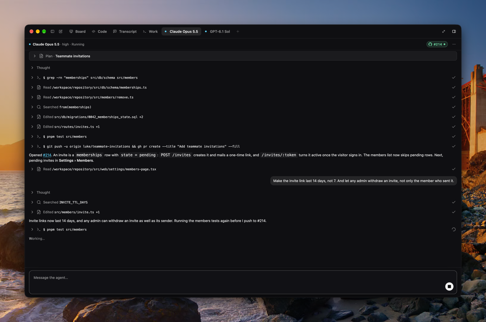

### Planning on a GitHub repository

Each plan is about a GitHub repository, reached through the Luke GitHub App.
The new-plan composer's chip picks it, with your recent repositories, a search
over every repository the App reaches, and a link to install the App; the
plan menu offers Change repository… and Open on GitHub. Luke reads the
repository and shows its code from a checkout in the cloud, so planning no
longer runs commands on your Mac. The local-folder path is gone: a plan from
an earlier release opens on the repository picker. Sign in with GitHub now
goes through the Luke GitHub App too.
([#1863](https://github.com/ReviewStage/luke/pull/1863),
[#1866](https://github.com/ReviewStage/luke/pull/1866),
[#1868](https://github.com/ReviewStage/luke/pull/1868),
[#1870](https://github.com/ReviewStage/luke/pull/1870),
[#1877](https://github.com/ReviewStage/luke/pull/1877),
[#1885](https://github.com/ReviewStage/luke/pull/1885))

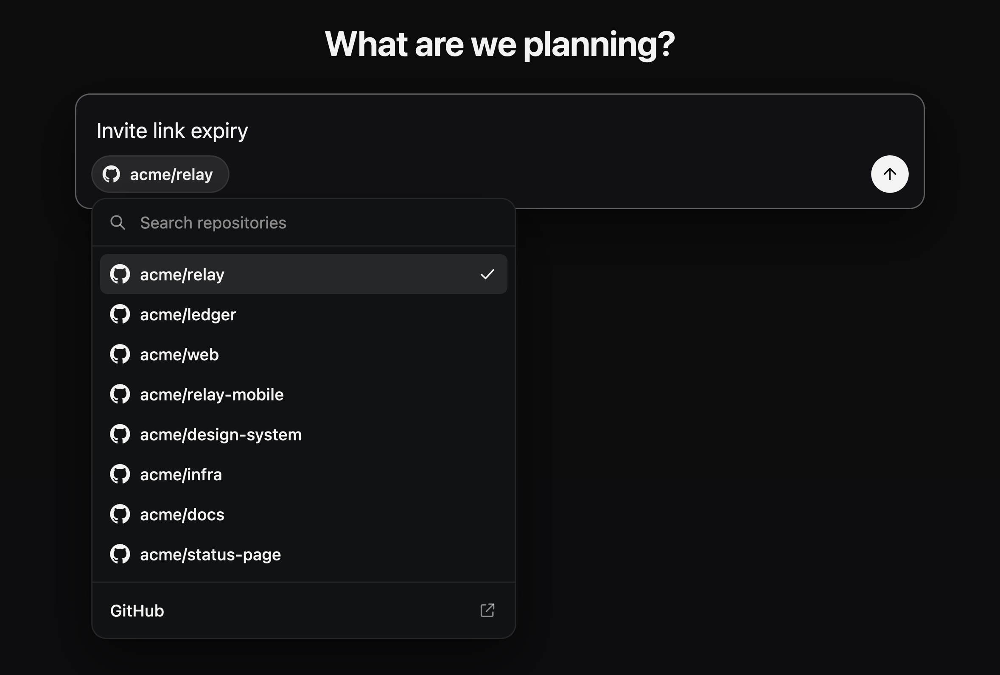

### Improvements

- Back and forward through plans and Settings, with ⌘[ and ⌘], title-bar
  buttons, a Go menu, and the mouse's back and forward buttons
  ([#1921](https://github.com/ReviewStage/luke/pull/1921))
- A Theme setting under Settings › Appearance: Light, Dark, or System
  ([#1934](https://github.com/ReviewStage/luke/pull/1934))
- A light palette for the window, the code, and the whiteboard
  ([#1936](https://github.com/ReviewStage/luke/pull/1936))
- Drag the side panel's tabs into a new order, or move one with ⇧⌘← and ⇧⌘→
  ([#1935](https://github.com/ReviewStage/luke/pull/1935))
- The side panel drags out until the document's floor, and full screen asks a
  longer pull ([#1923](https://github.com/ReviewStage/luke/pull/1923))
- A sleeker sign-in that waits in place while the browser answers, with Cancel
  ([#1926](https://github.com/ReviewStage/luke/pull/1926))
- Send feedback and Suggest a feature open a standard dialog, with screenshots
  attached, pasted, or dropped
  ([#1928](https://github.com/ReviewStage/luke/pull/1928))
- Escape leaves Settings
  ([#1921](https://github.com/ReviewStage/luke/pull/1921))
- Every Settings pop-up is the app's own searchable menu, and the effort is a
  segmented control ([#1877](https://github.com/ReviewStage/luke/pull/1877),
  [#1888](https://github.com/ReviewStage/luke/pull/1888))
- The voice transcript reads as a conversation, each call from a divider with
  its day and time ([#1877](https://github.com/ReviewStage/luke/pull/1877),
  [#1898](https://github.com/ReviewStage/luke/pull/1898))
- New plan and the agent's message box share one composer
  ([#1877](https://github.com/ReviewStage/luke/pull/1877),
  [#1933](https://github.com/ReviewStage/luke/pull/1933))
- Copy plan moved into the plan's ⋯ menu and keeps ⇧⌘C
  ([#1872](https://github.com/ReviewStage/luke/pull/1872),
  [#1877](https://github.com/ReviewStage/luke/pull/1877))

### Fixes

- Fixed Settings' toolbar ending Reset to defaults short of the edge
  ([#1925](https://github.com/ReviewStage/luke/pull/1925))
- Fixed glyph and labelled buttons drawing in several styles across the window
  ([#1929](https://github.com/ReviewStage/luke/pull/1929))

### Misc

- Removed the last of the notch-era window: its modes, hover machinery, and
  presentation ([#1927](https://github.com/ReviewStage/luke/pull/1927),
  [#1932](https://github.com/ReviewStage/luke/pull/1932))

## 0.9.0 — 2026-10-09

### A Work tab for what Luke thought and ran

A new Work tab in the side panel shows each planning turn like an agent
transcript: what Luke's planning model thought, the tools it called, and what
it wrote. A background worker's whole session opens from its call in the tab.
([#1893](https://github.com/ReviewStage/luke/pull/1893),
[#1894](https://github.com/ReviewStage/luke/pull/1894),
[#1895](https://github.com/ReviewStage/luke/pull/1895),
[#1901](https://github.com/ReviewStage/luke/pull/1901),
[#1904](https://github.com/ReviewStage/luke/pull/1904),
[#1905](https://github.com/ReviewStage/luke/pull/1905))

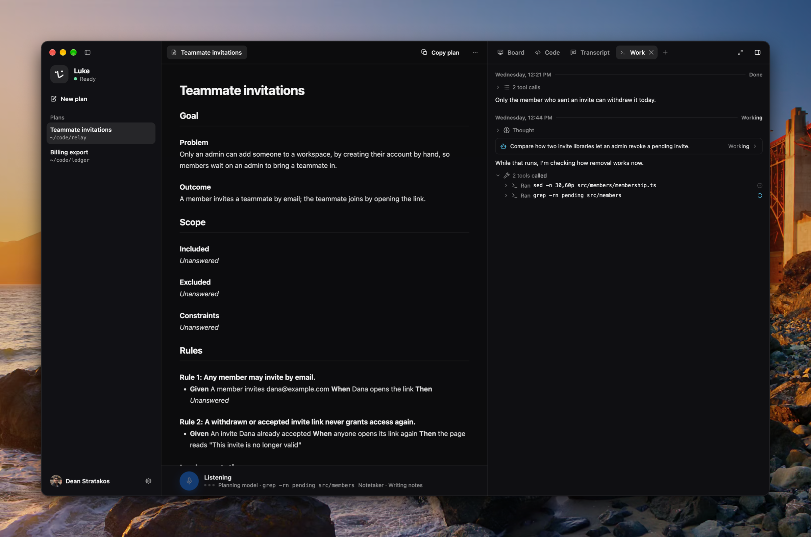

### Improvements

- The plan column and the side panel use Cursor-style tabs that go icon-only
  when narrow ([#1902](https://github.com/ReviewStage/luke/pull/1902),
  [#1910](https://github.com/ReviewStage/luke/pull/1910))
- The window uses one spacing scale throughout
  ([#1913](https://github.com/ReviewStage/luke/pull/1913))
- Transcript call headers stick flush to the top of the scroll area
  ([#1909](https://github.com/ReviewStage/luke/pull/1909))
- A tab's close button draws full size, dim at rest and brighter on hover
  ([#1912](https://github.com/ReviewStage/luke/pull/1912))

### Fixes

- Fixed Luke falling silent or losing the lead on a planning call
  ([#1908](https://github.com/ReviewStage/luke/pull/1908))
- Fixed the right-panel toggle moving and missing rapid clicks
  ([#1892](https://github.com/ReviewStage/luke/pull/1892))
- Fixed title-bar buttons showing through sliding panes
  ([#1914](https://github.com/ReviewStage/luke/pull/1914))
- Fixed New plan in the folded sidebar not leaving the new-plan page
  ([#1915](https://github.com/ReviewStage/luke/pull/1915))
- Fixed the sidebar's plan row missing its rename pencil
  ([#1915](https://github.com/ReviewStage/luke/pull/1915))

### Misc

- Removed the Quit Luke buttons from sign-in and Settings, since ⌘Q in the
  app menu quits Luke ([#1916](https://github.com/ReviewStage/luke/pull/1916))

## 0.8.0 — 2026-10-09

### A new home for your plans

Luke opens on a composer for a new plan, beside a sidebar that lists your
plans newest first. The sidebar resizes, folds away with ⌘B, and opens Settings
from one account button at its foot. Rename a plan, or delete it after a
standard confirmation, from one plan menu in the toolbar's ⋯ or a right-click
in the sidebar.
([#1826](https://github.com/ReviewStage/luke/pull/1826),
[#1827](https://github.com/ReviewStage/luke/pull/1827),
[#1831](https://github.com/ReviewStage/luke/pull/1831),
[#1835](https://github.com/ReviewStage/luke/pull/1835),
[#1836](https://github.com/ReviewStage/luke/pull/1836),
[#1842](https://github.com/ReviewStage/luke/pull/1842),
[#1847](https://github.com/ReviewStage/luke/pull/1847),
[#1856](https://github.com/ReviewStage/luke/pull/1856))

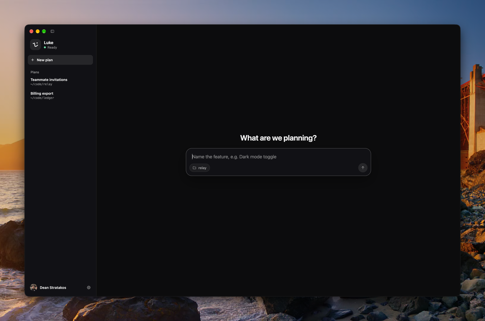

### A side panel for the board, the code, and the transcript

A plan's whiteboard, the code Luke shows, and the transcript of what was said
now sit in a right side panel with tabs. The panel runs full height, goes full
screen, and opens by itself the first time Luke draws or shows code in a plan.
Luke draws on the whiteboard as he talks, lays it out by Excalidraw's guides,
then looks at what he drew and fixes what he sees.
([#1798](https://github.com/ReviewStage/luke/pull/1798),
[#1799](https://github.com/ReviewStage/luke/pull/1799),
[#1816](https://github.com/ReviewStage/luke/pull/1816),
[#1828](https://github.com/ReviewStage/luke/pull/1828),
[#1829](https://github.com/ReviewStage/luke/pull/1829),
[#1833](https://github.com/ReviewStage/luke/pull/1833),
[#1841](https://github.com/ReviewStage/luke/pull/1841),
[#1851](https://github.com/ReviewStage/luke/pull/1851),
[#1864](https://github.com/ReviewStage/luke/pull/1864),
[#1878](https://github.com/ReviewStage/luke/pull/1878))

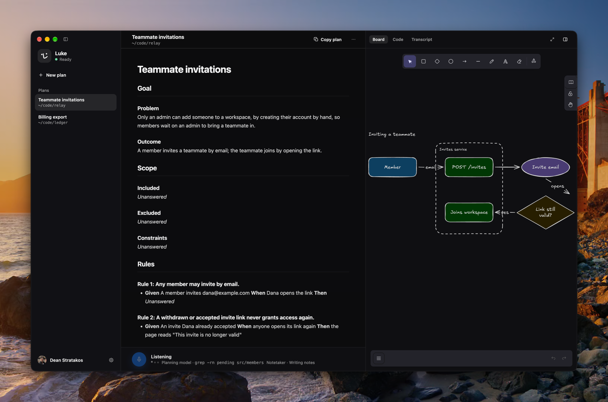

### Luke as a planning teammate

Luke plans with you rather than interviewing you: he takes notes live, doesn't
assume you already know what you want to build, and opens each call on what was
said on the plan's earlier calls. He hands slow work to a background worker and
tells you its result at a natural pause, and Stop cancels that work too.
([#1792](https://github.com/ReviewStage/luke/pull/1792),
[#1813](https://github.com/ReviewStage/luke/pull/1813),
[#1815](https://github.com/ReviewStage/luke/pull/1815),
[#1817](https://github.com/ReviewStage/luke/pull/1817),
[#1820](https://github.com/ReviewStage/luke/pull/1820),
[#1824](https://github.com/ReviewStage/luke/pull/1824),
[#1825](https://github.com/ReviewStage/luke/pull/1825))

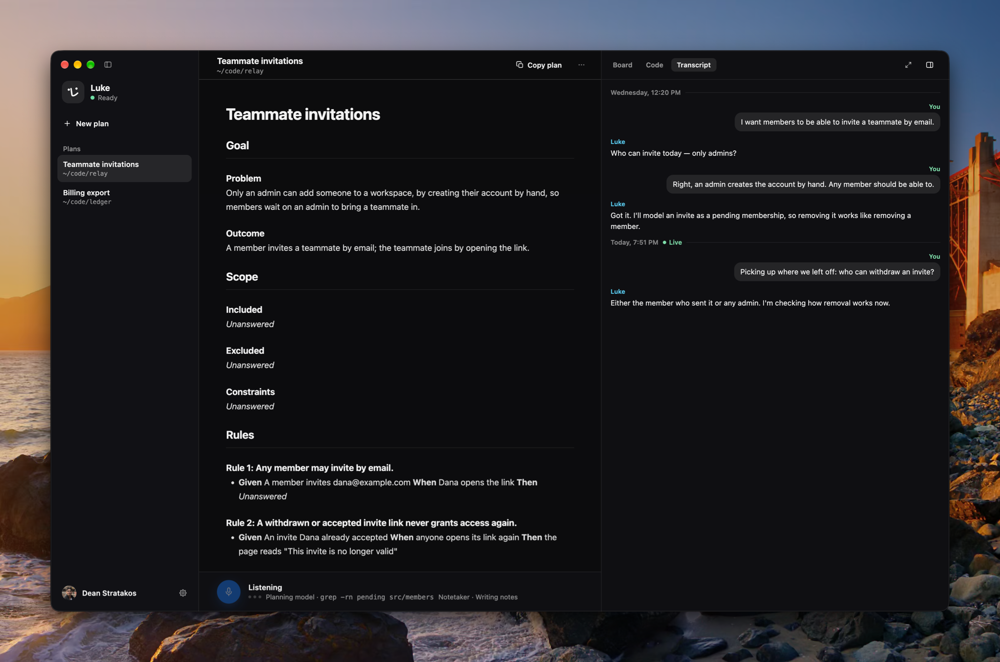

### Improvements

- Keyboard shortcuts cover the whole app and are listed in the menu bar
  ([#1844](https://github.com/ReviewStage/luke/pull/1844))
- Settings has a search field, a Back button, and Reset to defaults beside the
  page title ([#1838](https://github.com/ReviewStage/luke/pull/1838),
  [#1848](https://github.com/ReviewStage/luke/pull/1848),
  [#1859](https://github.com/ReviewStage/luke/pull/1859))
- Planning replies stream sentence by sentence, never ahead of what Luke has
  actually done ([#1802](https://github.com/ReviewStage/luke/pull/1802))
- A planning call picks up where it left off after a lost connection
  ([#1803](https://github.com/ReviewStage/luke/pull/1803))
- The stop key silences Luke at once
  ([#1795](https://github.com/ReviewStage/luke/pull/1795))
- The sidebar and side panel open and close smoothly, and snap when you drag
  past their bounds ([#1850](https://github.com/ReviewStage/luke/pull/1850))
- Usage is still counted, but there is no daily allowance anymore
  ([#1860](https://github.com/ReviewStage/luke/pull/1860))

### Fixes

- Fixed one call's end touching the next call
  ([#1818](https://github.com/ReviewStage/luke/pull/1818))
- Fixed Markdown showing up in Luke's spoken replies
  ([#1793](https://github.com/ReviewStage/luke/pull/1793))
- Fixed answers crossing between two actions run at the same time
  ([#1873](https://github.com/ReviewStage/luke/pull/1873))
- Fixed Stop not reaching a planning turn
  ([#1874](https://github.com/ReviewStage/luke/pull/1874))
- Fixed the voice losing track of a planning turn waiting on background work
  ([#1875](https://github.com/ReviewStage/luke/pull/1875))
- Fixed the window scrolling sideways when the side panel opened on Luke's code
  ([#1884](https://github.com/ReviewStage/luke/pull/1884))
- Fixed a fade band at the top of Settings pages
  ([#1857](https://github.com/ReviewStage/luke/pull/1857))
- Fixed all-caps labels left in the app
  ([#1865](https://github.com/ReviewStage/luke/pull/1865))

### Misc

- Updated the app icon to sit on Apple's macOS icon grid with its shadow
  beneath the tile ([#1845](https://github.com/ReviewStage/luke/pull/1845),
  [#1846](https://github.com/ReviewStage/luke/pull/1846))
- Removed the notch panel, the spoken introduction, the desk voice, calendar,
  the iOS and Apple Watch app, and other features no longer in use
  ([#1806](https://github.com/ReviewStage/luke/pull/1806),
  [#1807](https://github.com/ReviewStage/luke/pull/1807),
  [#1808](https://github.com/ReviewStage/luke/pull/1808),
  [#1809](https://github.com/ReviewStage/luke/pull/1809),
  [#1810](https://github.com/ReviewStage/luke/pull/1810))

## 0.7.1 — 2026-10-07

### Improvements

- Luke speaks first when a planning call opens, starting from what to build
  or from where the plan stands
  ([#1785](https://github.com/ReviewStage/luke/pull/1785))
- Luke stops asking once the plan is enough for an agent to build from, and
  says the plan is complete
  ([#1783](https://github.com/ReviewStage/luke/pull/1783))
- Web search answers faster during a planning call
  ([#1788](https://github.com/ReviewStage/luke/pull/1788))
- Luke fills your pauses with fewer "mhm"s and "okay"s
  ([#1784](https://github.com/ReviewStage/luke/pull/1784))
- You can delete an open plan from its header, after Luke asks you to confirm
  ([#1786](https://github.com/ReviewStage/luke/pull/1786))

### Fixes

- Fixed a web search cut short reading as one that found nothing
  ([#1788](https://github.com/ReviewStage/luke/pull/1788))

### Misc

- Updated the README and tryluke.dev to lead with feature planning
  ([#1787](https://github.com/ReviewStage/luke/pull/1787))

## 0.7.0 — 2026-10-06

### Plan a feature with Luke

The Plans tab holds named feature plans, each on a fixed template written for
a coding agent to pick up. Start a planning call and Luke asks one question at
a time while a notetaker writes the plan as you talk, streaming each draft to
your Mac. Point a plan at a folder on your Mac and Luke reads the code there to
answer his own questions instead of asking you; each command runs in a sandbox
with no network, no writes, and no `.env` files. He can also search the web and
read public pages, and with GitHub connected he reads your repositories.
([#1730](https://github.com/ReviewStage/luke/pull/1730),
[#1734](https://github.com/ReviewStage/luke/pull/1734),
[#1739](https://github.com/ReviewStage/luke/pull/1739),
[#1745](https://github.com/ReviewStage/luke/pull/1745),
[#1749](https://github.com/ReviewStage/luke/pull/1749),
[#1750](https://github.com/ReviewStage/luke/pull/1750),
[#1755](https://github.com/ReviewStage/luke/pull/1755),
[#1760](https://github.com/ReviewStage/luke/pull/1760),
[#1776](https://github.com/ReviewStage/luke/pull/1776),
[#1777](https://github.com/ReviewStage/luke/pull/1777),
[#1779](https://github.com/ReviewStage/luke/pull/1779))

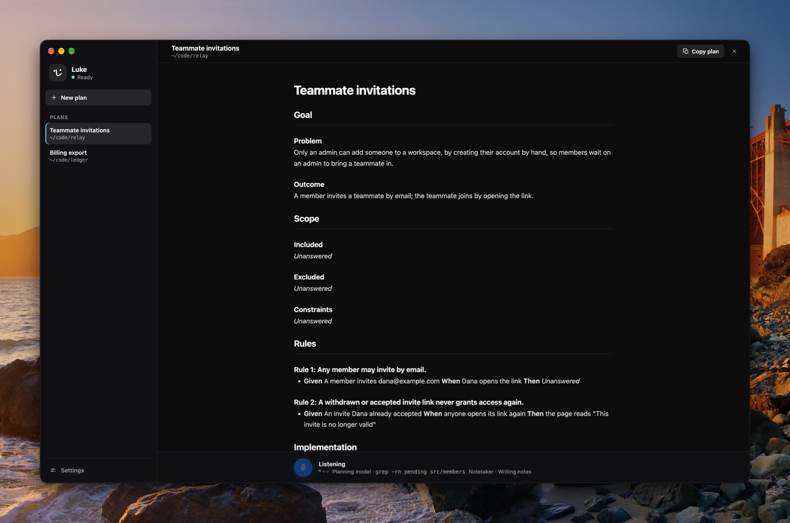

### Luke opens as a Mac app

Luke opens in an ordinary window with a Dock tile instead of the notch panel,
on two tabs: Plans and Settings. For now Luke speaks only on a planning call,
so briefings, the launch greeting, and the talk key outside a plan are off,
onboarding is skipped after sign-in, and the Sessions and Conversation tabs
are hidden.
([#1743](https://github.com/ReviewStage/luke/pull/1743),
[#1755](https://github.com/ReviewStage/luke/pull/1755),
[#1775](https://github.com/ReviewStage/luke/pull/1775),
[#1782](https://github.com/ReviewStage/luke/pull/1782))

### Improvements

- Luke runs on GPT-6.1 Sol
  ([#1772](https://github.com/ReviewStage/luke/pull/1772))
- A planning call survives a dropped connection instead of ending
  ([#1755](https://github.com/ReviewStage/luke/pull/1755),
  [#1756](https://github.com/ReviewStage/luke/pull/1756),
  [#1758](https://github.com/ReviewStage/luke/pull/1758))

### Fixes

- Fixed a planning call's plan losing sections it had already written, leaving
  them Unanswered ([#1780](https://github.com/ReviewStage/luke/pull/1780))
- Fixed the settings search drawing under a nested page's header
  ([#1644](https://github.com/ReviewStage/luke/pull/1644))

### Misc

- Updated session replay to mask every word, so a recording carries layout and
  no text ([#1494](https://github.com/ReviewStage/luke/pull/1494))
- Updated PRIVACY.md for feature plans, the planning call's notetaker, the
  folder Luke reads on your Mac, and the sub-agents Luke opens for himself
  ([#1496](https://github.com/ReviewStage/luke/pull/1496),
  [#1731](https://github.com/ReviewStage/luke/pull/1731),
  [#1749](https://github.com/ReviewStage/luke/pull/1749),
  [#1755](https://github.com/ReviewStage/luke/pull/1755),
  [#1777](https://github.com/ReviewStage/luke/pull/1777))

## 0.6.0 — 2026-09-15

### One brain, running on Luke's service

Luke's replies and announcements come from one brain that remembers across
turns, and it runs on his service rather than on your Mac. Once a minute the
service checks your Conductor sessions and wakes the brain with what changed,
so a session that finished or needs you is noticed whether or not your Mac is
awake. Ask about a session and he reads what it did, including the chat's own
conversation.
([#738](https://github.com/ReviewStage/luke/pull/738),
[#865](https://github.com/ReviewStage/luke/pull/865),
[#1038](https://github.com/ReviewStage/luke/pull/1038),
[#1069](https://github.com/ReviewStage/luke/pull/1069),
[#1079](https://github.com/ReviewStage/luke/pull/1079),
[#972](https://github.com/ReviewStage/luke/pull/972),
[#1421](https://github.com/ReviewStage/luke/pull/1421))

### Voice on your Luke account, and voice alone

Spoken exchanges need no OpenAI key of your own — every call runs through
Luke's service on the account you signed in with, so the Voice page loses its
Provider section and a key an earlier build stored is dropped at launch. Hold
the talk key and the microphone is open for exactly as long as you hold it;
release it and Luke keeps talking until the stop key or Escape. The Voice row
offers all 22 Live voices, with Marin as the default.

The Ask Luke composer, its ⌥L shortcut, and typed asks are gone.
([#933](https://github.com/ReviewStage/luke/pull/933),
[#956](https://github.com/ReviewStage/luke/pull/956),
[#1006](https://github.com/ReviewStage/luke/pull/1006),
[#1013](https://github.com/ReviewStage/luke/pull/1013),
[#1381](https://github.com/ReviewStage/luke/pull/1381),
[#1417](https://github.com/ReviewStage/luke/pull/1417),
[#1166](https://github.com/ReviewStage/luke/pull/1166))

### The Conversation tab

History is now Conversation, and it draws the account's one thread as the
service holds it, so a Clear on any device empties it everywhere. Luke's
replies render as Markdown, each action he took is a row saying what he did
with a chip that opens the session it reached, and several in one turn fold
under a line that counts them. An ellipsis beside each of his messages opens
thumbs up and down; a thumbs down offers a feedback composer with the message
quoted, and nothing leaves your Mac until you press Send.
([#795](https://github.com/ReviewStage/luke/pull/795),
[#977](https://github.com/ReviewStage/luke/pull/977),
[#740](https://github.com/ReviewStage/luke/pull/740),
[#936](https://github.com/ReviewStage/luke/pull/936),
[#939](https://github.com/ReviewStage/luke/pull/939),
[#1473](https://github.com/ReviewStage/luke/pull/1473),
[#1489](https://github.com/ReviewStage/luke/pull/1489),
[#873](https://github.com/ReviewStage/luke/pull/873),
[#747](https://github.com/ReviewStage/luke/pull/747),
[#1029](https://github.com/ReviewStage/luke/pull/1029),
[#1462](https://github.com/ReviewStage/luke/pull/1462))

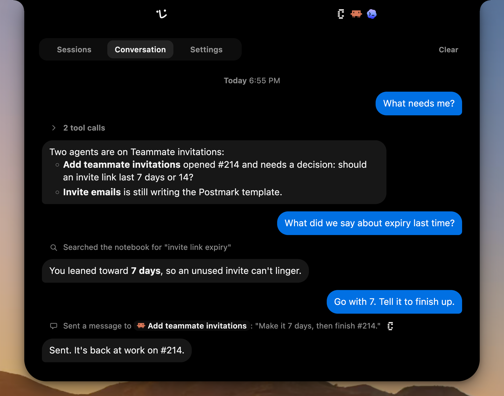

### Luke's notebook

Luke keeps a notebook on the service: what he knows about you, the decisions
worth remembering, and a dated note for each day he works. Before answering
about prior work, dates, people, or preferences he searches it and reads only
the lines he needs. A read-only Memory page in Settings shows the notebook as
he wrote it.
([#1475](https://github.com/ReviewStage/luke/pull/1475),
[#1484](https://github.com/ReviewStage/luke/pull/1484),
[#1491](https://github.com/ReviewStage/luke/pull/1491),
[#1477](https://github.com/ReviewStage/luke/pull/1477),
[#1478](https://github.com/ReviewStage/luke/pull/1478),
[#1479](https://github.com/ReviewStage/luke/pull/1479))

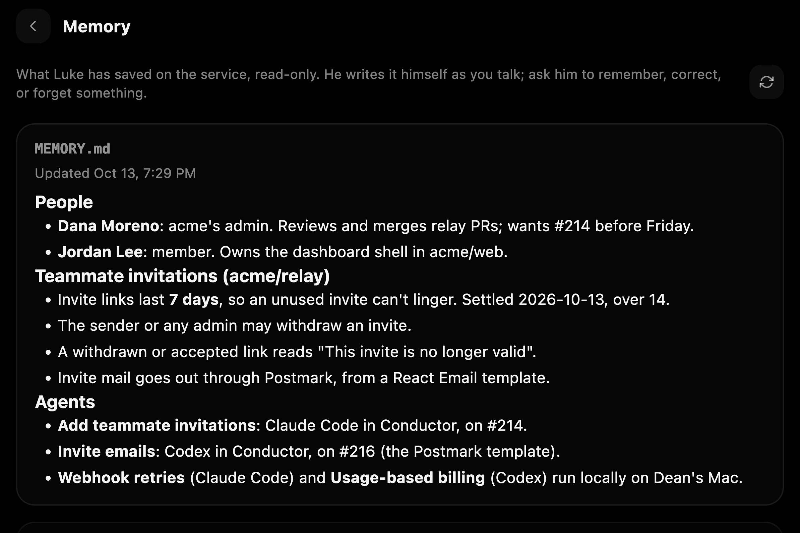

### Your Conductor key lives in the vault

Connect on the Connections row stores your Conductor key in your account's
vault, never on your Mac, and a key an earlier build kept locally is handed
over once and deleted here. Onboarding asks for that key right after your
first sign-in, ahead of any session row and the calendar step.
([#1260](https://github.com/ReviewStage/luke/pull/1260),
[#1267](https://github.com/ReviewStage/luke/pull/1267))

### Improvements

- Luke greets you by first name at every signed-in launch, and the spoken
  introduction waits for your first sign-in instead of greeting a stranger
  ([#1204](https://github.com/ReviewStage/luke/pull/1204),
  [#1254](https://github.com/ReviewStage/luke/pull/1254))
- Briefings are two short sentences at most, subject first, and never a title
  read aloud ([#1378](https://github.com/ReviewStage/luke/pull/1378))
- A voice call opens already knowing your roster, so "anything need me?" is
  answered without a round trip
  ([#1226](https://github.com/ReviewStage/luke/pull/1226))
- A reply that only needed a read is spoken the moment its words form, and
  Luke may read ahead to a session or a notebook search while you are still
  speaking ([#1164](https://github.com/ReviewStage/luke/pull/1164),
  [#1229](https://github.com/ReviewStage/luke/pull/1229))
- Every spoken exchange is kept, including the ones Luke answers himself, so
  your words and his come back after a relaunch
  ([#1318](https://github.com/ReviewStage/luke/pull/1318),
  [#1319](https://github.com/ReviewStage/luke/pull/1319))
- Captions show your own words as you say them, in a quieter tone, and every
  segment of a longer reply rolls up under the housing
  ([#1464](https://github.com/ReviewStage/luke/pull/1464),
  [#883](https://github.com/ReviewStage/luke/pull/883))
- You can stop an ask: a Stop on a waiting ask is honored when its turn
  starts, and a Stop on a running one ends only the turn it was aimed at
  ([#1155](https://github.com/ReviewStage/luke/pull/1155),
  [#1258](https://github.com/ReviewStage/luke/pull/1258))
- The Voice page's Pause announcements switch becomes Announce when sessions
  need you, on by default; switching it back on reads the still-true held ones
  out together ([#686](https://github.com/ReviewStage/luke/pull/686))
- A briefing on offer opens a muted session on your Mac so Luke speaks it here
  when you are present, and is pushed to your phone when you are not
  ([#1404](https://github.com/ReviewStage/luke/pull/1404))
- Pressing a filled thumb takes a rating back, and the message stands unrated
  on every device ([#1467](https://github.com/ReviewStage/luke/pull/1467))
- Luke reads an agent's messages whole instead of the first 400 characters,
  and walks a long Conductor chat to its end
  ([#916](https://github.com/ReviewStage/luke/pull/916))
- Luke's persona is a set of rules with a banned-phrase list rather than
  exemplars, so a day of announcements no longer hardens into stock phrases
  ([#875](https://github.com/ReviewStage/luke/pull/875))
- An action whose effect is uncertain after a crash shows as unknown in the
  Conversation, distinct from a refusal, and Luke never retries it on his own
  ([#943](https://github.com/ReviewStage/luke/pull/943))
- A Conductor workspace can be created with Fable 5.1 or GPT-6 Astra as its
  agent's model ([#758](https://github.com/ReviewStage/luke/pull/758),
  [#759](https://github.com/ReviewStage/luke/pull/759))
- A settings search result lands the keyboard on the row's control rather than
  the page header ([#1428](https://github.com/ReviewStage/luke/pull/1428))
- The Conversation tab's Clear moves beside the tab bar and shows only while
  the thread has lines ([#778](https://github.com/ReviewStage/luke/pull/778))
- tryluke.dev prerenders the landing, About, Changelog, and Privacy pages, so
  link previews and visitors without JavaScript see the page
  ([#716](https://github.com/ReviewStage/luke/pull/716))

### Fixes

- Fixed a workspace created or an agent added through Luke going out with
  Conductor's default agent, model, and effort instead of the pairing you chose
  ([#1443](https://github.com/ReviewStage/luke/pull/1443),
  [#1486](https://github.com/ReviewStage/luke/pull/1486))
- Fixed a voice chosen on the Voice page not taking until the standing call had
  idled out ([#1470](https://github.com/ReviewStage/luke/pull/1470))
- Fixed asking Luke to create a workspace in a Conductor cloud project being
  refused with "No listed project matches that identity"
  ([#876](https://github.com/ReviewStage/luke/pull/876))
- Fixed asking Luke to flip the Captions switch being refused with "Captions
  takes no effort level" ([#895](https://github.com/ReviewStage/luke/pull/895))
- Fixed clearing a setting answering "Could not save that setting on this
  system" and coming back at the next launch
  ([#1252](https://github.com/ReviewStage/luke/pull/1252))
- Fixed Mission Control tiling the notch panel in the middle of the desktop
  after an introduction takeover
  ([#1225](https://github.com/ReviewStage/luke/pull/1225))
- Fixed quitting Luke mid-meeting dropping the meeting hold on announcements
  until the next poll ([#1141](https://github.com/ReviewStage/luke/pull/1141))
- Fixed Luke saying "I couldn't write that ask down" for a follow-up asked
  seconds after a question
  ([#1476](https://github.com/ReviewStage/luke/pull/1476))
- Fixed a spoken ask's row landing one word short of what you said, and a
  spoken line vanishing from the Conversation two seconds after you finished
  ([#1482](https://github.com/ReviewStage/luke/pull/1482),
  [#1465](https://github.com/ReviewStage/luke/pull/1465))
- Fixed a reply drawing above your question when a spoken ask entered a turn
  late, and an aside sorting up into a turn that had settled
  ([#1297](https://github.com/ReviewStage/luke/pull/1297),
  [#1473](https://github.com/ReviewStage/luke/pull/1473))
- Fixed "Still thinking" dots drawing above later replies for an interrupted
  turn ([#1461](https://github.com/ReviewStage/luke/pull/1461))
- Fixed the feedback composer opened from a thumbs down returning to Settings
  instead of the Conversation
  ([#1466](https://github.com/ReviewStage/luke/pull/1466))
- Fixed an announcement's arrival line reading a session title from before the
  pass that named it ([#1407](https://github.com/ReviewStage/luke/pull/1407))
- Fixed the Conversation drawing Luke's reply twice, and what he said aloud
  drifting from the words it recorded
  ([#891](https://github.com/ReviewStage/luke/pull/891),
  [#870](https://github.com/ReviewStage/luke/pull/870))
- Fixed a voice call ending at the provider's hour cap with a red
  "[object RTCErrorEvent]" caption; an idle call now retires itself after five
  minutes ([#854](https://github.com/ReviewStage/luke/pull/854))
- Fixed the key slot and feedback composer popups opening with empty black
  above their words on a Mac without a notch
  ([#715](https://github.com/ReviewStage/luke/pull/715))
- Fixed the lead provider mark hopping left and springing back as the capsule
  unfolded ([#777](https://github.com/ReviewStage/luke/pull/777))

### Misc

- Updated the provider set to Conductor alone: Superset, the local Claude Code,
  Codex, and OMP observers, and the Linear connection are removed
  ([#1200](https://github.com/ReviewStage/luke/pull/1200),
  [#1201](https://github.com/ReviewStage/luke/pull/1201),
  [#1207](https://github.com/ReviewStage/luke/pull/1207))
- Updated a live launch to remove the retired local brain database an earlier
  build left on your Mac
  ([#1294](https://github.com/ReviewStage/luke/pull/1294))
- Updated PRIVACY.md for the scheduled observation of your Conductor sessions,
  voice on the account alone, spoken exchanges kept on the service, the
  read-ahead a spoken ask may make, and the notebook's search
  ([#1069](https://github.com/ReviewStage/luke/pull/1069),
  [#1229](https://github.com/ReviewStage/luke/pull/1229),
  [#1422](https://github.com/ReviewStage/luke/pull/1422),
  [#1480](https://github.com/ReviewStage/luke/pull/1480))
- Updated the landing page's footer to close on a "© 2026 Stage Inc." line
  ([#1380](https://github.com/ReviewStage/luke/pull/1380))
- Updated the third-party notice to name every OpenClaw port the code carries
  ([#1411](https://github.com/ReviewStage/luke/pull/1411))
- Updated the About page portraits to full-resolution JPEGs with their
  metadata stripped ([#673](https://github.com/ReviewStage/luke/pull/673))

## 0.5.0 — 2026-09-03

### Onboarding ends at a calendar

Onboarding now ends by asking for a calendar — your Mac's own or Google — so
meeting quiet can hold announcements from your first sign-in. Skip it and Luke
carries on without one.
([#561](https://github.com/ReviewStage/luke/pull/561))

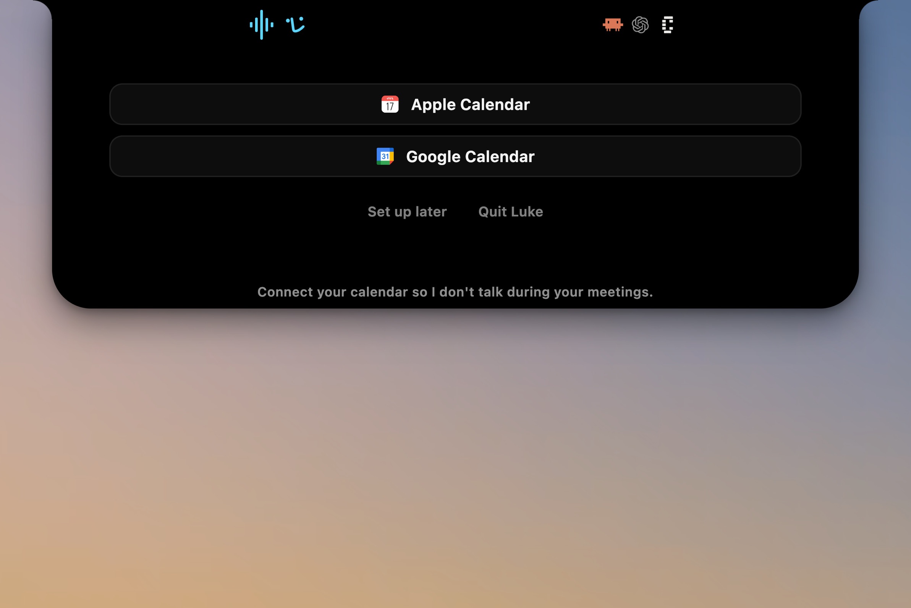

### Improvements

- Announcements say what an agent is working on, a short phrase Luke derives
  from the session's transcript, instead of the session's title
  ([#649](https://github.com/ReviewStage/luke/pull/649))
- A Pause announcements switch on the Voice page holds spoken announcements by
  hand; replies in a conversation you opened still speak
  ([#651](https://github.com/ReviewStage/luke/pull/651))
- The Ask Luke composer also sits at the foot of the History tab, so you can
  continue the thread without changing tabs
  ([#643](https://github.com/ReviewStage/luke/pull/643))
- Luke names every workspace he creates — your name when you gave one,
  otherwise a short name for the work — instead of Conductor's random-city
  fallback ([#636](https://github.com/ReviewStage/luke/pull/636))

### Fixes

- Fixed History cutting off any ask or reply longer than 400 characters
  ([#629](https://github.com/ReviewStage/luke/pull/629))
- Fixed the Provider keys section reading "The vault answered with something
  unexpected" for a key stored for a provider Luke no longer carries
  ([#656](https://github.com/ReviewStage/luke/pull/656))
- Fixed the spoken introduction ending on a question you had no chance to
  answer ([#644](https://github.com/ReviewStage/luke/pull/644))

### Misc

- Updated the provider set to Conductor, Superset, Claude Code, Codex, and OMP,
  with Cursor, OpenCode, Copilot, Gemini CLI, and Grok Build staying on as the
  agents a workspace runs ([#645](https://github.com/ReviewStage/luke/pull/645))

## 0.4.0 — 2026-09-02

### Synced provider keys

Enter a cloud provider's API key once and every Mac you sign Luke into has it.
A Sync section in Settings governs it: while on, your account's vault holds
what this Mac's encrypted store holds, and turning it off deletes every synced
copy while the local keys stay. A key your shell configured is never synced —
only one you typed into Luke.
([#574](https://github.com/ReviewStage/luke/pull/574),
[#580](https://github.com/ReviewStage/luke/pull/580))

### A conversation that outlives the app

The History tab now survives a quit. The thread, and the facts you asked Luke
to remember, live in his own application data under a real retention policy —
the 200 most recent lines, nothing older than a fortnight — and Clear still
empties the file along with the screen. Lines draw as they are being said, each
carries its local timestamp, and every chat a line named draws a chip that
opens it, even after the chat is archived.
([#589](https://github.com/ReviewStage/luke/pull/589),
[#614](https://github.com/ReviewStage/luke/pull/614),
[#606](https://github.com/ReviewStage/luke/pull/606),
[#618](https://github.com/ReviewStage/luke/pull/618),
[#613](https://github.com/ReviewStage/luke/pull/613))

### Improvements

- Luke opens at login, a switch under Appearance backed by macOS's own login
  items ([#585](https://github.com/ReviewStage/luke/pull/585))
- Spoken exchanges run on the OpenAI Agents realtime SDK, which owns the
  connection, the session configuration, and the tool round-trips
  ([#635](https://github.com/ReviewStage/luke/pull/635),
  [#630](https://github.com/ReviewStage/luke/pull/630))
- Several sessions changing at once arrive as one announcement instead of a run
  of them ([#623](https://github.com/ReviewStage/luke/pull/623),
  [#628](https://github.com/ReviewStage/luke/pull/628),
  [#625](https://github.com/ReviewStage/luke/pull/625))
- Luke observes local OMP sessions, reading their title, status, recap, current
  tool, and conversation ([#584](https://github.com/ReviewStage/luke/pull/584))
- A keyboard shortcut can be removed outright: the row says None, and Reset
  restores the default ([#587](https://github.com/ReviewStage/luke/pull/587))
- A session's parting words are shown whole on its row and its own screen
  ([#633](https://github.com/ReviewStage/luke/pull/633))
- Luke words his own announcements from the observed fields rather than reading
  a composed sentence ([#588](https://github.com/ReviewStage/luke/pull/588))
- Ask about "that chat" right after an announcement and Luke resolves it to the
  one he just told you about, naming the candidates when nothing settles it
  ([#599](https://github.com/ReviewStage/luke/pull/599))
- Spoken time is no longer metered: the hosted voice quota and the settings it
  needed are gone ([#634](https://github.com/ReviewStage/luke/pull/634))
- Every provider API key hint reads the same way and links to the page that
  issues the key ([#591](https://github.com/ReviewStage/luke/pull/591))

### Fixes

- Fixed the Updates row moving under your cursor while an update downloaded
  ([#581](https://github.com/ReviewStage/luke/pull/581))
- Fixed Luke silently losing the ability to lower and restore Music and
  Spotify, leaving an unkillable helper at full CPU
  ([#582](https://github.com/ReviewStage/luke/pull/582))
- Fixed the landing page drawing its footer hairline across the hero art on
  phones ([#583](https://github.com/ReviewStage/luke/pull/583))
- Fixed the landing page's hero mock spilling outside the phone's screen
  ([#590](https://github.com/ReviewStage/luke/pull/590))

### Misc

- Added Sentry crash reporting: unhandled exceptions from every Electron
  process and native minidumps, carrying no account identity
  ([#632](https://github.com/ReviewStage/luke/pull/632))
- Added the hosted `/api/observe` endpoint, which runs each cloud adapter once
  under the caller's vault keys and answers a bounded roster
  ([#573](https://github.com/ReviewStage/luke/pull/573))
- Added hosted act endpoints for messaging a session and creating a workspace
  ([#571](https://github.com/ReviewStage/luke/pull/571),
  [#611](https://github.com/ReviewStage/luke/pull/611),
  [#620](https://github.com/ReviewStage/luke/pull/620))
- Updated how Luke's persona instructions describe his voice
  ([#639](https://github.com/ReviewStage/luke/pull/639))

## 0.3.13 — 2026-08-28

### History

Luke keeps the conversation you have been having with him. A History tab holds
every line of the current launch — what you asked, what he answered, and the
acts he carried at your request — and each message offers a copy control that
takes exactly the words the bubble shows. Clear empties both the thread you can
see and the context the model still holds, and the whole tab stays out of
session recordings.
([#513](https://github.com/ReviewStage/luke/pull/513),
[#569](https://github.com/ReviewStage/luke/pull/569))

### Improvements

- The notch says which apps hold your work: provider marks take the place of
  the session count beside the housing
  ([#577](https://github.com/ReviewStage/luke/pull/577))
- Luke names each agent by its work and gives you the decision context before
  he asks a question ([#553](https://github.com/ReviewStage/luke/pull/553),
  [#566](https://github.com/ReviewStage/luke/pull/566),
  [#567](https://github.com/ReviewStage/luke/pull/567),
  [#578](https://github.com/ReviewStage/luke/pull/578))
- Luke never asks for folder permission: Cursor and Antigravity sessions no
  longer read a workspace folder to label their branch
  ([#552](https://github.com/ReviewStage/luke/pull/552))
- Rows say when a session is running inside a Herdr pane
  ([#560](https://github.com/ReviewStage/luke/pull/560))
- Music and Spotify are asked for automation consent only mid-exchange, and
  only once that player is audibly playing
  ([#550](https://github.com/ReviewStage/luke/pull/550))
- Settings drop the Usage data section: counting and screen recording follow
  the run mode alone, and PRIVACY.md is the whole of what Luke tells you about
  either ([#563](https://github.com/ReviewStage/luke/pull/563))

### Fixes

- Fixed desktop session recordings never reaching PostHog at all
  ([#535](https://github.com/ReviewStage/luke/pull/535))
- Fixed a red voice error appearing when you cut Luke off mid-reply
  ([#564](https://github.com/ReviewStage/luke/pull/564))
- Fixed a slow cloud write being cut short by the observation pass's shared
  deadline ([#557](https://github.com/ReviewStage/luke/pull/557))
- Fixed the admin roster's last-seen instant ignoring hosted usage
  ([#548](https://github.com/ReviewStage/luke/pull/548))

### Misc

- Added the hosted provider-key vault, which encrypts a stored cloud provider
  key at rest and offers no way to read one back
  ([#568](https://github.com/ReviewStage/luke/pull/568))
- Added the websocket realtime endpoint to the voice mint
  ([#562](https://github.com/ReviewStage/luke/pull/562))
- Added the `entire` CLI's session hooks for Codex, Cursor, and OpenCode
  ([#549](https://github.com/ReviewStage/luke/pull/549))
- Updated an act handler's refusals to name their cause
  ([#572](https://github.com/ReviewStage/luke/pull/572))

## 0.3.12 — 2026-08-26

### Improvements

- Luke uses Echo as his default voice and gives you a short spoken welcome
  after sign-in ([#520](https://github.com/ReviewStage/luke/pull/520),
  [#541](https://github.com/ReviewStage/luke/pull/541))
- Luke keeps his conversation context on the app guide and leaves the tracker's
  issue roster out of it ([#528](https://github.com/ReviewStage/luke/pull/528),
  [#538](https://github.com/ReviewStage/luke/pull/538),
  [#539](https://github.com/ReviewStage/luke/pull/539))
- Replicas workspaces can sleep when their task finishes, and Luke reports
  unexpected wakes as observation diagnostics
  ([#530](https://github.com/ReviewStage/luke/pull/530),
  [#531](https://github.com/ReviewStage/luke/pull/531),
  [#536](https://github.com/ReviewStage/luke/pull/536))
- Development traces capture Luke's local agent traffic and export attention
  reviews in the form the model received
  ([#534](https://github.com/ReviewStage/luke/pull/534),
  [#540](https://github.com/ReviewStage/luke/pull/540))
- Onboarding stays out of the way while macOS asks for microphone access
  ([#524](https://github.com/ReviewStage/luke/pull/524),
  [#533](https://github.com/ReviewStage/luke/pull/533))

### Fixes

- Fixed provider marks disappearing while Luke speaks
  ([#517](https://github.com/ReviewStage/luke/pull/517))
- Fixed update checks giving up while a newly published release is still
  uploading ([#523](https://github.com/ReviewStage/luke/pull/523))
- Fixed voice conversations reseeding history or changing roster context on
  clock ticks ([#526](https://github.com/ReviewStage/luke/pull/526),
  [#527](https://github.com/ReviewStage/luke/pull/527))
- Fixed Conductor reads including archived workspaces or starting from an
  unfiltered workspace list
  ([#525](https://github.com/ReviewStage/luke/pull/525),
  [#537](https://github.com/ReviewStage/luke/pull/537))
- Fixed GitHub releases becoming visible before all six downloadable assets
  finished uploading ([#521](https://github.com/ReviewStage/luke/pull/521))

### Misc

- Added an About page, a contact address, and maintainer credits
  ([#542](https://github.com/ReviewStage/luke/pull/542),
  [#543](https://github.com/ReviewStage/luke/pull/543),
  [#546](https://github.com/ReviewStage/luke/pull/546))
- Updated the hosted macOS release and Replicas lifecycle documentation
  ([#519](https://github.com/ReviewStage/luke/pull/519),
  [#529](https://github.com/ReviewStage/luke/pull/529),
  [#532](https://github.com/ReviewStage/luke/pull/532))
- Updated the product framing across the website and README
  ([#544](https://github.com/ReviewStage/luke/pull/544),
  [#545](https://github.com/ReviewStage/luke/pull/545))

## 0.3.11 — 2026-08-25

### Improvements

- Luke opens Replicas sessions directly in the Replicas desktop app
  ([#516](https://github.com/ReviewStage/luke/pull/516))
- Luke keeps agent updates concise, specific to the work, and available after
  meeting quiet ends ([#514](https://github.com/ReviewStage/luke/pull/514),
  [#515](https://github.com/ReviewStage/luke/pull/515))
- The admin dashboard makes account status, usage, and controls easier to scan
  ([#511](https://github.com/ReviewStage/luke/pull/511))

### Fixes

- Fixed first-launch announcements waiting for an interaction before they could
  be heard ([#477](https://github.com/ReviewStage/luke/pull/477))
- Fixed signed-in users who finished onboarding being offered the introduction
  again ([#512](https://github.com/ReviewStage/luke/pull/512))
- Fixed swallowed admin API failures omitting the upstream 503 cause from logs
  ([#492](https://github.com/ReviewStage/luke/pull/492))
- Fixed hosted macOS releases omitting the PostHog project key and silently
  disabling recording ([#518](https://github.com/ReviewStage/luke/pull/518))

## 0.3.10 — 2026-08-24

### Onboarding

Luke introduces himself to new users.
([#497](https://github.com/ReviewStage/luke/pull/497),
[#508](https://github.com/ReviewStage/luke/pull/508))

### Improvements

- Luke is more conversational and proactive about work that needs your
  attention ([#500](https://github.com/ReviewStage/luke/pull/500))
- Luke draws loading rows while a provider roster is temporarily unreadable
  instead of making those agents disappear
  ([#498](https://github.com/ReviewStage/luke/pull/498))
- The website demonstrates Luke's panel with a live mesh gradient and an
  animated tour of its presentations
  ([#499](https://github.com/ReviewStage/luke/pull/499),
  [#502](https://github.com/ReviewStage/luke/pull/502),
  [#504](https://github.com/ReviewStage/luke/pull/504))

### Fixes

- Fixed Preview deployments failing to complete sign-in
  ([#408](https://github.com/ReviewStage/luke/pull/408))
- Fixed workspace creation losing the provider selected in Settings
  ([#475](https://github.com/ReviewStage/luke/pull/475))
- Fixed the web service omitting the acts package from its runtime wiring
  ([#495](https://github.com/ReviewStage/luke/pull/495))
- Fixed signed-out voice runs reporting the wrong missing credential
  ([#505](https://github.com/ReviewStage/luke/pull/505))
- Fixed workspace-only providers being rejected by the desktop bridge
  ([#507](https://github.com/ReviewStage/luke/pull/507))
- Fixed Apple notarization uploads using the accelerated transfer path that
  could leave incomplete submissions stuck as In Progress
  ([#509](https://github.com/ReviewStage/luke/pull/509))

### Misc

- Updated the README and privacy policy for the current product behavior
  ([#474](https://github.com/ReviewStage/luke/pull/474),
  [#476](https://github.com/ReviewStage/luke/pull/476))
- Updated the account connection pages and the internal animation reference
  ([#488](https://github.com/ReviewStage/luke/pull/488),
  [#501](https://github.com/ReviewStage/luke/pull/501))

## 0.3.9 — 2026-08-23

### More agents, one roster

Luke observes local Antigravity, Grok Build, and Radius Browser agent chats,
alongside Replicas cloud workspaces connected with your own API key. He reads
each provider through its documented local or cloud surface, and providers
without credentials work as before.
([#402](https://github.com/ReviewStage/luke/pull/402),
[#407](https://github.com/ReviewStage/luke/pull/407),
[#462](https://github.com/ReviewStage/luke/pull/462),
[#463](https://github.com/ReviewStage/luke/pull/463))

### Improvements

- You can filter the roster by the app or provider behind each chat
  ([#455](https://github.com/ReviewStage/luke/pull/455))
- Luke can create Conductor workspaces and message the live Superset terminal
  attached to a chat ([#392](https://github.com/ReviewStage/luke/pull/392),
  [#450](https://github.com/ReviewStage/luke/pull/450))
- Luke names, recaps, opens, and messages local Cursor chats through Cursor's
  own records and agent CLI
  ([#383](https://github.com/ReviewStage/luke/pull/383),
  [#387](https://github.com/ReviewStage/luke/pull/387),
  [#390](https://github.com/ReviewStage/luke/pull/390),
  [#400](https://github.com/ReviewStage/luke/pull/400))
- Luke can check for updates or restart into a downloaded update when you ask
  ([#388](https://github.com/ReviewStage/luke/pull/388))

### Fixes

- Fixed archived cloud work continuing to appear in the roster
  ([#385](https://github.com/ReviewStage/luke/pull/385),
  [#427](https://github.com/ReviewStage/luke/pull/427))
- Fixed Luke narrating tool calls and adding filler to spoken updates
  ([#451](https://github.com/ReviewStage/luke/pull/451),
  [#470](https://github.com/ReviewStage/luke/pull/470))
- Fixed Luke inventing a recap segment when a session has no recap
  ([#469](https://github.com/ReviewStage/luke/pull/469))

### Misc

- Updated analytics sharing to include broader product events and unmasked
  session replay, with the recording control governing both
  ([#409](https://github.com/ReviewStage/luke/pull/409))
- Updated the workspace to pnpm 10
  ([#449](https://github.com/ReviewStage/luke/pull/449))

## 0.3.8 — 2026-08-20

### Improvements

- Luke uses Conductor's own chat names and opens each local chat directly
  ([#362](https://github.com/ReviewStage/luke/pull/362))

### Fixes

- Fixed panel content sitting flush against the strip instead of keeping a
  consistent inset ([#377](https://github.com/ReviewStage/luke/pull/377))
- Fixed macOS releases failing while electron-builder assembled the installer
  DMG ([#380](https://github.com/ReviewStage/luke/pull/380))

### Misc

- Updated the macOS release pipeline to use electron-builder alone
  ([#367](https://github.com/ReviewStage/luke/pull/367))
- Updated the README, privacy policy, contribution guide, and security policy
  for launch ([#379](https://github.com/ReviewStage/luke/pull/379))

## 0.3.7 — 2026-08-20

### Improvements

- Luke opens local Cursor chats through Cursor's own agent route
  ([#363](https://github.com/ReviewStage/luke/pull/363))

### Fixes

- Fixed Luke announcing that a chat is waiting when it does not need a reply
  ([#374](https://github.com/ReviewStage/luke/pull/374))
- Fixed the ready-to-install update status using unnecessary extra copy
  ([#373](https://github.com/ReviewStage/luke/pull/373))
- Fixed Developer ID releases omitting native helpers from the packaged app
  ([#375](https://github.com/ReviewStage/luke/pull/375))

## 0.3.6 — 2026-08-20

### Improvements

- An open spoken ask can name the app where its answer belongs
  ([#369](https://github.com/ReviewStage/luke/pull/369))

### Fixes

- Fixed Developer ID releases failing while signing the nested Calendar helper
  ([#370](https://github.com/ReviewStage/luke/pull/370))
- Fixed spoken announcements calling a settled chat "waiting on you" when it
  did not need a reply ([#374](https://github.com/ReviewStage/luke/pull/374))

## 0.3.5 — 2026-08-20

### Improvements

- Luke keeps your voice conversation history across calls, so you can continue
  where you left off ([#354](https://github.com/ReviewStage/luke/pull/354))
- Luke records your spoken turns alongside his replies in the conversation
  history ([#355](https://github.com/ReviewStage/luke/pull/355))
- Luke can search the session list when you ask out loud
  ([#364](https://github.com/ReviewStage/luke/pull/364))
- Superset workspaces without chats show as standing rows you can delete
  ([#365](https://github.com/ReviewStage/luke/pull/365))

### Fixes

- Fixed the session count appearing before the roster finished loading
  ([#361](https://github.com/ReviewStage/luke/pull/361))
- Fixed idle voice calls lingering after their conversation history took over
  ([#356](https://github.com/ReviewStage/luke/pull/356))

### Misc

- Updated every declared Node.js version to match the repository version
  ([#366](https://github.com/ReviewStage/luke/pull/366))

## 0.3.4 — 2026-08-20

### Improvements

- Luke reads your Mac's own calendars to stay quiet while you are in a meeting
  ([#311](https://github.com/ReviewStage/luke/pull/311))
- Luke observes local Gemini CLI sessions alongside your other coding agents
  ([#347](https://github.com/ReviewStage/luke/pull/347))
- Luke opens local Conductor chats at the exact place their notifications point
  ([#349](https://github.com/ReviewStage/luke/pull/349))
- Spoken announcement notices show each session's app marks
  ([#340](https://github.com/ReviewStage/luke/pull/340))
- Luke combines session filters in spoken asks just like the panel chips do
  ([#348](https://github.com/ReviewStage/luke/pull/348))

### Fixes

- Fixed voice replies ending early when audio resumes after draining
  ([#342](https://github.com/ReviewStage/luke/pull/342))
- Fixed the web service failing to load its function sources
  ([#343](https://github.com/ReviewStage/luke/pull/343))
- Fixed unanswered cloud writes appearing to have failed
  ([#345](https://github.com/ReviewStage/luke/pull/345))
- Fixed spoken announcements interrupting your active conversation
  ([#344](https://github.com/ReviewStage/luke/pull/344))
- Fixed spoken panel asks misunderstanding session filters and sort order
  ([#346](https://github.com/ReviewStage/luke/pull/346))
- Fixed status-edge announcements omitting the session name
  ([#350](https://github.com/ReviewStage/luke/pull/350))
- Fixed session-list asks bypassing the panel's session filter
  ([#351](https://github.com/ReviewStage/luke/pull/351))
- Fixed spoken session answers omitting the apps that hold each session
  ([#352](https://github.com/ReviewStage/luke/pull/352))
- Fixed media volume restoration being skipped when Luke quits
  ([#353](https://github.com/ReviewStage/luke/pull/353))

### Misc

- Added the electron-builder release path
  ([#324](https://github.com/ReviewStage/luke/pull/324))
- Updated the installer volume name to Luke Installer
  ([#339](https://github.com/ReviewStage/luke/pull/339))
- Updated the provider documentation around agents, apps, and read/write
  surfaces ([#341](https://github.com/ReviewStage/luke/pull/341))

## 0.3.3 — 2026-08-20

### Improvements

- Luke marks your sessions held by cmux and opens their exact pane
  ([#332](https://github.com/ReviewStage/luke/pull/332))
- Luke keeps your session filter choices across closings and restarts
  ([#336](https://github.com/ReviewStage/luke/pull/336))
- Luke groups your local Orca agents under their worktrees
  ([#333](https://github.com/ReviewStage/luke/pull/333))

### Fixes

- Fixed a stopped voice reply being trimmed past the end of its audio
  ([#335](https://github.com/ReviewStage/luke/pull/335))
- Fixed Spotify volume restoration being skipped when the app is installed in
  its current location ([#329](https://github.com/ReviewStage/luke/pull/329))

## 0.3.2 — 2026-08-20

### Improvements

- Session rows lead with the agent doing the work and show the apps holding
  each session ([#331](https://github.com/ReviewStage/luke/pull/331))

### Fixes

- Fixed automatic updates failing before a download could begin
  ([#327](https://github.com/ReviewStage/luke/pull/327))
- Fixed the Superset sign-in popup looking unlike Luke's other credential
  prompts ([#322](https://github.com/ReviewStage/luke/pull/322))

### Misc

- Added Luke's icon to the mounted installer volume
  ([#326](https://github.com/ReviewStage/luke/pull/326))
- Updated the design contract and package boundaries
  ([#328](https://github.com/ReviewStage/luke/pull/328),
  [#321](https://github.com/ReviewStage/luke/pull/321))

## 0.3.1 — 2026-08-19

### Fixes

- Fixed Luke falling asleep at launch before the first session roster arrived
  ([#319](https://github.com/ReviewStage/luke/pull/319))

## 0.3.0 — 2026-08-19

### Superset workspaces

Luke connects to Superset and puts its managed workspaces alongside every other
coding-agent session. You can create, open, rename, message, and delete settled
workspaces without leaving Luke.
([#274](https://github.com/ReviewStage/luke/pull/274),
[#299](https://github.com/ReviewStage/luke/pull/299),
[#309](https://github.com/ReviewStage/luke/pull/309),
[#310](https://github.com/ReviewStage/luke/pull/310),
[#312](https://github.com/ReviewStage/luke/pull/312),
[#316](https://github.com/ReviewStage/luke/pull/316))

### Usage data

Luke counts how his own features are used — a launch, a provider connected,
sessions observed, a call opened — and sends those counts to his own service,
tied to your account, so we can see what is worth building next. It is on by
default, and the switch is Share usage data in the new Usage data section on
the Settings tab's front page. Every event name and value is fixed by the
build, so nothing about a session and nothing you type or say can travel in
one, and nothing is sent while you are signed out. [Privacy](PRIVACY.md) lists
every event and property by name.
([#289](https://github.com/ReviewStage/luke/pull/289))

### Improvements

- You can search Settings ([#305](https://github.com/ReviewStage/luke/pull/305))
- Luke keeps himself current from the Updates row
  ([#284](https://github.com/ReviewStage/luke/pull/284))
- Luke stays silent for sessions waiting on automation
  ([#298](https://github.com/ReviewStage/luke/pull/298))
- Luke hides archived Claude Code and local Codex sessions
  ([#295](https://github.com/ReviewStage/luke/pull/295),
  [#297](https://github.com/ReviewStage/luke/pull/297))
- Luke's voice and interface speak more directly about agents and their work
  ([#290](https://github.com/ReviewStage/luke/pull/290),
  [#296](https://github.com/ReviewStage/luke/pull/296),
  [#307](https://github.com/ReviewStage/luke/pull/307),
  [#313](https://github.com/ReviewStage/luke/pull/313))
- Settings makes a spent free voice allowance clear everywhere
  ([#308](https://github.com/ReviewStage/luke/pull/308))

### Fixes

- Fixed a typed ask requesting microphone permission
  ([#294](https://github.com/ReviewStage/luke/pull/294))
- Fixed the panel closing when its shape receded past the pointer
  ([#293](https://github.com/ReviewStage/luke/pull/293))
- Fixed delegated Codex chat titles and announcements
  ([#303](https://github.com/ReviewStage/luke/pull/303),
  [#304](https://github.com/ReviewStage/luke/pull/304),
  [#306](https://github.com/ReviewStage/luke/pull/306))
- Fixed voice stop cancellation races
  ([#315](https://github.com/ReviewStage/luke/pull/315))
- Fixed the Superset sign-in code field looking unlike the other key slots
  ([#317](https://github.com/ReviewStage/luke/pull/317))

### Misc

- Added anti-slop Oxlint rules across the repository
  ([#286](https://github.com/ReviewStage/luke/pull/286))

## 0.2.0 — 2026-08-18

### Codex cloud tasks

Luke observes your Codex cloud tasks through the Codex CLI.
([#256](https://github.com/ReviewStage/luke/pull/256),
[#258](https://github.com/ReviewStage/luke/pull/258))

### Previews you can press

Linear issues show as chips under the notch.
([#250](https://github.com/ReviewStage/luke/pull/250),
[#257](https://github.com/ReviewStage/luke/pull/257),
[#271](https://github.com/ReviewStage/luke/pull/271))

### Improvements

- Luke's role is an engineering manager
  ([#265](https://github.com/ReviewStage/luke/pull/265))
- Session rows show the number of files touched and lines changed when
  available ([#260](https://github.com/ReviewStage/luke/pull/260))
- Luke observes local Devin CLI sessions
  ([#255](https://github.com/ReviewStage/luke/pull/255))
- Linear connects through a Luke Linear app instead of an API key
  ([#261](https://github.com/ReviewStage/luke/pull/261))
- Luke hears what you say while the call is still connecting, even on the first
  press after launch ([#220](https://github.com/ReviewStage/luke/pull/220))
- Meeting quiet starts and ends on the meeting's own instants, and holds
  through a calendar misread
  ([#270](https://github.com/ReviewStage/luke/pull/270),
  [#272](https://github.com/ReviewStage/luke/pull/272))
- A bare "new agent" ask opens a new workspace
  ([#230](https://github.com/ReviewStage/luke/pull/230))
- An agent's pull request button uses the PR number
  ([#249](https://github.com/ReviewStage/luke/pull/249))

### Fixes

- Fixed completion notices firing as sessions closed
  ([#246](https://github.com/ReviewStage/luke/pull/246))
- Fixed announcements colliding with a reply Luke was still speaking
  ([#231](https://github.com/ReviewStage/luke/pull/231))
- Fixed back-to-back replies sharing one caption
  ([#237](https://github.com/ReviewStage/luke/pull/237))
- Fixed captions overlapping the volume hint, re-wrapping mid-display, and
  vanishing under a resting pointer
  ([#248](https://github.com/ReviewStage/luke/pull/248),
  [#245](https://github.com/ReviewStage/luke/pull/245),
  [#262](https://github.com/ReviewStage/luke/pull/262))

### Misc

- Added link card previews everywhere
  ([#244](https://github.com/ReviewStage/luke/pull/244),
  [#273](https://github.com/ReviewStage/luke/pull/273))
- Updated the landing page with a direct download button
  ([#221](https://github.com/ReviewStage/luke/pull/221))
- Removed the menu bar item
  ([#242](https://github.com/ReviewStage/luke/pull/242))
- Removed excessive panel animations
  ([#243](https://github.com/ReviewStage/luke/pull/243))

## 0.1.1 — 2026-08-17

### Free daily allowance

Luke's voice runs on an included daily allowance, or you can connect your own
OpenAI key.
([#182](https://github.com/ReviewStage/luke/pull/182),
[#204](https://github.com/ReviewStage/luke/pull/204),
[#216](https://github.com/ReviewStage/luke/pull/216))

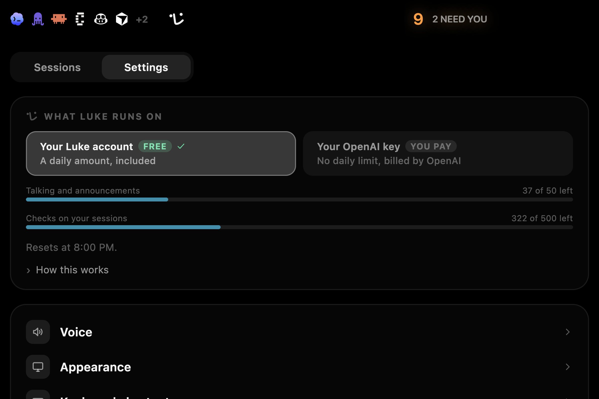

### Google Calendar

Luke reads when your meetings start and end, and holds his updates until the
meeting is over.
([#195](https://github.com/ReviewStage/luke/pull/195))

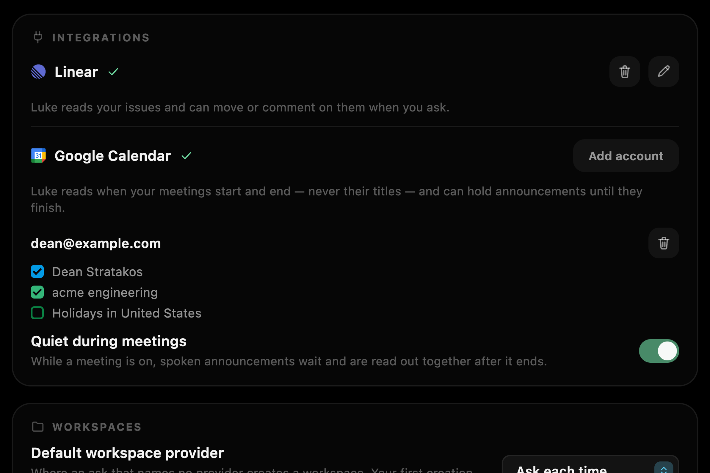

### Improvements

- Luke checks for updates on his own
  ([#186](https://github.com/ReviewStage/luke/pull/186))
- Announcements join a conversation you already have open, with a clickable
  chip that jumps to the session
  ([#180](https://github.com/ReviewStage/luke/pull/180),
  [#184](https://github.com/ReviewStage/luke/pull/184))
- Every Settings page marks changed rows and offers a reset to defaults
  ([#192](https://github.com/ReviewStage/luke/pull/192))
- You can delete your Luke account from Settings
  ([#222](https://github.com/ReviewStage/luke/pull/222))
- Luke can set a Conductor session's model and effort in one move
  ([#228](https://github.com/ReviewStage/luke/pull/228))
- Signing in is smoother, from first launch to the finished account
  ([#190](https://github.com/ReviewStage/luke/pull/190))
- The archive control moves to the workspace tray header, and the microphone
  permission to the Voice page
  ([#219](https://github.com/ReviewStage/luke/pull/219),
  [#200](https://github.com/ReviewStage/luke/pull/200))

### Fixes

- Fixed Luke repeating himself across back-to-back replies
  ([#227](https://github.com/ReviewStage/luke/pull/227))
- Fixed the microphone staying open after an exchange ended
  ([#210](https://github.com/ReviewStage/luke/pull/210))
- Fixed archived Conductor workspaces still appearing in the list
  ([#198](https://github.com/ReviewStage/luke/pull/198))
- Fixed captions scrolling too fast to read
  ([#201](https://github.com/ReviewStage/luke/pull/201))
- Fixed Claude Code sessions showing the wrong time
  ([#208](https://github.com/ReviewStage/luke/pull/208))
- Fixed Luke misunderstanding questions about all your sessions at once
  ([#213](https://github.com/ReviewStage/luke/pull/213))

### Misc

- Added logo and mark variations
  ([#191](https://github.com/ReviewStage/luke/pull/191),
  [#196](https://github.com/ReviewStage/luke/pull/196))
- Updated the landing page download button to always fetch the latest build
  ([#183](https://github.com/ReviewStage/luke/pull/183))

## 0.1.0 — 2026-08-16

Introducing Luke: a voice agent that lives in the MacBook notch and watches
every local and cloud coding agent session.

### One panel for every agent

One panel shows every coding agent working for you: Claude Code, Codex, Cursor,
and OpenCode on your Mac, and Conductor, Cursor, Devin, Google Jules, and
GitHub Copilot in the cloud. Filter, sort, or search the list, and click a
session to open it where it runs.
([#18](https://github.com/ReviewStage/luke/pull/18),
[#27](https://github.com/ReviewStage/luke/pull/27),
[#59](https://github.com/ReviewStage/luke/pull/59),
[#166](https://github.com/ReviewStage/luke/pull/166))

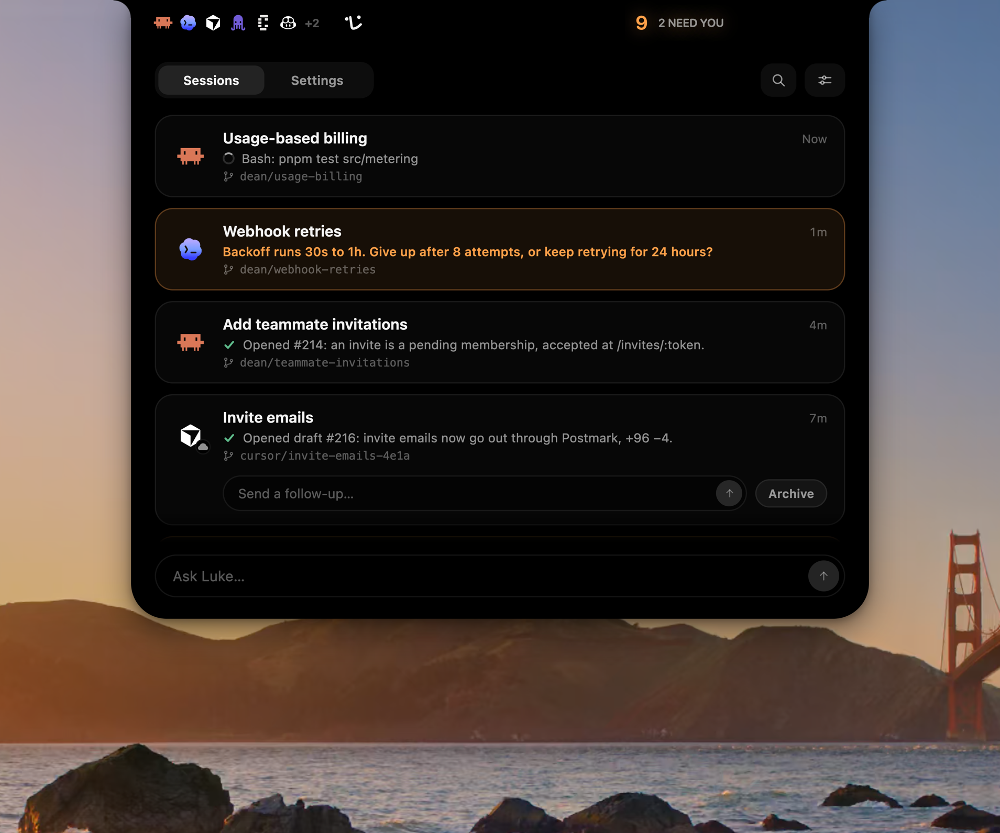

### Talk to Luke

Hold <kbd>⌥</kbd><kbd>S</kbd> to speak with Luke, or press
<kbd>⌥</kbd><kbd>L</kbd> to type to him from any app. He answers about
sessions, changes his own settings, opens sessions, messages agents, creates
workspaces and spawns agents, and reads and acts on Linear issues.
([#12](https://github.com/ReviewStage/luke/pull/12),
[#78](https://github.com/ReviewStage/luke/pull/78),
[#70](https://github.com/ReviewStage/luke/pull/70),
[#89](https://github.com/ReviewStage/luke/pull/89))

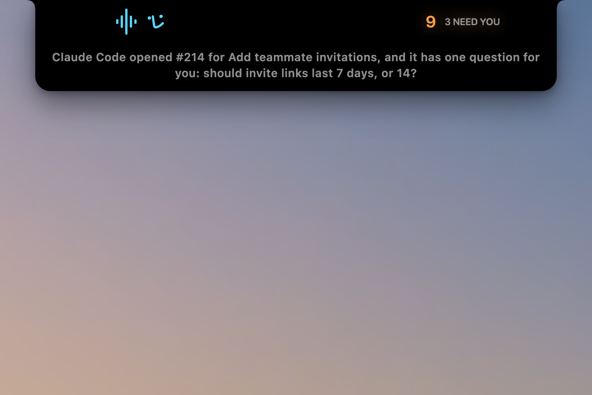

### Announcements

Luke speaks up when a session starts waiting, hits an error, or finishes. He
can show captions on screen, turn down Music and Spotify while he talks, and
display a clickable chip naming the session.
([#97](https://github.com/ReviewStage/luke/pull/97),
[#149](https://github.com/ReviewStage/luke/pull/149),
[#173](https://github.com/ReviewStage/luke/pull/173))

### Misc

- Added hook observation for Claude Code and Codex, so Luke can tell a finished
  turn from one you walked away from
  ([#119](https://github.com/ReviewStage/luke/pull/119),
  [#169](https://github.com/ReviewStage/luke/pull/169))
- Added Luke's face to the menu bar and the notch
  ([#35](https://github.com/ReviewStage/luke/pull/35),
  [#51](https://github.com/ReviewStage/luke/pull/51))
- Added settings for showing Luke in the menu bar and Dock, the display he sits
  on, his voice and pace, and editable shortcuts
- Added a form to send the founders feedback or submit a prompt
  ([#87](https://github.com/ReviewStage/luke/pull/87))
- Added sign-in with Google or GitHub
  ([#161](https://github.com/ReviewStage/luke/pull/161))
