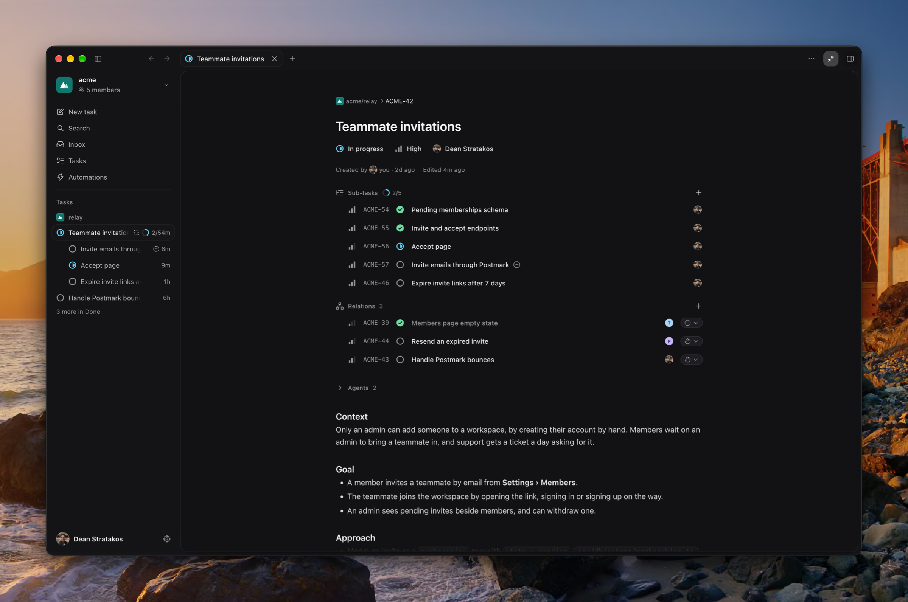
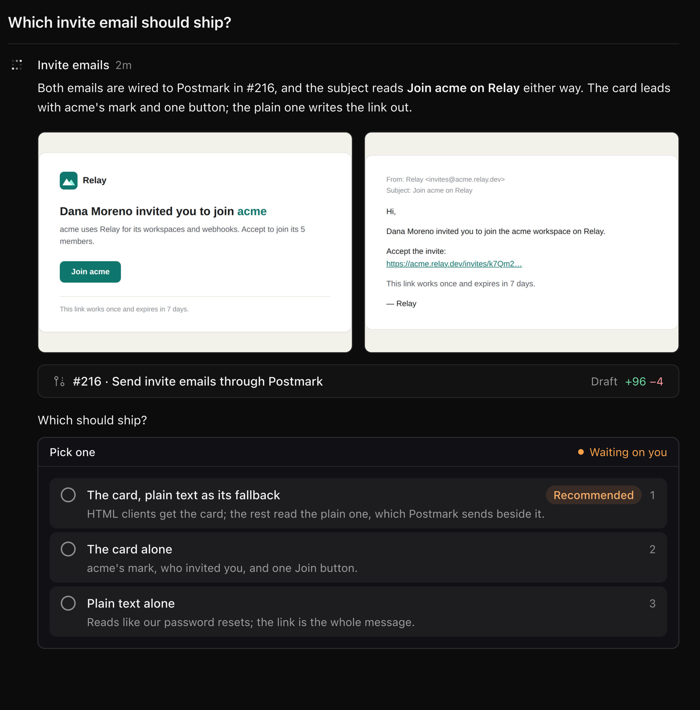
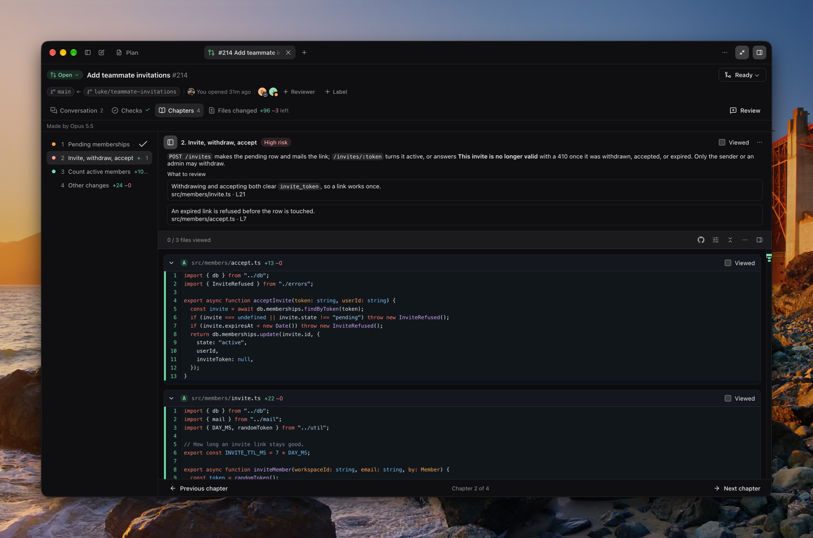
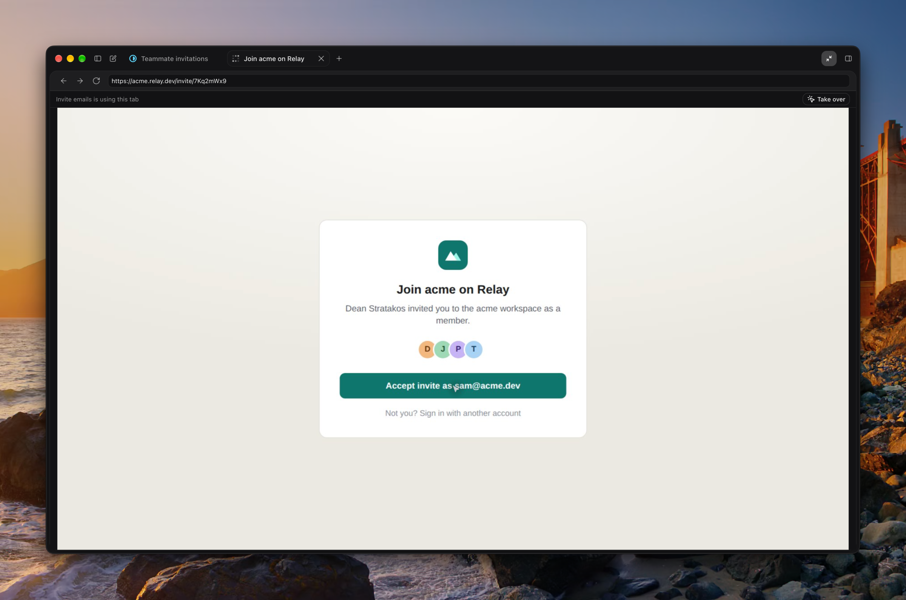

  <picture>
    <source media="(prefers-color-scheme: dark)" srcset="packages/brand/assets/logo/logo-dark.svg">
    
  </picture>

  An inbox for all your coding agents.

  
  
  
  

  <a href="https://vespin.dev">Website</a> - <a href="https://github.com/ReviewStage/vespin/releases/latest/download/Vespin.dmg">Download</a> - <a href="https://vespin.dev/app">Web app</a> - <a href="CHANGELOG.md">Changelog</a> - <a href="https://github.com/ReviewStage/vespin/issues/new/choose">Bug reports</a>

  

## What's Vespin?

Vespin is an inbox for all your coding agents. An agent posts to your Inbox
when it needs a decision, a manual step, or your eyes on something, and you
answer it there. A task breaks into sub-tasks that agents work on, agents start
and message other agents, and they run on your own Claude or ChatGPT
subscription or API key.

It is an early MVP. It runs on Apple silicon Macs with macOS 14 or newer, and
in a browser at [vespin.dev/app](https://vespin.dev/app). It is free.

  
  
  

## Features

**Plan**

- Tasks: create a task on a GitHub repository and message a coding agent on
  it, typed or dictated. It reads the repository in a sandbox of its own.
- Plans: the agent writes what you settle into the task's plan, a Markdown
  document with pictures and Mermaid diagrams that you can edit, comment on,
  and restore from version history.
- Sub-tasks and blocked tasks: break a task down, nest sub-tasks under it, and
  make a task wait on others. Agents make sub-tasks and set blocks too.

**Build**

- Coding agents: **Start** hands the plan to a coding agent on the Claude or
  GPT model you pick. It works in a cloud sandbox, runs the tests, opens the
  pull request under your GitHub account, and fixes the checks that fail.
- Agents that start agents: agents hand scoped work to read-only subagents,
  and message and start other agents in the workspace.
- The Browser tab: watch an agent's cloud browser live beside the plan, and
  press **Take over** to sign in or steer it.

**Review**

- The Inbox: the threads your agents open, each with the lines of code or the
  screenshot it is about. Pick an option, fill in a form, mark a step done, or
  reply, and your answer goes back to the agent.
- Pull requests: a tab with the conversation, checks, diff, and a Chapters
  view that splits the diff into chapters, each with its risk. A review left
  on GitHub reaches the agent too.

**Team and integrations**

- Workspaces: share tasks and agents with your team.
- Integrations: Linear, Notion, Sentry, GitHub, Granola, Mercury, Neon,
  PostHog, Stripe, Supabase, Vercel, Y Combinator, and Executor, through each
  service's own MCP server.
- Skills: skills in the repository's `.agents/skills` or `.claude/skills` are
  offered to agents.
- Automations: start agents on a schedule, a GitHub event, an integration's
  event, or a webhook.
- Your own keys: agents run on your Claude or ChatGPT subscription or your
  Anthropic or OpenAI API key. Vespin pays for no model calls.

## Install

1. Download [Vespin for macOS](https://github.com/ReviewStage/vespin/releases/latest/download/Vespin.dmg),
   open it, and drag **Vespin** into **Applications**.
2. Open Vespin and sign in with Google or GitHub.
3. In Settings › Workspace, under **Workspace connections**, press **Connect**
   on the GitHub row to install the Vespin GitHub App.

## Documentation

To see what each release added, visit [CHANGELOG.md](CHANGELOG.md).

To see how to contribute, visit [CONTRIBUTING.md](CONTRIBUTING.md).

To see what Vespin stores and every provider it sends data to, visit
[PRIVACY.md](PRIVACY.md).

## Community & Support

- [GitHub Issues](https://github.com/ReviewStage/vespin/issues). Best for: bugs and feature requests.
- [Security](SECURITY.md). Best for: reporting a vulnerability.

## License

The app is open source under the [Apache License 2.0](LICENSE). It signs in to
a hosted service at [vespin.dev](https://vespin.dev), run by Stage Inc., which
is free to use. The service's code is in this repository to read, but running
your own copy of it is not supported yet.

Hosted coding agents run Anthropic's Claude Code through the Claude Agent SDK,
which is proprietary and not covered by this repository's license, or OpenAI's
Codex, depending on the model you pick.

Third-party names and logos, such as those of the integrations above, belong
to their owners. Their use here does not mean those owners endorse Vespin.
