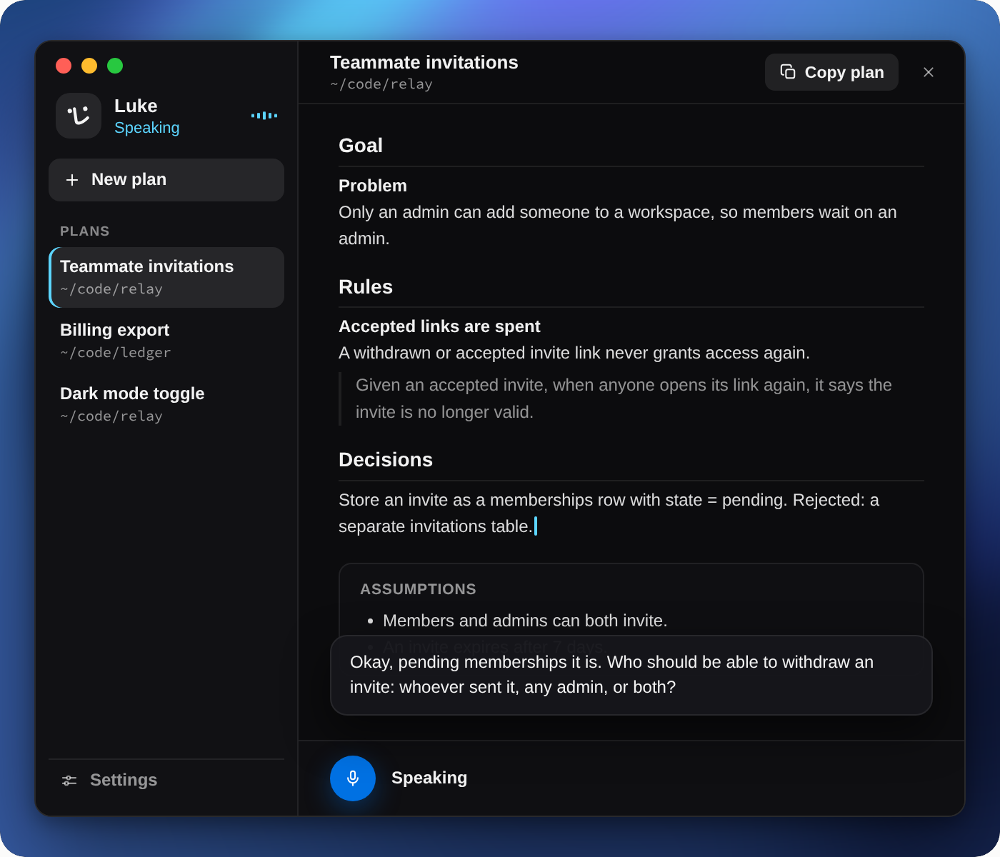

  <picture>
    <source media="(prefers-color-scheme: dark)" srcset="packages/brand/assets/luke-wordmark-dark.svg">
    
  </picture>

  
  
  
  

Luke is a macOS app for planning a feature by voice before you hand it to a
coding agent. You describe the feature, Luke reads your repository and asks
about what you left open, and a second model writes the plan during the call.
Then you press Start and a coding agent implements the plan in a sandbox and
opens the pull request, or you copy the plan into Claude Code, Codex, or any
other agent.

## Install

Requires an Apple silicon Mac on macOS 14 or newer.

1. Download [Luke.dmg](https://github.com/ReviewStage/luke/releases/latest/download/Luke.dmg).
2. Open the DMG and drag **Luke** into **Applications**.
3. Open Luke and sign in with Google or GitHub. A workspace's repositories
   come from the GitHub account or organization connected to it: an owner or
   admin connects one in Settings › Workspace › Integrations, which installs
   the Luke GitHub App there.

Luke asks for microphone access the first time you start a call.

## Usage

1. Press **New task**, name it, and choose its GitHub repository.
2. Press the microphone and describe the feature.
3. Answer Luke's questions until the plan is complete.
4. Press **Start** to have a coding agent implement it and open a pull
   request, or **Copy plan** to paste it into your own.

## Plan format

| Section | Contents |
| --- | --- |
| Context | What happens today, who it affects, and why now |
| Goal | What's true when it ships, each outcome checkable |
| Approach | The design: the pieces, where they live, and the code they follow |
| Interfaces | Every changed type, schema, route, or signature, as code |
| Alternatives | Other approaches and why they lost (when there were any) |
| Hard parts | Each tricky case and exactly what the change does in it |
| Not doing | What's out of scope, and why |
| Plan of attack | The order the work lands in (when order matters) |
| Testing | "When …, then …" cases for every goal and hard part, and the end-to-end check |
| Open questions | Anything not yet decided |
| Assumptions | Defaults Luke chose that you didn't state |

The plan reads like the design doc two engineers would write after talking a
task through, and holds each section to the bar a coding agent needs to build
from it.

## Code access

Nothing reads code on your Mac unless you run a pull request there yourself
(below). Luke's service checks the task's repository
out in a Vercel Sandbox, with a token the Luke GitHub App mints for that one
repository and sets at the sandbox's firewall, never inside it, and Luke
runs commands such as `ls`, `grep`, or `cat` there. A coding
agent you start works in a sandbox of its own, on a full checkout, and pushes
its branch and pull request through the same App, as the App's own bot.

You can also run a coding agent's pull request on your Mac: Run on this Mac,
in the pull request's menu, fetches its newest commit into a clone Luke keeps
under its application data, with a one-repository read token the same App
mints and Luke gives back once the fetch ends, and runs the repository's
setup and run commands, shared by the workspace under Settings › Workspace ›
Repositories, from the pull request's own checkout, its output live in a tab
of its own. Nothing runs until you press it, and the pull request never
chooses the commands. See [PRIVACY.md](PRIVACY.md) for details.

## Contributing

See [CONTRIBUTING.md](CONTRIBUTING.md). To report a vulnerability, see
[SECURITY.md](SECURITY.md).

## License

[Apache License 2.0](LICENSE)
