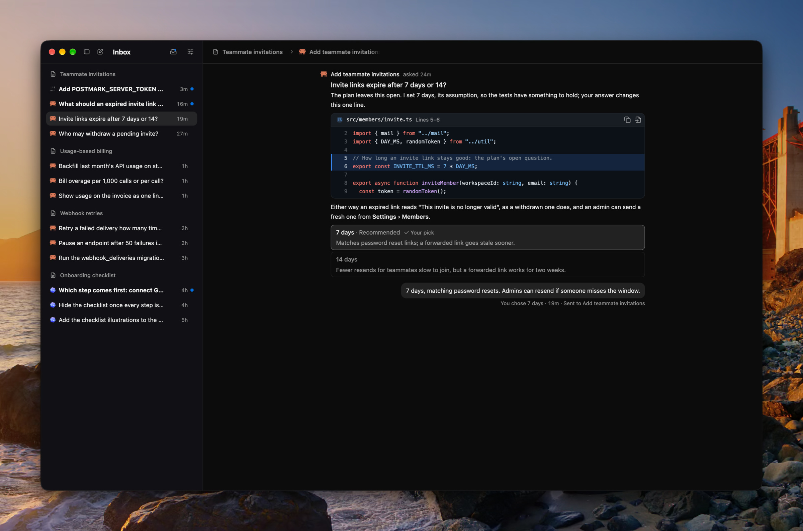

  <picture>
    <source media="(prefers-color-scheme: dark)" srcset="packages/brand/assets/logo/luke-logo-dark.svg">
    
  </picture>

  
  
  
  

Vespin is an inbox for all your coding agents. An agent posts to your Inbox
when it needs a decision, a manual step, or your eyes on something, and you
answer it there. A task breaks into sub-tasks that agents work on, agents start
and message other agents, and they run on your own Claude or ChatGPT
subscription or API key.

**Status:** an early MVP. It runs on Apple silicon Macs with macOS 14 or newer,
and in a browser at [vespin.dev/app](https://vespin.dev/app). It is free.

You describe the change to a coding agent, typed or dictated. It reads the
repository, asks about what you left open, and writes the plan as a design doc
as you go. Press **Start** and a coding agent implements the plan in a cloud
sandbox and opens a pull request, which you review without leaving the app. Or
copy the plan into Claude Code, Codex, or any other agent.

## How it works

1. **Discuss.** Create a task on a GitHub repository and message a coding
   agent on it, typing or dictating. It reads the repository in a sandbox of
   its own, and hands longer searches to read-only workers so the
   conversation keeps going.
2. **Plan.** The agent writes what you settle into the task's plan: a
   Markdown document you can edit, comment on, and restore from version
   history. Each section says who last wrote it: you, a teammate, or an
   agent.
3. **Build.** **Start** hands the plan to a coding agent on the Claude or GPT
   model you pick. It works on a full checkout in a sandbox of its own, runs
   the tests, pushes a branch, opens the pull request under your GitHub
   account with Vespin's bot as co-author, and fixes the checks that fail. You
   can message it mid-run or open a terminal in its sandbox.
4. **Review.** When an agent needs a decision, a manual step, or your eyes on
   something, it posts to the Inbox with the lines of code or the screenshot
   it is about, and your answer goes back to it. The pull request opens in a
   tab with its conversation, checks, diff, and a Chapters view that splits the
   diff into chapters, each with its risk. A review left on GitHub reaches the
   agent too.

## Features

- **The Inbox** lists the threads your agents open, each with the lines of
  code or the screenshot it is about. Pick an option, fill in a form, mark a
  step done, or reply, and your answer goes back to the agent.
- **Sub-tasks and blocked tasks**: New sub-task breaks a task down, its
  sub-tasks nest under it in the sidebar, a task can wait on others, and
  agents make sub-tasks and set blocks too.
- **Plans** hold pictures and Mermaid diagrams.
- **Coding agents** hand scoped work to read-only subagents on a model and
  effort they choose, message and start other agents in the workspace, and
  show you screenshots or an interactive HTML page of what they built.
- **The Browser tab** shows an agent's cloud browser live beside the plan.
  Press **Take over** to sign in or steer it, then **Hand back**.
- **Workspaces** share tasks and agents with your team, on the repositories
  of the GitHub account or organization the workspace connects.
- **Integrations** reach Linear, Notion, Sentry, GitHub, Granola, Mercury,
  Neon, PostHog, Stripe, Supabase, Vercel, Y Combinator, and Executor through
  each service's own MCP server, for every agent. Gmail, Google Calendar, and
  Google Drive are offered to some accounts so far, and Slack to none yet.
- **Skills** in the repository's `.agents/skills` or `.claude/skills` are
  offered to agents. The experimental Skills adds skills you install in
  Settings › Skills, and `/` in an agent's message box to pick one.
- **Your own keys**: coding agents run on your Claude or ChatGPT subscription
  or on your Anthropic or OpenAI API key, added in Settings › Agents. Vespin
  pays for no model calls.
- **Automations** start agents on a schedule, a GitHub event, an
  integration's event, or a webhook.
- **Experiments** in Settings › Experimental, each off until you turn it on:
  Pilot, which plans a new task, splits it into sub-tasks, and runs an agent on
  each; Channels, which lists a workspace's threads by topic; Memory, facts
  agents keep about how your team works and recall later; Skills; and Bring
  your own host, below.

## Install

Requires an Apple silicon Mac on macOS 14 or newer.

1. Download [Vespin for macOS](https://github.com/ReviewStage/vespin/releases/latest/download/Luke.dmg),
   open it, and drag **Vespin** into **Applications**.
2. Open Vespin and sign in with Google or GitHub.
3. In Settings › Workspace, under **Workspace connections**, press **Connect**
   on the GitHub row. It installs the Vespin GitHub App on the account or
   organization whose repositories you want to work on. A workspace's owner or
   an admin connects it.

Vespin asks for microphone access the first time you dictate, and updates
itself.

## Where your code and data go

Vespin is a desktop app and a web app backed by a hosted service, and all three
are in this repository.

- **Your code** is read in a [Vercel Sandbox](https://vercel.com/docs/sandbox),
  not on your Mac. The GitHub App mints a token for that one repository, and
  the sandbox's firewall adds it to the sandbox's outbound requests to GitHub,
  so code in the sandbox never sees it. Each coding agent gets a sandbox of its
  own and pushes through the same App.
- **Models.** Every model call runs on your own keys or subscriptions, added
  in Settings › Agents; Vespin pays for none. Dictation runs on OpenAI, on your
  OpenAI API key, and is off without one; the recording goes through Vespin's
  service to OpenAI. Coding agents run on Anthropic or OpenAI, depending on the
  model you pick, on your subscription or API key.
- **Commands on your Mac.** Vespin asks before each command an agent runs on
  your Mac; choose Always allow or Never for "Let agents run commands on this
  Mac" in Settings › This Mac. Commands run in your login shell, and what they
  print goes to the model. This is how an agent reads a local checkout or a
  server you have running.
- **Agents on your own machines** (experimental). With Bring your own host on
  in Settings › Experimental, an agent can run on This Mac, or on a Mac or
  Linux machine you add in Settings › Hosts, instead of in a sandbox. It runs
  straight on that machine, as you or the user Vespin's host program runs as,
  with full access to whatever that account can reach. Its work stays on the
  machine; its transcript and the files its tools read still reach Vespin's
  service.
- **Telemetry.** Vespin sends PostHog counts of which features you use, under
  your account and never what you type. It also records what its own panel
  draws for PostHog, with every word masked, only while you are signed in, and
  files the recording under your account with your name and email. It sends
  Sentry crash, error, and performance reports, which name your account by its
  id. Turn the usage counts off with "Share usage data" in Settings › Account;
  it is on by default in the app you download and off in a build you run from
  source.

[PRIVACY.md](PRIVACY.md) lists everything Vespin stores, every provider it sends
data to, and how long each keeps it.

## Open source and the hosted service

The app is open source under the [Apache License 2.0](LICENSE). It signs in to
a hosted service at [vespin.dev](https://vespin.dev), run by Stage Inc.,
which is free to use. The service's code is in this repository to read, but
running your own copy of it is not supported yet.

Hosted coding agents run Anthropic's Claude Code through the Claude Agent SDK,
which is proprietary and not covered by this repository's license, or OpenAI's
Codex, depending on the model you pick.

Third-party names and logos, such as those of the integrations above, belong
to their owners. Their use here does not mean those owners endorse Vespin.

## FAQ

**Is it free?** Yes. The app and the hosted service at
[vespin.dev](https://vespin.dev) are free to use. Models run on your own
subscription or API key, and Vespin pays for none.

**Can I self-host it?** Not yet. The service's code is in this repository to
read, but running your own copy of it is not supported. The experimental
Bring your own host runs agents on your own machines, and they still work
through the hosted service.

## Contributing

Setup, repository layout, and checks are in [CONTRIBUTING.md](CONTRIBUTING.md).
[CHANGELOG.md](CHANGELOG.md) describes every release and links the pull
requests behind it. To report a vulnerability, see [SECURITY.md](SECURITY.md).

## License

[Apache License 2.0](LICENSE)
