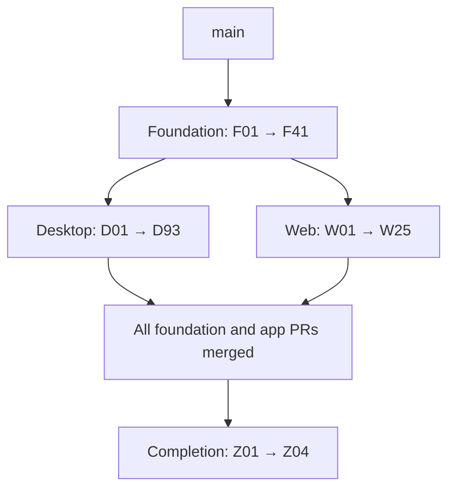

# Proposal: Luke's design system

Status: **adopted for the design-system migration** (163 PRs in four stacks:
Foundation F01–F41, Desktop D01–D93, Web W01–W25, Completion Z01–Z04). This
file is the contract every one of those PRs is reviewed against and the
inventory that says which PR moves each surface. It replaces the earlier
40-PR plan, which no longer describes the work.

`docs/DESIGN.md` stays the contract for motion and copy; nothing here
changes it. This file says how a control is sized, spaced, and set, and where
its code lives.

## The contract

Luke's own design system lives in `@luke/ui`. It preserves Luke's
appearance and follows the page composition Twenty and Cal.diy share: a page
pattern owns the frame, a section owns its heading and edges, a row owns its
label and control, and a control owns its own insides.

### Fixed choices

| Property | Desktop | Web |
|---|---:|---:|
| Control height | 30px | 44px |
| Control radius | 8px | 8px |
| Control icon | 15px | 16px |
| Body text / line height | 13 / 20px | 16 / 24px |
| Label text / line height | 13 / 18px | 14 / 20px |
| Caption text / line height | 12 / 16px | 12 / 16px |
| Section heading / line height | 13 / 18px | 16 / 24px |
| Dialog heading / line height | 15 / 20px | 20 / 28px |
| Page title / line height | 22 / 30px | 28 / 36px |
| Page inset | 40px; 24px below 480px content width | 24px |
| Control and icon-label gaps | 8px | 8px |
| Field and settings-section gaps | 16px | 16px |

- Weights: 400 for body and captions, 500 for labels, 600 for section and
  dialog headings, 700 for page titles.
- The spacing scale is namespaced and the same in every app: **0, 2, 4, 6, 8,
  12, 16, 20, 24, 32, 40, 48, 64, 96px**. A base value means the same length
  everywhere; a component reads a role token (a control's height, a row's
  inset), never a base value picked at its call site.
- A settings row pads 12px vertically and 16px horizontally, and its control
  wraps below its label when the row's container is narrower than 380px.
- A confirmation dialog is at most 400px wide, insets 20px, and rounds 14px.
  Its actions align to the end, 8px apart, each at least 80px wide.
- A desktop menu keeps its 32px rows, 4px inset, and 10px outer radius; a web
  menu's rows are the web control's height.
- Fonts, the semantic palettes, and the generated motion are kept as they
  are. The marketing site's display styles are named apart from the product's
  roles. A page pattern owns its content width and where it scrolls.

### Two profiles, two themes each

A profile is the set of role values for one app: `desktop` or `web`. A theme
is the palette: `dark` or `light`, or, on the desktop, `system`, which follows
the native appearance (`nativeTheme.themeSource`) through
`prefers-color-scheme`, so the window flips on the frame the Mac does without
a render. Both are attributes on the app's root and on every overlay portal,
so a dialog drawn into `document.body` reads the same tokens as the window
that opened it. The desktop's reset (`base.css`) and the web's server
rendering are kept: an attribute is markup, not a script that runs first.

### API and ownership

- A shared control owns its internal spacing, typography, and states, and
  exposes a finite set of variants through an `as const` object and the union
  derived from it.
- A button is `quiet`, `outline`, `primary`, `danger`, or `danger-outline`.
- An ordinary control takes no arbitrary class or style for its insides; its
  outer layout is its container's.
- A component takes data and callbacks. App state, network requests,
  shortcuts, and runtime integration (the renderer's Effect runtime, the
  settings search, `window.luke`) stay in the app's adapter around it.
- The main barrel stays light: a heavy chart or editor dependency is reached
  through a subpath of its own (`@luke/ui/chart`).
- A third-party editor, terminal, or canvas keeps its own engine; the
  controls around it and the theme adapter it supports migrate.
- The hidden voice window draws nothing and is outside the visual migration.
- No backend change, no custom design lint rule, and no `AGENTS.md` change is
  part of the migration.

### Where it lives

| What | Where |
|---|---|
| Base scale, profiles, palettes, legacy aliases | `packages/ui/src/tokens/`, imported as `@luke/ui/tokens.css` |
| A component | `packages/ui/src/components/<name>/`: its `.tsx`, its `.css`, and its tests, exported from `@luke/ui` |
| A page or form pattern | `packages/ui/src/patterns/<name>/`, exported the same way |
| Every shared stylesheet in its cascade order | `@luke/ui/styles.css` |
| The catalog: every component's example, in both profiles and themes | `apps/catalog` |
| Browser interaction, accessibility, and visual checks | `packages/ui`'s browser project, beside its node one |
| An app's adapter (runtime, search anchors, IPC) | the app, wrapping the shared component |

### Checks every PR meets

- `pnpm check:affected` before every push; the full `./scripts/check.sh` once
  the Foundation stack is complete and again at the end.
- Behavior tests are kept, and move with the behavior they cover. Changed
  behavior is tested through a public interface or the boundary it crosses.
- A pure styling change carries rendered evidence, not a test restating a CSS
  value.
- Shared interactions are covered for keyboard navigation, disabled and busy
  states, error announcements, and focus return; a confirmation for its
  invalidation when its subject or surface goes.
- Visual evidence covers both themes, a narrow container, long content, and
  the failure states that apply, on synthetic data with a fixed browser and
  fonts. A golden changes only under `LUKE_UPDATE_FIXTURES=1`.
- Visual goldens are recorded on Linux in the pinned Playwright Chromium,
  CI's machine, and compared only there: in CI, and in `check.sh` on Linux.
  A Mac rasterizes the same fonts to different pixels, so `check.sh` on a Mac
  skips the comparison, says so on a line of its own, and still passes.
- Desktop fixtures are checked at 1280×840; web at 320, 768, and 1440px wide.
- Mac-only behavior (native window controls, drag regions, zoom, pane
  motion, call surfaces) needs Mac evidence; without it the validation is
  recorded as incomplete.
- Every PR works without the ones after it: a compatibility path stays until
  its last caller migrates, and an obsolete implementation or selector is
  removed with that caller.

## The stacks

Each stack is one chain of PRs, each targeting the one before. Desktop and
Web start from F41's branch; Completion starts from `main` once everything
else has merged. The desktop stays one chain because its stylesheets cascade
in a deliberate order.

### Foundation

| ID | Change |
|---|---|
| F01 | This contract and inventory |
| F02 | Shared tokens and the desktop and web profiles, with legacy aliases |
| F03 | The catalog shell |
| F04 | Browser interaction and accessibility tests |
| F05 | Visual comparison |
| F06 | The desktop root on the shared themes |
| F07 | The web roots on the shared themes |
| F08 | Typography roles |
| F09 | Stack and Inline |
| F10 | Button and IconButton |
| F11 | Chip |
| F12 | FormField |
| F13 | TextField and TextArea |
| F14 | Checkbox |
| F15 | Switch |
| F16 | Segmented |
| F17 | Spinner and BusyLabel |
| F18 | Skeleton |
| F19 | Badge |
| F20 | Avatar |
| F21 | EmptyState |
| F22 | ErrorState |
| F23 | Dialog |
| F24 | ConfirmDialog |
| F25 | AnchoredPopover |
| F26 | Menu |
| F27 | Select |
| F28 | Tooltip |
| F29 | HoverCard |
| F30 | FoldingButton on the shared controls |
| F31 | SettingsRow |
| F32 | SettingsSection |
| F33 | SettingsPage |
| F34 | FormSection |
| F35 | AuthPage |
| F36 | ListRow |
| F37 | CollectionPage |
| F38 | DetailPage |
| F39 | PublicPage |
| F40 | Schema-driven settings rows and sections (Appearance, This Mac) |
| F41 | Web consent on AuthPage |

## The inventory

Every surface the apps draw, and the PR that moves it, or the boundary that
keeps it out. Desktop paths are under `apps/desktop/src/renderer/`, web paths
under `apps/web/src/`. A surface drawn wholly from a shared component that a
Foundation PR extracts is moved by that PR, and its row says so.

### Outside the visual migration

| Surface | Boundary |
|---|---|
| Hidden voice window (`voice/voice-host.tsx`, `voice.html`) | Draws no UI |
| The Mac's app menu (`apps/desktop/src/main/main.ts`) | Native, drawn by macOS |
| OS notifications (`apps/desktop/src/main/window/notice-doors.ts`) | Native, drawn by macOS |
| The quit message box (`apps/desktop/src/main/window/quit-dialog.ts`) | Native, drawn by macOS |
| The OAuth loopback page (`packages/credentials/src/loopback-page.ts`) | A self-contained HTML string served by the desktop's loopback listener, with no stylesheet or React to share |
| An agent-written page's own content (`planning/page-pane.tsx`'s sandboxed `luke-page:` frame) | The agent's HTML, isolated by the frame; its chrome is D84's |
| Code, terminal, file-tree, whiteboard, and diagram engines | Each keeps its engine; its chrome and theme adapter are D83–D87 |
| Providers and bundles with no UI (`automation-directory.tsx`, `member-directory.tsx`, `github-connect.tsx`, `copy-link-item.tsx`, `open-settings.tsx`, `session-recorder/`, `avatar-session/`) | Draw nothing of their own |

### Shared components the Foundation extracts

| Surface | Files | PR |
|---|---|---|
| Design tokens and palettes | `styles/base.css` (custom properties), `apps/web/src/styles.css` (`:root`, `.dark`) | F02, F06, F07 |
| The desktop's roots: the panel, the call window, and the renderer's stylesheet order | `index.html`, `call.html`, `index.tsx`, `app.tsx`, `styles/index.css` | F06 |
| The web's roots: every page's HTML, its mounting, and its prerender | `apps/web/*.html`, `mount-page.tsx`, `entry-server.tsx`, `apps/web/scripts/prerender.ts` | F07 |
| Labelled, icon, primary, quiet, bordered, and danger buttons | `.toolbar-button`, `.icon-button`, `.primary-button`, `.quiet-button`, `.bordered-button`, `.danger-button` in `styles/desktop.css` | F10 (callers move in their screen's D row) |
| Chip | `chip.tsx` | F11 |
| Switch | `switch.tsx` | F15 |
| Segmented control | `segmented.tsx` | F16 |
| Spinner, SpinnerRing, SpinnerRegion, BusyLabel | `spinner.tsx` | F17 |
| Skeleton, SkeletonRegion | `skeleton.tsx`, `styles/skeleton.css` | F18 |
| Empty state, and the not-found tab drawn from it | `empty-state.tsx`, `not-found.tsx` | F21 |
| Failure note, read failure, retry button | `failure-note.tsx`, `read-failure.tsx`, `retry-button.tsx` | F22 |
| Modal shell | `modal-shell.tsx` | F23 |
| Confirm dialog | `settings/confirm-dialog.tsx` | F24 |
| Anchored popover | `anchored-popover.tsx` | F25 |
| Action menu and its items | `desktop/action-menu.tsx` | F26 |
| Searchable menu | `searchable-menu.tsx` | F26 (its pickers move in D63–D67) |
| Select | none yet; settings select rows move onto it in D14 | F27 |
| Tooltip | `tooltip.tsx`, `styles/tooltip.css` | F28 |
| Hover card | `hover-card.tsx` | F29 |
| Folding button | `folding-button.tsx` | F30 |
| Settings rows and sections drawn from `APP_SETTING_SCHEMA` | `settings/schema-rows.tsx`, `settings/switch-row.tsx`, `settings/select-row.tsx`, `settings/settings-group.tsx` | F40 |
| Appearance | `settings/appearance-page.tsx` | F40 |
| This Mac | `settings/mac-commands-section.tsx` | F40 |
| Web consent | `consent.tsx`, `@luke/ui/auth-surface` | F41 |

### Desktop: shell and global flows

| Surface | Files | PR |
|---|---|---|
| Window chrome | `desktop/desktop-shell.tsx`, `desktop/pane-motion.tsx`, `desktop/window-title.ts` | D01 |
| Tab strip | `desktop/tab-strip.tsx`, `desktop/main-tabs.tsx`, `desktop/strip-tabs.tsx`, `planning/tab-look.tsx`, `panel-tabs.tsx` | D02 |
| Side panel | `desktop/side-panel.tsx` | D03 |
| Sidebar navigation, its groups, pinned rows, footer, and folded agents | `desktop/desktop-sidebar.tsx`, `desktop/sidebar-*.tsx`, `desktop/luke-identity.tsx`, `desktop/plan-actions.tsx` (`SidebarPlan`), `desktop/agent-archive.tsx` | D04 |
| Workspace switcher | `desktop/workspace-switcher.tsx`, `desktop/workspace-tile.tsx`, `desktop/workspace-ref.tsx` | D05 |
| Create-workspace dialog | `desktop/new-workspace-dialog.tsx` | D06 |
| Command palette | `desktop/command-palette.tsx` | D07 |
| Find in tab | `find-in-tab.tsx` | D08 |
| Sign-in gate | `sign-in-gate.tsx`, `styles/sign-in.css` | D09 |
| Feedback dialog | `feedback-dialog.tsx`, `open-feedback.tsx`, `experiment-marks.tsx` | D10 |
| Inline notices | `banner.tsx`, `desktop/plan-banner.tsx`, `desktop/stranded-plan-banner.tsx` | D11 |
| Toasts | `toast.tsx` and its sources (`update-toast.ts`, `planning/inbox-toast.ts`, `planning/agent-end-toast.ts`, `desktop/failed-runs.ts`, `copy-feedback.tsx`) | D12 |

### Desktop: settings

| Surface | Files | PR |
|---|---|---|
| Settings navigation, search, and page frame | `desktop/desktop-settings.tsx`, `settings/settings-panel.tsx`, `settings/pages.tsx`, `settings-search.tsx`, `search-field.tsx` | D13 |
| Bespoke picker and menu rows | `settings/picker-row.tsx`, `settings/menu-row.tsx`, `settings/one-line.tsx`, `settings/marks.tsx` | D14 |
| Account | `settings/account-section.tsx` | D15 |
| API keys | `settings/api-keys-section.tsx` | D16 |
| Workspace identity | `settings/workspace-page.tsx` (name and image) | D17 |
| Workspace members | `settings/workspace-page.tsx` (members) | D18 |
| Workspace invitations | `settings/workspace-page.tsx` (invitations) | D19 |
| Workspace GitHub connections | `settings/workspace-page.tsx` (GitHub) | D20 |
| Workspace Linear connections | `settings/workspace-page.tsx` (Linear) | D21 |
| Leave the workspace, transfer ownership | `settings/workspace-page.tsx` (leave) | D22 |
| Coding-agent defaults | `settings/coding-agents-page.tsx` | D23 |
| Integration directory | `settings/integrations-page.tsx` | D24 |
| Integration tool details | `integration-tool-list.tsx` | D25 |
| Integration connection controls | `settings/integrations-page.tsx` (connect, reconnect, disconnect) | D26 |
| Voice | `settings/voice-page.tsx` | D27 |
| Voice key bindings | `settings/voice-keys.tsx` | D28 |
| Notifications | `settings/notifications-section.tsx` | D29 |
| Plan template editor | `settings/plan-template-page.tsx` | D30 |
| Plan template history | `settings/plan-template-history.tsx` | D31 |
| Experimental | `settings/experimental-page.tsx` | D32 |
| About and updates | `settings/updates.tsx` | D33 |
| Keyboard shortcuts, and the chord they draw | `settings/shortcuts-page.tsx`, `shortcut.tsx`, `styles/shortcut.css` | D34 |
| Reset | `settings/reset.tsx` | D35 |

### Desktop: collections and profiles

| Surface | Files | PR |
|---|---|---|
| Home | `desktop/desktop-home.tsx` | D36 |
| Plans | `desktop/desktop-plans.tsx`, `desktop/plan-card.tsx`, `desktop/plan-summary.tsx` | D37 |
| Plan action menu and inline rename | `desktop/plan-actions.tsx`, `desktop/plan-name-field.tsx`, `planning/plan-menu-items.tsx` | D38 |
| Move plan | `desktop/move-plan-dialog.tsx` | D39 |
| Plan board | `planning/plan-board.tsx` | D40 |
| Inbox | `desktop/desktop-inbox.tsx`, `planning/inbox-pane.tsx`, `planning/inbox-list.tsx`, `planning/inbox-pager.tsx` | D41 |
| Factory | `desktop/desktop-factory.tsx` | D42 |
| Actor references and their hover cards | `actor-ref.tsx`, `planning/agent-ref.tsx`, `planning/skill-ref.tsx`, `planning/file-ref.tsx`, `planning/edit-ref.tsx`, `state-glyph.tsx`, `attention-mark.tsx`, `harness-marks.tsx`, `repository-picture.tsx` | D43 |
| Person page | `desktop/person-page.tsx`, `person-door.tsx` | D44 |
| Agent profile | `desktop/desktop-agent-page.tsx` | D45 |

### Desktop: automations

`desktop/automation-editor.tsx` holds every form of the editor in one file;
D47–D55 each move one of its forms.

| Surface | Files | PR |
|---|---|---|
| Automations collection | `desktop/automations-page.tsx`, `desktop/listed-automations.tsx` | D46 |
| Editor frame | `desktop/automation-editor.tsx` (heading, toolbar, save) | D47 |
| Prompt field | `desktop/automation-editor.tsx` (prompt) | D48 |
| Schedule trigger | `desktop/automation-editor.tsx` (schedule) | D49 |
| GitHub trigger | `desktop/automation-editor.tsx` (GitHub) | D50 |
| Code-review options | `desktop/automation-editor.tsx` (code review) | D51 |
| Webhook trigger | `desktop/automation-editor.tsx` (webhook) | D52 |
| Ownership | `desktop/automation-editor.tsx`, `desktop/automation-owner.tsx` | D53 |
| Server selection | `desktop/automation-editor.tsx` (servers) | D54 |
| Run destination | `desktop/automation-editor.tsx` (repository, agent and model, archive) | D55 |
| Run history | `desktop/automation-runs-panel.tsx` | D56 |

### Desktop: planning and composers

| Surface | Files | PR |
|---|---|---|
| Plan header | `planning/plan-title.tsx`, `planning/plan-crumb.tsx`, `ai-elements/plan.tsx`, `desktop/start-agent-button.tsx` | D57 |
| Document editor frame | `planning/plan-document-editor.tsx`, `planning/plan-body.tsx`, `planning/plan-mentions.tsx`, `planning/plan-pictures.tsx`, `planning/editor-pictures.tsx`, `plan-diagram.tsx`, `picture-block.tsx` | D58 |
| Archived plan | `planning/archived-plan.tsx` | D59 |
| New plan | `planning/new-plan-dialog.tsx` | D60 |
| Composer field | `planning/composer-field.tsx`, `ai-elements/prompt-input.tsx` | D61 |
| Agent composer and its context ring | `planning/agent-composer.tsx`, `planning/agent-context.tsx` | D62 |
| Model picker | `planning/model-menu.tsx`, `planning/agent-model-chip.tsx`, `planning/model-label.tsx` | D63 |
| Repository picker | `planning/repository-chip.tsx`, `planning/repository-remedy.tsx` | D64 |
| Skill picker | `planning/skill-picker.tsx`, `planning/skill-chip.tsx` | D65 |
| Mention picker | `planning/mention-picker.tsx`, `planning/mention-chip.tsx` | D66 |
| Issue picker | `planning/linear-issue-picker.tsx`, `planning/issue-mark.tsx` | D67 |
| Attachment chips | `planning/attached-file-chips.tsx`, `planning/add-to-plan.tsx` | D68 |

### Desktop: transcripts and agent work

| Surface | Files | PR |
|---|---|---|
| Transcript frame | `planning/transcript-blocks.tsx` (rows, notes), `ai-elements/conversation.tsx`, `ai-elements/message.tsx` | D69 |
| Markdown and code blocks, links, and message actions | `planning/transcript-markdown.tsx`, `markdown-message.tsx`, `ai-elements/code-block.tsx`, `styles/markdown.css`, `text-link.tsx`, `planning/copy-message.tsx`, `planning/message-links.tsx` | D70 |
| Reasoning | `ai-elements/reasoning.tsx`, `ai-elements/shimmer.tsx`, `thinking-dots.tsx` | D71 |
| Tool results | `ai-elements/tool.tsx`, `ai-elements/fold.tsx`, `planning/transcript-blocks.tsx` (`TranscriptTool`) | D72 |
| Checkpoints | `ai-elements/checkpoint.tsx`, `planning/call-card.tsx` | D73 |
| Agent work frame | `planning/agent-tab.tsx`, `planning/agent-tab-card.tsx`, `planning/turn-card.tsx`, `planning/working-time.tsx`, `planning/relative-time.tsx`, `working-mark.tsx` | D74 |
| Delegation | `planning/transcript-blocks.tsx` (`TranscriptSubagent`), `planning/agent-tab.tsx` (`AgentSubagentTab`) | D75 |
| Todo dock | `planning/transcript-blocks.tsx` (`TranscriptTodos`, `TranscriptTodosDock`) | D76 |
| Origin references | `planning/agent-tab.tsx` (`TranscriptOrigin`, `OriginBody`) | D77 |
| Changes view and pull requests | `planning/agent-changes-tab.tsx`, `planning/pull-request-mark.tsx`, `planning/pull-request-people.tsx` | D78 |
| Server picker | `planning/agent-servers.tsx`, `planning/server-card.tsx` | D79 |
| Published agents | `planning/agent-published.tsx` | D80 |
| Draft agent | `planning/draft-agent-tab.tsx`, `draft-mark.tsx` | D81 |
| Version history | `desktop/desktop-version-history.tsx`, `planning/version-view.tsx` | D82 |

### Desktop: specialized renderers and calls

| Surface | Files | PR |
|---|---|---|
| File tree | `planning/file-tree-pane.tsx` (engine: `file-tree/`) | D83 |
| File view, and the chrome around an agent-written page | `planning/file-view.tsx`, `planning/file-tab.tsx`, `planning/file-breadcrumbs.tsx`, `planning/file-menu.tsx`, `planning/file-note.tsx`, `planning/file-type-icon.tsx`, `planning/page-pane.tsx` | D84 |
| Code and diff theme | `planning/code-pane.tsx` | D85 |
| Terminal chrome | `planning/terminal-tab.tsx`, `planning/terminal-picker.tsx`, `planning/terminal-shells.tsx`, `planning/terminal-commands.tsx` (engine: `terminal/`) | D86 |
| Whiteboard theme | `whiteboard/` (engine: Excalidraw) | D87 |
| Media viewer | `planning/attachment-viewer.tsx`, `planning/agent-pictures.tsx` | D88 |
| Call controls and the floating call window | `call/call-card.tsx`, `planning/planning-parts.tsx` (`CallBar`), `planning/plan-call.tsx`, `call.html` | D89 |
| Video tiles | `call/call-video-tile.tsx` | D90 |
| Avatar frame | `call/panel-avatar.tsx`, `.call-video-frame` | D91 |
| Captions | `caption-strip.tsx` | D92 |
| Dictation strip | `planning/dictation-strip.tsx` | D93 |

### Web

| Surface | Files | PR |
|---|---|---|
| Sign-in | `sign-in.tsx`, `sign-in-choices.tsx` | W01 |
| Consent | `consent.tsx` | F41 |
| Invitation | `accept-invitation.tsx` | W02 |
| Desktop session | `desktop-session.tsx` | W03 |
| GitHub connection | `connect-github.tsx`, `connection-graphic.tsx` | W04 |
| GitHub installation result | `github-installed.tsx` | W05 |
| Integration connection result | `integration-connected.tsx` | W06 |
| Admin shell | `admin.tsx`, `AdminDashboard.tsx`, `admin/chrome/`, `admin/skeleton.tsx` | W07 |
| Chart frame | `admin/charts/chart-heading.tsx`, `admin/charts/stat-card.tsx`, `@luke/ui/chart` | W08 |
| Usage chart | `admin/charts/usage-chart.tsx` | W09 |
| Signups chart | `admin/charts/signups-chart.tsx` | W10 |
| Retention grid | `admin/charts/retention-grid.tsx` | W11 |
| Activity calendar | `admin/charts/activity-calendar.tsx` | W12 |
| Dashboard | `admin/screens/dashboard.tsx` | W13 |
| Day | `admin/screens/day.tsx` | W14 |
| Accounts table | `admin/accounts-table/accounts-table.tsx` | W15 |
| Users | `admin/screens/users.tsx` | W16 |
| Account | `admin/screens/account.tsx` | W17 |
| Animations | `admin/screens/animations.tsx` | W18 |
| Site chrome | `SiteChrome.tsx` | W19 |
| Landing | `App.tsx`, `main.tsx` | W20 |
| Demo video | `DemoVideo.tsx` | W21 |
| Open in Luke | `OpenPage.tsx`, `open.tsx` | W22 |
| About | `AboutPage.tsx`, `about.tsx` | W23 |
| Privacy | `PrivacyPage.tsx`, `privacy.tsx` | W24 |
| Changelog | `ChangelogPage.tsx`, `changelog.tsx`, `changelog-releases.ts` | W25 |

### Completion

| Change | PR |
|---|---|
| Desktop compatibility aliases removed | Z01 |
| Web compatibility aliases removed | Z02 |
| Remaining shared compatibility exports removed | Z03 |
| This file brought to what shipped, with each surface's evidence | Z04 |
